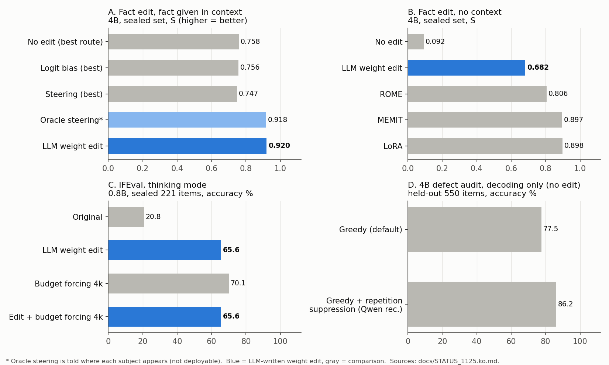

# ForwardEdit

**LLM이 모델의 가중치를 직접 읽고, 편집 내용을 스스로 설계합니다. 학습이나 경사 계산은 하지 않고, GPU는 추론에만 씁니다.**

[English](README.md) · [전체 안내 (설치, 도구, 과거 연구)](docs/README_FULL.ko.md) · [현황 정리](docs/STATUS_1125.ko.md) · [논문 원고](paper/cross-task/manuscript_v2.md) · [논문 준비도](docs/PAPER_READINESS_1125.ko.md) · [실험 이름표](docs/EXPERIMENT_NAMES.md)



## 결과 한눈에 보기 (2026-11-25 갱신)

| | 결과 | 판정 |
|---|---|---|
| ✅ 사실 편집, 맥락 있음 (4B) | 봉인 세트 S **.920**, 가장 강한 무편집 .758. 겹치는 문항을 빼도 +.17 / +.13 (신뢰구간이 0보다 위) | 사전 등록한 통제 실험에서도 유지 |
| ⚠️ 사실 편집, 맥락 없음 (4B) | .682. ROME .806, MEMIT .897, LoRA .898보다 낮음 | 학습·풀이 기반 방법이 우위 |
| ❌ 9B 블라인드 사실 편집 | 봉인 세트 S .836 (무편집 .823), ARC −0.85 (2.2 SE) | 회귀 평가 실패 |
| ⚠️ IFEval 루프 수리 (0.8B, thinking) | 20.8 → 65.6%. budget forcing만 써도 70.1% | 오류 수리일 뿐, 성능 향상은 아님 |
| ℹ️ 4B 결함 조사 | Qwen 권장 반복 억제만으로 정답률 .775 → .862 | 남은 목표: MATH의 긴 풀이, IFEval 루프 |

판정은 [세 단계 기준](docs/EDIT_EVALUATION_PROTOCOL.md#comparison-tiers-adopted-2026-11-24-prospective)을 따릅니다.
1. 같은 권장 설정에서 원본과 편집 모델을 비교하고, LoRA·MEMIT와도 비교합니다.
2. "편집 + 추론 기법"을 "추론 기법만"과 비교합니다.
3. 추론 기법만 쓴 점수는 참고로 함께 봅니다.

## 아직 안 되는 것
- 실제 벤치마크에서 추론 기법(budget forcing, 권장 디코딩)을 이긴 편집은 아직 없습니다.
- 맥락이 없으면 LLM이 정한 값이 학습·풀이 기반 방법(LoRA, MEMIT)보다 약합니다.
- 실행마다 결과가 흔들립니다. 0.8B 봉인 통과는 2/5였고, 실행마다 다른 층을 골랐습니다.
- "거의 켜지지 않는다"는 주장은 철회했습니다. 출력이 1% 넘게 바뀌는 토큰이 약 99%, 5% 넘게 바뀌는 토큰이 약 2%입니다.

## 다음 할 일
- 4B 편집: 같은 MATH 정답을 더 적은 토큰으로 내거나, IFEval에 남은 루프를 고칩니다. 둘 다 권장 디코딩 위에서 효과를 검증합니다.
- 맥락 없는 설계, 9B, 0.8B 과제를 겹치는 문항 없이 다시 채점하고, 0.8B 특이성 대조군을 돌립니다.
- 논문: 주제를 좁힌 워크숍 논문은 쓸 수 있지만, 본 트랙은 아직 이릅니다. 자세한 내용은 [준비도 점검](docs/PAPER_READINESS_1125.ko.md)에 있습니다.

## 진행 기록
| 날짜 | 한 줄 요약 |
|---|---|
| 11-25 | 맥락 있는 사실 편집이 통제 실험을 통과했습니다. "희소" 주장은 철회했습니다. 4B 결함은 디코딩 설정만으로 대부분 해결됩니다(.775 → .862). [기록](docs/daily/2026-11-25.ko.md) |
| 11-24 | 9B 블라인드 사실 편집이 동결까지 갔지만 회귀 평가에서 실패했습니다. MoVA-36B를 24GB GPU 한 장에서 실행했습니다. 세 단계 비교 기준을 도입했습니다. [기록](docs/daily/2026-11-24.ko.md) |
| 11-23 | 검증 세트에서 편집이 logit bias·steering보다 높았습니다. 맥락이 없으면 LoRA·MEMIT가 이깁니다. 반복 실행 통과는 2/5였습니다. [기록](docs/daily/2026-11-23.ko.md) |
| 11-22 | 교차 과제 연구(15개 이상 과제): 편집은 지식 과제에는 효과가 있고 계산 과제에는 없습니다. [요약](docs/CROSS_TASK_STUDY_1122.ko.md) |

## 빠른 시작
```bash
git clone https://github.com/AnamKwon/ForwardEdit.git && cd ForwardEdit
python3 -m venv .venv && .venv/bin/python -m pip install -e '.[lm,mcp,test]'
```
MCP 클라이언트(Claude, Codex 등)를 연결하는 방법은 [전체 안내](docs/README_FULL.ko.md)에 있습니다. 실행 규칙은 [추론 전용 계약](docs/INFERENCE_ONLY_CONTRACT.md)과 [데이터 분리 프로토콜](docs/EDIT_EVALUATION_PROTOCOL.md)을 따릅니다.

숫자는 호스트 평가 기록에서 가져왔고, 실행 산출물은 이 저장소에 **포함되어 있지 않습니다**. 이 프로젝트는 [Weight-Space Programming](https://rikiyat.github.io/blog/weight-space-programming/)에서 영감을 받았으며, WSP보다 낫다고 주장하지 않습니다.
