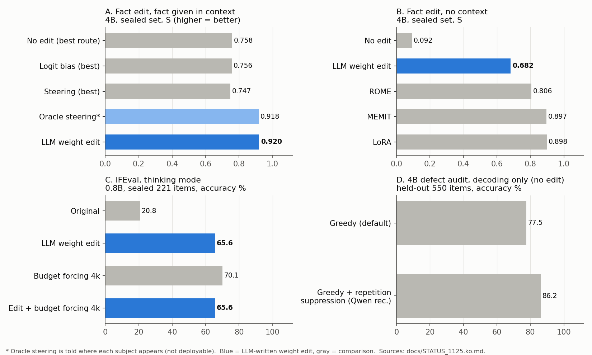

# ForwardEdit

**An LLM reads a model's weights and writes the weight edit itself. No training, no gradients; the GPU runs inference only.**

[한국어](README.ko.md) · [Full guide (install, tools, past studies)](docs/README_FULL.md) · [Status (KO)](docs/STATUS_1125.ko.md) · [Manuscript draft](paper/cross-task/manuscript_v2.md) · [Experiment names](docs/EXPERIMENT_NAMES.md)



## Results at a glance (updated 2026-11-27)

| | Result | Verdict |
|---|---|---|
| ✅ Fact edit, fact in context (4B) | Sealed S **.920** vs .758 for the best no-edit setting. The margin holds after removing overlapping items: +.17 / +.13 (95% CI > 0). | Holds under pre-registered controls |
| ⚠️ Fact edit, no context (4B) | .682, below ROME .806, MEMIT .897 and LoRA .898. | Fitted methods win |
| ❌ 9B fact edit vs LoRA, same data | 40 rows: LoRA .743, edit .737 (both neighbours −12.5). 200: LoRA **.994**, edit did not freeze. 620: LoRA **.996**, edit .836 (ARC −0.85). | LoRA equal or better at every data size |
| ⚠️ IFEval loop repair (0.8B, thinking) | 20.8 → 65.6%, but budget forcing alone reaches 70.1%. | Error repair, not a capability gain |
| ⚠️ BFCL irrelevance (4B, real test, run once) | LLM edit **82.23** (+2.1 [1.2, 3.0] vs original 80.14), same-data LoRA 80.23 (+0.1). Edit − LoRA +2.0 [0.8, 3.2]. Prompt instruction alone 82.89. | Beats LoRA, not the prompt baseline |
| ⚠️ "Look at all parameters" (0.8B fact edit) | Editor with a full-parameter atlas: S .860, no-context S **.55** (current method .846 / .21). Full fine-tuning: **.994** with context, .06 without. | Full FT wins in context; atlas edit stores more facts in weights |
| ℹ️ 4B defect audit | Qwen's recommended repetition suppression alone raises accuracy from .775 to .862. | Remaining targets: long MATH reasoning, IFEval loops |

Claims follow three tiers ([protocol](docs/EDIT_EVALUATION_PROTOCOL.md#comparison-tiers-adopted-2026-11-24-prospective)):
1. Edited vs original model under the same recommended settings, and vs LoRA/MEMIT.
2. Edit + the best inference trick vs the trick alone.
3. Inference-only methods as a reference.

## What does not work yet
- No edit beats the best inference-time method on a real benchmark (budget forcing, recommended decoding).
- Without context, LLM-chosen values lose to fitted editors (LoRA, MEMIT). At 9B, LoRA wins even with matched data.
- On BFCL the edit does not beat a plain prompt instruction. In IFBench validation, ~54% of failures are label, conflict or grader problems, not model errors.
- High run-to-run variance: 2 of 5 sealed passes at 0.8B, with a different layer each run.
- The "fires on almost no tokens" claim is withdrawn: the edit changes ~99% of tokens by more than 1%, and ~2% by more than 5%.

## Next
- IFBench: clean the labels, then target truncation from long thinking on letter-counting prompts. Compare the LLM edit (effort max, full-parameter atlas) against LoRA and budget forcing. Then MedXpertQA-MM (vision) and Multi-IF (multi-turn).
- 4B: edit for efficiency (same MATH answers in fewer tokens) or for the remaining IFEval loops, tested on top of the recommended decoding.
- Re-score the remaining arms (no-context, 9B, 0.8B) without overlapping items; run 0.8B specificity controls.
- Paper: a focused workshop paper is feasible; main track is not yet. See the [readiness review (KO)](docs/PAPER_READINESS_1125.ko.md).

## Daily log
| Date | One line |
|---|---|
| 11-27 | BFCL real test: LLM edit +2.1, beats LoRA (+0.1) but not the prompt instruction (+2.8). 0.8B: full-parameter atlas helps the editor; full fine-tuning wins in context. IFBench: ~54% of validation failures are not model errors. [log](docs/daily/2026-11-27.ko.md) |
| 11-26 | Weak-benchmark 4B baselines; BFCL irrelevance labels found mostly wrong; with clean labels LoRA passes all 4 criteria; LLM edit passes confirmation (freeze pending). [log](docs/daily/2026-11-26.ko.md) |
| 11-25 | Controls pass for in-context fact edits; "sparse" claim withdrawn; 9B data-matched (40/200/620 rows): LoRA equal or better at every size. [log](docs/daily/2026-11-25.ko.md) |
| 11-24 | 9B blind fact edit froze but failed regression; MoVA-36B runs on one 24 GB GPU; three-tier comparison adopted. [log](docs/daily/2026-11-24.ko.md) |
| 11-23 | Edit beats logit bias and steering on validation; LoRA/MEMIT beat the edit without context; 2/5 replicate passes. [log](docs/daily/2026-11-23.ko.md) |
| 11-22 | Cross-task study: 15+ tasks, edits help knowledge, not computation. [summary](docs/CROSS_TASK_STUDY_1122.ko.md) |

## Quick start
```bash
git clone https://github.com/AnamKwon/ForwardEdit.git && cd ForwardEdit
python3 -m venv .venv && .venv/bin/python -m pip install -e '.[lm,mcp,test]'
```
Connect an MCP client (Claude, Codex, …) as described in the [full guide](docs/README_FULL.md#connect-an-llm-client). Rules: [inference-only contract](docs/INFERENCE_ONLY_CONTRACT.md) · [data separation](docs/EDIT_EVALUATION_PROTOCOL.md).

Numbers come from host evaluation records. Run artifacts are **not bundled**. Inspired by [Weight-Space Programming](https://rikiyat.github.io/blog/weight-space-programming/); no superiority over WSP is claimed.
