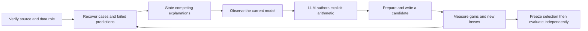

# Editing from retained experiment logs

[한국어](LOG_DRIVEN_EDITING.ko.md)

Retained logs can help an LLM editor choose a better hypothesis, observation or
explicit weight intervention. Their value depends on preserving failures and
counterexamples with the successful cases. Reading logs does not itself train
the model or establish a correct mechanism.

The portable workflow is in
[the model-editor reference](../skills/weight-space-engineer/references/log-feedback.md).
It uses existing ForwardEdit MCP tools. No automatic weight selector, optimizer,
or new model execution is introduced by this documentation.

## What transfers between experiments

General methodological lessons can motivate a disclosed new study: audit input
and label agreement, check individual preservation, inspect every competing
answer, verify actual loaded precision, and measure an applicable original-model
alternative. Current-model train evidence supplies the actual numeric design.

An old coordinate, direction, strength or activation is evidence about its own
source model and prefix. A new model requires its own structure, values and
observations. Old final-test cases stay exposed audit records; they cannot become
fresh validation or guide a revision of the frozen experiment.

## Minimum useful review record

| Field | Purpose |
|---|---|
| Source/parent checkpoint and patch hashes | Identify the model that actually produced feedback |
| Scientific data role and exposure | Distinguish numerical design, selection and independent evaluation |
| Job, problem/group, artifact hash and excerpt selector | Recover the actual evidence without importing unrelated log content |
| Label review and task scorer | Separate model mistakes from annotation or grading problems |
| Prediction, observation and alternatives | Retain what the previous explanation did and did not explain |
| Rescues, regressions and preserved cases | Expose interference hidden by aggregate accuracy |
| Next observation, falsifier and disposition | Turn a retrospective story into a testable next decision |

The host should hash-check imported records, select only role-eligible excerpts,
and preserve original-source and excerpt-byte hashes separately. A case bank is
maintained through `record_observation`; source/parent revision is already
supported by `revise_candidate` and `compare_candidate_parameters`. These tools
do not certify prose claims, scientific independence or semantic roles.

## Use with ongoing studies

Before adding feedback-driven revisions, check the declared design. Repeated
revision and a fixed one-update comparison answer different questions. Keep
their protocols, candidate lineage and cumulative budgets explicit. When resources
are unavailable, retaining a reviewed history packet and a concrete next
measurement is useful progress, but it is not an executed edit or a performance
result.

## Unaddressed criticisms / 미대응 비판

- This workflow is procedural; it does not automatically verify labels, filter
  information leakage, prove causal claims or validate arbitrary imported prose.
- No controlled study here establishes that log-informed editing outperforms an
  equally budgeted editor without history.
- Correct local arithmetic and case-level repairs still require frozen,
  independent evaluation and preservation checks.
