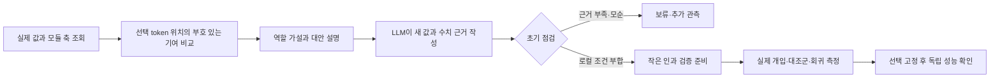

# 수정 전 parameter 분석과 수정 근거

목표는 값을 바꾸기 전에 **왜 이 위치인지, 왜 이 방향과 크기인지, 어떤 관측으로 틀렸음을 알 수 있는지**를 기록하는 것이다. 초기 분석은 weight·실제 추론 관측·수정값의 산술을 연결한다. 의미 역할과 성능은 이후 개입으로 검증한다. 훈련·gradient·optimizer·자동 loss fitting은 계속 금지한다.



## 실제 값과 역할의 연결

`describe_parameter`로 실제 module/layout/작은 값을 먼저 읽는다. 다음 `analyze_parameter_contexts`가 명시한 discovery 예제와 token 위치에서 실제 forward hook을 실행한다. 정상/실패라는 label은 호출자가 정한 주장으로 표시한다. 올바름을 도구가 자동 판정했다고 취급하지 않는다. prefix hash, 실제 공유 prefix 길이와 동일 문맥 여부를 기록해 pairing의 한계를 드러낸다.

각 위치에서 다음을 저장한다.

- 선택 입력 feature의 **부호 있는 실제 activation**
- 선택 출력 feature의 실제 module 출력
- 선택 weight block이 그 출력에 쓰는 기여
- 참조/실패 사례의 기여 차이와 실제 target token log-probability
- LLM이 명시한 새 값의 **고정 입력에서의 로컬 출력 변화**

Linear `W[out,in]`의 선택 block을 B, 해당 입력을 x라 하면 선택 기여는 `B @ x`, 새 값의 변화는 `(B_new-B) @ x`다. GPT-2 Conv1D `[in,out]`는 `x @ B`, `x @ (B_new-B)`다. 이것은 관측한 입력에 대한 affine 연산의 직접 계산이며 미분이나 numerical gradient가 아니다. bias와 다른 feature의 기여는 그대로 남는다.

예를 들어 W=0.4를 0.2로 줄일 때 activation이 +1이면 해당 출력 변화는 -0.2, activation이 -2이면 +0.4다. 따라서 weight 부호만 보고 ‘줄이면 그 기능이 줄어든다’고 판단할 수 없다. 이 예는 수치 단위 검증이며 의미 기능을 입증한 모델 사례가 아니다.

이 예측은 원본 입력을 고정한 **로컬 module 효과**다. 다른 layer, LayerNorm, residual 경로, attention, 생성의 누적 효과를 포함한 모델 전체 예측으로 해석하지 않는다. 같은 module이 한 forward에서 여러 번 재사용되는 경우는 현재 거부한다.

## 분석 요청

JSON spec 예시:

```json
{
  "model_dir":"model", "dataset_path":"development.json",
  "tensor":"ACTUAL_TENSOR_NAME", "rows":[0], "columns":[0],
  "pairs":[{
    "id":"contrast-1", "reference_id":"reference-example", "failure_id":"failure-example",
    "reference_positions":[5], "failure_positions":[5]
  }],
  "proposed_values":[[0.2]], "device":"cuda"
}
```

position은 0부터 시작한다. 입력 tokens[p] 위치의 module 입출력과 다음 tokens[p+1]의 확률을 측정한다. 현재 FP32 source의 Linear/Conv1D, 최대8쌍·쌍당8위치, 선택 block 최대1024값·축당64좌표를 다룬다. 모델은 frozen/inference_mode이며 GPU는 forward에만 사용한다. 모델을 새로 학습하는 과정은 없다.

```bash
.venv/bin/weight-space --workspace /absolute/experiment analyze-parameter spec.json analysis.json
```

MCP의 analyze_parameter_contexts는 spec의 각 인자와 output을 받는다. proposed_values를 생략하면 관측만 저장하고 새 값을 선택하지 않는다. 반환한 analysis path/hash와 report에 source/config/data hash·원래 값·지정한 새 값·좌표·관측을 보존한다. 기존 파일은 덮어쓰지 않는다.

## 수정 근거 기록 작성

prepare_edit_proposal에 분석 파일과 LLM이 작성한 basis를 전달한다. basis에는 다음 내용이 필요하다.

| 필드 | LLM이 설명할 내용 |
|---|---|
| failure_description | 무엇을 실패로 보았고 어떤 관측을 근거로 하는가 |
| structural_role | 실제 모듈·축·계산상의 역할 |
| mechanism_hypothesis | 이 성분이 실패를 만든다고 생각한 메커니즘 |
| pairing_justification / evidence_pairs | 왜 비교 가능하며 분석의 어떤 쌍을 근거로 삼았는가 |
| value_derivation / value_rule | 왜 이 새 값이며 수치의 산출 근거는 무엇인가 |
| alternative_explanation | 다른 원인과 미확인 부분 |
| expected_behavior / disconfirming_result | 예측과 이를 반증할 결과 |
| controls | identity와 opposing_edit의 목적 |
| target_output_direction | 선택 출력 좌표에서 원하는 변화 방향 |
| max_reference_output_delta | 참조 사례에서 허용할 로컬 출력 변화 |

value_rule이 {"kind":"attenuate","fraction":0.5}이면 LLM이 지정한 새 값이 실제 원래 값의50% 감쇠와 맞는지 확인한다. 도구가 값을 탐색하거나 생성하지 않는다. kind=explicit이면 변경한 각[row,column]의 이유를 coordinate_reasons에 기록한다. 설명의 진실을 기계적으로 입증할 수는 없으므로 LLM의 주장으로 보존한다.

구조적 수정은 `value_rule={"kind":"rank_one","left":[...],"right":[...],"strength":0.5}`로 명시할 수 있다. 제안된 값이 실제 FP32 `old + strength*outer(left,right)`와 정확히 같은지 확인한다. 방향·strength의 선택 근거는 LLM이 기록하며 도구는 방향을 풀거나 탐색하지 않는다. 이 일치는 수치 산식 확인이며 방향의 인과적 타당성을 보증하지 않는다.

로컬 점검은 수정이 의도한 방향을 향하는지, 비교 사례보다 실패 사례에 더 작용하는지, 참조 영향이 선언한 상한 안인지 확인한다. 선택적인 실패 메커니즘 가설을 위한 조건이며 모든 편집에 통용되는 규칙은 아니다. 분석 내 모든 쌍의 수치를 점검한다. 기준은 제안 시점의 선언이며 사전 등록을 증명하지 않는다.

```bash
.venv/bin/weight-space --workspace /absolute/experiment prepare-proposal analysis.json basis-request.json proposal.json
```

basis-request.json의 최상위 구조는 {"basis":{...},"limits":{"max_changed_fraction":0.002,"max_relative_l2":0.05}}이다. MCP는 prepare_edit_proposal(analysis_path,basis,limits,output)을 제공한다.

- **defer**: 설명·수치 근거 부족, 방향 모순, 참조 영향 초과, 예산 초과 등. plan은 null이며 후보를 만들지 않는다.
- **ready_for_causal_probe**: 설명 항목과 로컬 산술 조건이 갖춰진 단계. 작은 반증 개입용 plan을 반환한다. 후보 생성은 별도 작업이다.
- 두 경우 모두 causal_status/performance_status는 unverified다. 형식을 갖춘 설명을 인과적 증거로 승인하지 않는다.

원래 model/config/data가 바뀐 분석은 stale로 거부하고 재관측해야 한다. 분석 파일 hash는 참조 혼동 방지용이며 파일을 바꿀 수 있는 주체에 대한 변조 불가능한 인증서는 아니다.

## 실제 국소 개입과 대조

작은 후보를 MCP로 만들었다면 같은 pairs/positions에 candidate_dir를 지정해 다시 분석한다. 실제 module 출력 차이와 앞선 로컬 예측, target log-probability, 생성, 정상 사례 회귀를 비교한다. 후보 분석에는 patch hash를 기록한다. 후보 값을 원래 checkpoint 값으로 오용하지 않도록 편집된 분석에서 새 원본용 plan 생성은 거부한다.

최종 판단에는 대조 개입과 독립 데이터의 행동 평가가 더 필요하다. 저수준 write 도구를 모든 용도에서 봉쇄하는 기능은 아니며, 표준 스킬의 실험 절차로 초기 단계를 사용한다.

## 실행 예와 한계

runs/parameter-analysis-001/에서 과거 LLM이 작성한6개 값을0으로 만드는 가설을 새 분석으로 점검했다. 새 값을 탐색하거나 최적화하지 않았다. 두 실제 문말 문맥의 activation 부호를 읽었고, 선언한 newline 방향에 대한 변화가 반대여서 defer로 판단했다. 성공/실패 label은 미검증이고 공유 prefix도 없이 내용이 달라 좋은 matched 대조라고 주장하지 않는다.

보관된 과거 실패 후보를 별도로 replay해 로컬 출력 차이가 예측과 맞는지 검증했다. 과거 결과를 아는 상태에서의 개발 점검이며 새로운 독립 성공 실험이 아니다. 새 분석이 후보를 생성한 것도 아니다. 실제 수치와 오차는 verification.json에 저장한다.

전체 테스트66개와 실제 MCP/CUDA 재현을 통과했다. 로컬 출력 변화 예측과 실측의 최대 오차는 약3.2e-9였다. [원본 분석](evidence/parameter-analysis.json), [보류 판단과 근거](evidence/parameter-proposal.json), [과거 개입 재현](evidence/parameter-historical-intervention.json), [검증 기록](evidence/parameter-analysis-verification.json)을 보존했다. 수치 계산 일치와 의미 역할/성능 입증을 구분한다.
