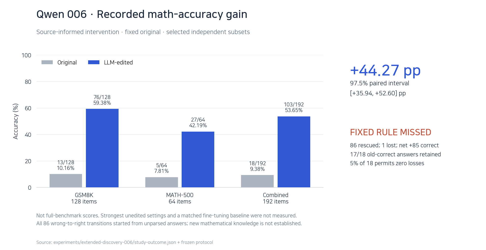
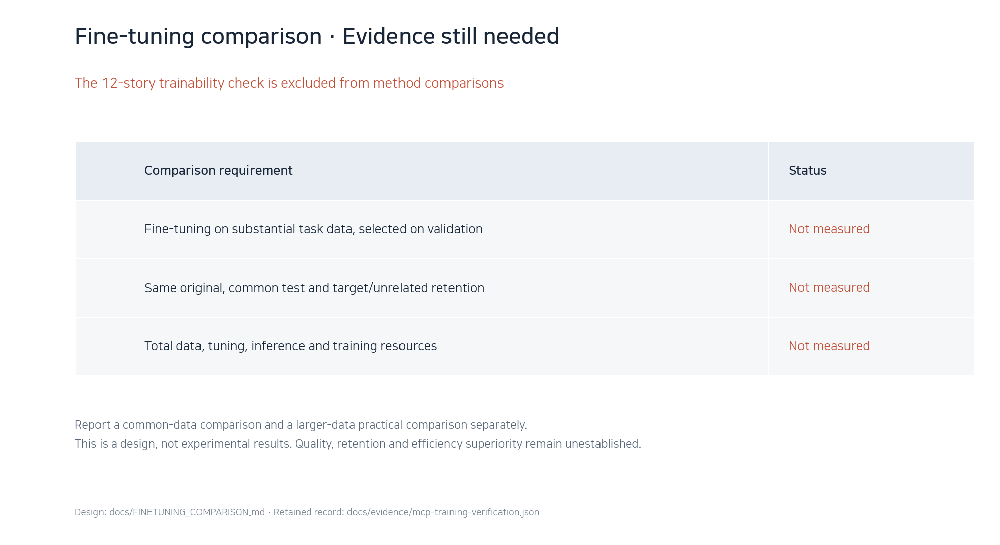

# ForwardEdit — full guide

> The short overview is the repository [README](../README.md). This page keeps the full previous README (tools, install, historical evidence).

**Inference-only tools for inspecting, directly editing, and evaluating neural network weights.**

[한국어](../README.ko.md) · [Case studies and logs](../experiments/README.md) · [Architecture](../DESIGN.md) · [Detailed usage](USAGE.md)

ForwardEdit lets an external LLM inspect real weights and forward observations, propose a failure mechanism, and specify explicit parameter changes through MCP or a CLI. Edits are computed on CPU; GPU use is inference only. The package does not train a model or automatically fit edits to a loss.

It is inspired by [Weight-Space Programming (WSP)](https://rikiyat.github.io/blog/weight-space-programming/). The contribution here is a reusable tool interface, editing workflow and inspectable evidence. A new editing algorithm or superiority over WSP has not been established.

For a visual walkthrough, preview the [136-second English workflow and results explainer](../videos/forwardedit-explainer/README.md). A [Korean edition](../videos/forwardedit-explainer/README.ko.md) is also available. Both are editable Remotion compositions with matching captions. Workflow examples are illustrative; the Qwen scene uses retained measurements, and the fine-tuning scene explains the comparison still needed. No new model experiment was run.

## What is included

- Actual parameter values, module ownership/axes, loaded forward source and selected token activations.
- Explicit value replacement, local scaling, projection and rank-one edits with source checks and change budgets.
- Parent/child revisions, value restoration and comparisons against the original model.
- Forward-only development evaluation, frozen selections and separate independent confirmation.
- Model-editor skills and MCP interfaces usable from external clients such as Codex or Claude.
- Historical tool receipts, edit plans, failed hypotheses and both positive and negative score comparisons.

The LLM chooses what to change and why. Tools calculate and record the specified operations. A plausible explanation, successful file write or passing software test does not establish a causal mechanism or a better model.

## Separate edit data from evaluation

Construct and revise edits using **edit/train data only**. Use separate validation metrics to select candidates, then evaluate the frozen choice on an untouched final test. Report all three scores separately: reevaluating examples used to derive an edit does not measure generalization. If validation examples feed new weight updates, disclose them as development data. The [data-separation protocol](EDIT_EVALUATION_PROTOCOL.md) defines grouping, exposure, matched controls and the two-cohort alternative. Research preflights reject exact cross-split input overlap and repeated declared source groups; they do not guarantee semantic independence or isolate final data from an unrestricted client.

## Measured results

The clearest recorded score gain is the **source-informed Qwen 006** intervention: **18 → 103 correct out of 192** selected independent problems, a **+44.27 percentage-point** gain against its fixed original. Its 97.5% paired interval was **[+35.94, +52.60] points**. **Accuracy improved; the study's prespecified retention rule was missed.** The edit rescued 86 answers and lost one, for a net gain of 85; 17/18 originally correct answers remained correct. The frozen 5% loss limit was a study-specific decision rule, not a universal definition of model improvement. With only 18 originally correct answers, it effectively permitted zero losses. The original rejection is retained; it does not negate the score gain. These are subset results, not full-benchmark scores or evidence of new mathematical knowledge.



**Retention is a shared comparison axis.** Fine-tuning can also degrade prior capabilities; this has been observed in [continual fine-tuning](https://arxiv.org/abs/2308.08747v5) and [LoRA](https://arxiv.org/abs/2401.05605). The learning/retention balance also differs between [LoRA and full fine-tuning](https://arxiv.org/abs/2405.09673v2). A fair comparison applies the same target-quality and retention measurements to both fine-tuning and direct editing. We have not measured which retains more under matched conditions. The one lost Qwen answer is within-set regression, not a measurement of broad catastrophic forgetting. [Interpreting the gate and forgetting](RESULTS.md#interpreting-adoption-and-forgetting).

| Demonstrated outcome | Evidence | What it establishes |
|---|---|---|
| A large fixed-original accuracy gain | [Qwen 006 outcome](../experiments/extended-discovery-006/study-outcome.json) | 86 wrong-to-right changes and one right-to-wrong change; all rescues started from unparsed answers; source-informed, with a failed preservation gate |
| Exact edits reached loaded parameters | [Direct values 001 audit](../experiments/direct-values-inference-only-001/host-audit.json) | Two six-value edits matched specified arithmetic and loaded values; CPU/CUDA observations agreed; both candidates were rejected |
| A revision used actual parent feedback | [MCP 014 feedback audit](../experiments/independent-mcp-014/feedback-flow-audit.json) | Three values were restored after reading parent results; development correct answers changed 7 → 10/64, while independent accuracy later changed 25 → 22/192 |

The positive score and workflow results above have different scopes. **No currently bundled study passed every declared model-adoption criterion.** This does not mean that no task metric improved, or that fine-tuning would pass the same retention rule. The [results guide](RESULTS.md) separates measured performance, retention and protocol decisions.

## Fine-tuning versus LLM editing: comparison still needed

> **Update (2026-11-23/25):** the cross-task series has since measured host-only LoRA, ROME and MEMIT comparisons on CounterFact. LoRA/MEMIT beat the LLM edit without context (sealed S .898/.897 vs .682), so this section's statement applies only to the bundled historical studies. See [Latest results](../README.md).

**A representative fine-tuning comparison has not been measured.** The historical AdamW check used only 12 training stories / 319 target tokens and tested trainability after a prior patch. Its validation deterioration is not evidence against fine-tuning. We exclude that check from method-comparison tables and figures; its [measurements and limitations remain available](RESULTS.md#fine-tuning-reference-comparison).

A useful comparison needs a validation-selected fine-tuning baseline trained on a substantial task-relevant corpus, starting from the same original checkpoint as the LLM editor. Data volume alone does not establish a good baseline: report data quality, learning curves, tuning budget and checkpoint selection. Evaluate both methods on the same selection-unseen test, with target quality, answer retention, unrelated-task retention and total cost reported together.



The [comparison design](FINETUNING_COMPARISON.md) separates a common-data experiment from a practical comparison against fine-tuning using a larger corpus. It specifies data provenance and evaluation requirements without inventing results. **No method, speed or cost advantage is established.**

## Read an actual experiment

These are retrospective publications of completed local studies, not new runs. Every bundled study failed at least one declared acceptance criterion; none is presented as an accepted model improvement.

| Case | Recorded outcome | Why read it |
|---|---|---|
| [Direct values 001](../experiments/direct-values-inference-only-001/README.md) | Two candidates, six values changed each; both rejected | Exact old/new numbers, MCP calls and CPU/CUDA checks |
| [TinyStories 004](../experiments/skill-edit-experiment-004/README.md) | Independent repetition 7.279% → 7.081%; interval includes zero | Development improvement did not establish an independent benefit |
| [TinyStories 005](../experiments/failure-repair-005/README.md) | Independent repetition 6.060% → 6.512%; rejected | Feedback revisions, an opposing control and normal-case damage |
| [Source-informed Qwen 006](../experiments/extended-discovery-006/README.md) | Independent answers 18 → 103 / 192; preservation failed | A large score gain can still fail the declared acceptance gate |
| [MCP-only Qwen 009–014](../experiments/independent-mcp-014/README.md) | Development 5 → 10 / 64; independent 25 → 22 / 192 | Fresh client sessions, failures, one feedback revision and negative transfer |

The Qwen 006 edit used source-paper-informed host guidance; it is not blind rediscovery. Its gain is against the fixed original under the recorded decoding configuration, with no demonstrated advantage over the strongest unedited configuration. The studies use different populations and protocols and are not a controlled head-to-head comparison. See each case's **Unaddressed criticisms / 미대응 비판**.

The [evidence index](../experiments/README.md) explains selection, redactions and omissions. Check the published bytes without loading any model:

```bash
python3 scripts/verify_public_evidence.py
```

This checks artifact integrity and JSON parseability. It does not reproduce inference, authenticate unavailable originals or certify performance.

## Install

ForwardEdit is currently distributed as a **local stdio MCP server and repository skills**. This repository does not include an installable Codex/Claude marketplace plugin or a hosted MCP URL. Install the Python source, then register the server with your client. The skills are available through its `read_guidance` tool; separate skill installation is optional.

Python 3.11 or newer is required. Use an editable source install: MCP guidance reads the repository's `skills/` and contract documents.

```bash
git clone https://github.com/AnamKwon/ForwardEdit.git
cd ForwardEdit
python3 -m venv .venv
.venv/bin/python -m pip install -e '.[lm,mcp,test]'
.venv/bin/forwardedit --help
.venv/bin/forwardedit-mcp --help
```

If you already have a checkout, start with the virtual-environment command in that directory. These instructions install from GitHub and do not require a PyPI release.

This installs the Transformers 4.x small-model path. The separate Qwen/research environment uses `pip install -e '.[qwen]'`; choose a PyTorch build compatible with the inference hardware. Optional vLLM generation requires its own compatible, explicitly pinned executable. Do not combine the `lm` and `qwen` Transformers constraints in one environment. See [runtime setup](STANDALONE_MCP.md).

Experimental native Gemma 3 image-and-text generation uses the research environment with Pillow installed, tested with Transformers 5.22.1. The original vision encoder and projector stay frozen, and candidate edits apply to the verified text component. See [image input configuration and observation provenance](../skills/weight-space-engineer/references/research-tools.md).

The distribution is `forwardedit`; the Python import/module path remains `weight_space_lab`. Existing `weight-space` and `weight-space-mcp` commands are compatibility aliases.

## Connect an LLM client

From the cloned `ForwardEdit` directory, set the source and workspace paths. Replace the workspace placeholder with your own writable directory:

```bash
FORWARDEDIT_ROOT="$(pwd)"
FORWARDEDIT_WORKSPACE="/absolute/path/to/experiment"
mkdir -p "$FORWARDEDIT_WORKSPACE"
```

**Codex CLI:**

```bash
codex mcp add forwardedit --env OMP_NUM_THREADS=1 --env MKL_NUM_THREADS=1 -- \
  "$FORWARDEDIT_ROOT/.venv/bin/forwardedit-mcp" --workspace "$FORWARDEDIT_WORKSPACE"
codex mcp get forwardedit
```

**Claude Code:**

```bash
claude mcp add --transport stdio --scope user forwardedit -- \
  "$FORWARDEDIT_ROOT/.venv/bin/forwardedit-mcp" --workspace "$FORWARDEDIT_WORKSPACE"
claude mcp get forwardedit
```

Choose the command for your client. `mcp get` checks the saved registration. Start a new client session and ask it to call `edit_api_schema` and `read_guidance` with `path="skills/weight-space-mcp-only/SKILL.md"` to check the connection and load the shipped workflow. Those two calls require no model inference.

An empty writable directory is enough for this connection check. Actual model experiments require your local `model/`, development inputs and the configuration described in [workspace setup](STANDALONE_MCP.md). No checkpoint or dataset is downloaded automatically. `experiment_info` requires a configured research workspace.

For clients configured through files, use the [Claude-style JSON](../examples/mcp/claude.json) or [Codex TOML](../examples/mcp/codex.toml) template and replace all absolute paths. For details, see [standalone MCP](STANDALONE_MCP.md) and [Codex client notes](CODEX_MCP_CLIENT.md). Server startup on stdio waits for a client; it does not display a web interface.

The editor starts by reading `skills/weight-space-mcp-only/SKILL.md` through `read_guidance`, then inspects `edit_api_schema` and `experiment_info`. Choose targets and coefficients from actual observations, record predictions before intervention, and freeze selection before independent evaluation. Historical cases are for human review; supplying their recipes to an editor changes a blind experiment into a source-informed one.

## CLI and model support

```bash
.venv/bin/forwardedit --workspace /absolute/path/to/experiment inspect model/model.safetensors
.venv/bin/forwardedit --workspace /absolute/path/to/experiment preview plan.json
.venv/bin/forwardedit --workspace /absolute/path/to/experiment apply plan.json candidate-01
```

`plan.json` is an explicit caller-authored edit, not a request for automatic optimization. See [numeric examples and evaluation APIs](USAGE.md).

| Path | Scope |
|---|---|
| Basic model/CLI path | Local `config.json` plus one `model.safetensors`; CPU/CUDA FP32 observations; CPU FP32 paired NLL confirmation |
| Research MCP path | Hash-bound model/data/decoding policy, bounded logical jobs and configured BF16 inference; optional separate vLLM generation runtime |

Quantized/sharded checkpoints, remote model code and automatic model downloads are unsupported. Tied/shared parameter edits are restricted. A saved candidate contains replacement tensors and a manifest, not a complete Hugging Face checkpoint. Read the [architecture](../DESIGN.md) before assuming support for another model or precision.

## Execution rules

The [inference-only contract](INFERENCE_ONLY_CONTRACT.md) excludes backward/autograd, gradient collection, numerical gradients, optimizer/LoRA training, automatic loss fitting and random/coordinate/strength sweeps. Explicit CPU arithmetic and bounded hypothesis-driven controls are allowed. A one-shot multi-error update must have its examples, layers, coefficients and formula chosen explicitly by the LLM; least-squares/pseudoinverse fitting remains prohibited.

Models run frozen in evaluation/inference mode. The runtime and tests include training API guards. These are software checks, not an OS sandbox or a guarantee about arbitrary external code. Correct writes, behavior changes and independent task gains are separate claims.

## Repository and agents

| Path | Purpose |
|---|---|
| `weight_space_lab/`, `tests/` | Implementation and software checks |
| `skills/` | Product guidance for a weight-editing LLM |
| `AGENTS.md`, `DESIGN.md` | Contributor instructions and current implementation architecture |
| `docs/` | Usage, contracts, review checklist and historical reports |
| `experiments/` | Selected public historical text evidence |
| `examples/mcp/` | Shareable client configuration templates |
| `archive/gradient_experiments/` | Non-executable records of earlier disallowed approaches, excluded from current success evidence |

Personal agent configuration, credentials, virtual environments, logs, checkpoints and full `runs/` workspaces are ignored. The public cases are deliberate copies, including records from local workspaces that were stored elsewhere through symlinks. Model weights, large activations and full datasets are not bundled. Published test examples are now exposed and cannot serve as fresh held-out data.

## Development checks

```bash
OMP_NUM_THREADS=1 MKL_NUM_THREADS=1 .venv/bin/python -B -m pytest -q -p no:cacheprovider
python3 scripts/verify_public_evidence.py
```

Tests use untrained numerical fixtures and inference-only paths. Report skipped checks separately. Source/evidence maintenance requires no new model experiment.

## Attribution

The original WSP work and its [public experiment logs](https://github.com/RikiyaT/lm_understand-logs) provide the methodological reference. [Our source investigation](WEIGHT_SPACE_SKILL_DESIGN.md) distinguishes that work from this implementation. External model and dataset terms remain applicable; publishing these text records does not distribute or relicense their checkpoints or full datasets.
