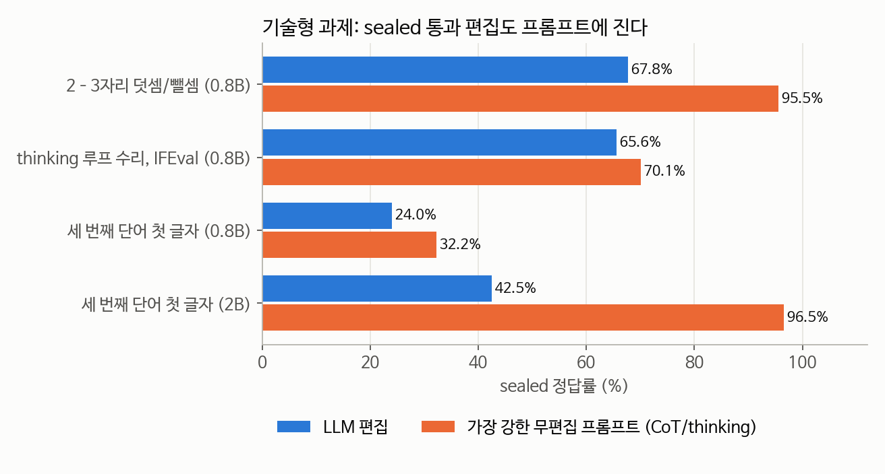
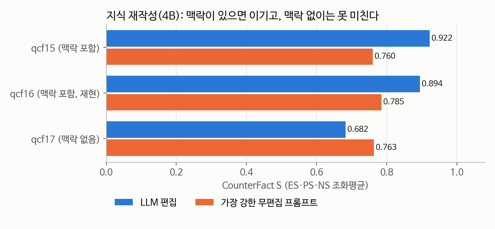
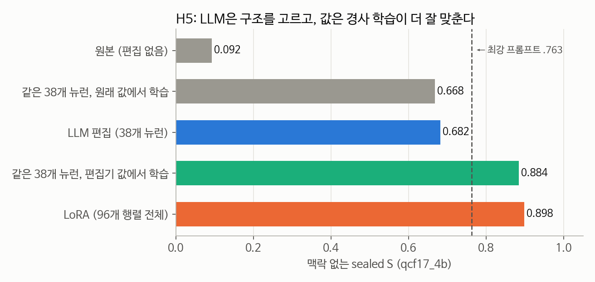
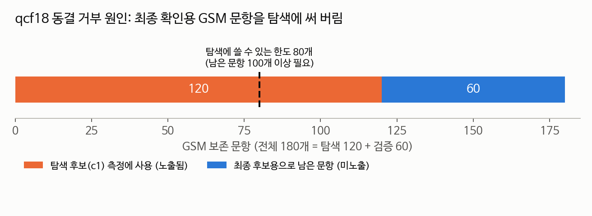

# LLM이 직접 쓴 가중치 편집: 교차 과제 결과와 한계 리포트 (2026-11-23)

[연구 요약](CROSS_TASK_STUDY_1122.ko.md) · [논문 초안](../paper/cross-task/manuscript.ko.md) · [결과 가이드](RESULTS.ko.md) · [실험 이름표](EXPERIMENT_NAMES.md)

> **근거 상태.** 이 리포트의 숫자는 호스트 평가 파일에서 가져왔습니다. 실행 작업 공간, 편집기 기록, sealed 문항 목록은 **이 저장소에 포함되어 있지 않습니다.** 따라서 여기 공개된 바이트만으로는 검증할 수 없습니다. 공개 근거로 검증 가능한 결과는 [결과 가이드](RESULTS.ko.md)를 보세요.

## 요약

- **질문.** WSP 계열 연구는 주로 수학 문제와 thinking 루프 수리를 다뤘습니다. 우리는 다른 과제에서도 LLM이 쓴 추론 전용 가중치 편집이 *가장 강한 무편집 기준선보다* 실제로 나은지를 시험했습니다.
- **답.**
  - 기술형 과제(산술, 글자, 형식)에서는 편집이 sealed 테스트를 통과해도 프롬프트(CoT/thinking)에 졌습니다.
  - 지식을 다시 쓰는 과제(CounterFact, 4B)에서는 모든 프롬프트를 이겼습니다.
  - 같은 데이터로 학습한 LoRA는 편집보다 강합니다.
  - 편집기가 고른 구조에서 경사 학습을 시작하면 LoRA에 가깝게 도달합니다. 즉 LLM의 기여는 **구조**이고, 부족한 것은 **값**입니다.

| 범주 | 대표 결과 | 판정 |
|---|---|---|
| 기술형 (산술, 글자 과제) | sealed +4 ~ +11점 | 6/6 프롬프트에 패배 |
| thinking 루프 수리 | +44.8점 | thinking 예산 강제(무편집)로 같은 효과 |
| 지식 삽입 (0.8B) | 과거형 58개 +46.6점 | 3-shot을 이기고 함께 쓰면 더 좋아짐 |
| 지식 재작성 (4B, 맥락 포함) | S .922 / .894 | **PRIMARY 2/2 통과** |
| 지식 재작성 (4B, 맥락 없음) | S .682 | PRIMARY 실패 (기준 .763) |
| 레시피 없이 진행 (4B) | 후보 +8.75점 (z 2.75) | 동결 실패 (도구 규칙) |

## 1. 실험 방식

- **편집기와 대상 모델.** 편집기는 Claude Opus이고, MCP를 통해 Qwen3.5 0.8B / 2B / 4B와 Qwen2.5-0.5B의 가중치를 직접 씁니다.
- **추론 전용 계약.** GPU에서는 순전파만 합니다. 역전파, 옵티마이저, 최소제곱 풀이, 자동 탐색은 쓰지 않습니다.
- **절차.**
  - 실행 전에 PREREG(사전 등록)를 작성합니다.
  - 검증은 블라인드로 합니다. 편집기는 집계값만 보고 후보는 최대 2개입니다.
  - 동결 규칙은 도구가 강제합니다.
  - sealed 세트는 한 번만 평가합니다.
  - 일반 능력 회귀 검사(GSM8K, MMLU, ARC-C)를 함께 돌립니다.
- **비교 대상.**
  - 가장 강한 무편집 프롬프트(직접 답, few-shot, CoT, thinking, override 지시).
  - 같은 데이터로 학습한 호스트 전용 LoRA. 상한 참고용이며 편집이 아닙니다.

## 2. 결과

### 2.1 기술형 과제: 통과해도 프롬프트에 진다

| 과제 | 모델 | 원본 | 편집 (sealed) | 가장 강한 무편집 | 일반 능력 |
|---|---|---:|---:|---:|---|
| 2–3자리 덧셈/뺄셈 | 0.8B | 48.5–74% | +4.8 ~ +6.8 (67.75%) | 짧은 CoT 95.5% | 손실 없음. 단, CoT와 함께 쓰면 −8 ~ −11 |
| thinking 루프 수리 (IFEval) | 0.8B | 20.8% | +44.8 (65.6%) | thinking 예산 강제 70.1% | 손실 없음 |
| 세 번째 단어 첫 글자 | 0.8B | 13% | +11.0 (24.0%) | thinking 32.25% | ARC-C 경계선 |
| 세 번째 단어 첫 글자 | 2B | 32% | +10.5 (42.5%) | thinking 96.5% | 손실 없음 |
| 단어 마지막 글자 | 0.8B / 2B / Qwen2.5-0.5B | 53–72% | +4.0 ~ +9.75 | thinking이 더 높음 | 4건 중 3건에서 작은 ARC-C 손실 |
| BBH dyck_languages | 2B | 5% | 공식 문구 +8.0, 새 문구 −3.0 | — | GSM −9.0 (실패) |

**해석.** 편집은 모델이 3토큰 안에 바로 답해야 할 때만 이겼습니다. 추론이 허용되면 이점이 사라졌습니다. 0.8B에서 편집으로 메운 차이는 4B에서는 편집 없이도 이미 메워져 있었습니다. **"수학 향상은 실제 수학 능력이 아니다"라는 비판은 일부 맞습니다.**

### 2.2 지식 재작성: 견고한 영역

| 실행 | 설계 | 가장 강한 무편집 S | 편집 S | LoRA S | 판정 |
|---|---|---:|---:|---:|---|
| 4B 사실 편집 A (qcf15_4b) | 맥락 포함 | .760 | **.922** | .989 | PRIMARY 4/4 통과 |
| 4B 사실 편집 B (qcf16_4b) | 맥락 포함 (재현) | .785 | **.894** | .987 | PRIMARY 4/4 통과 |
| 4B 사실 편집 (무맥락 설계, qcf17_4b) | 맥락 없음 (지식 유지) | .763 | .682 | .898 | PRIMARY 3/4, **실패** |

- 맥락이 있을 때 편집은 "이 사실들이 기존 지식을 대체한다"는 명시적 지시(override)까지 포함한 모든 프롬프트를 S .11–.16 차이로 이겼습니다. MMLU, ARC, GSM은 변하지 않았습니다.
- 맥락 없이 지식이 유지되는지를 기준으로 삼으면 편집이 프롬프트 기준에도 못 미쳤습니다.
- 앞선 실행에서는 "편집이 LoRA보다 맥락 없이 더 오래 간다"고 보였습니다. 그러나 이는 그 LoRA들이 맥락이 붙은 행으로 학습됐기 때문에 생긴 착시였습니다. 같은 무맥락 행으로 학습하자 LoRA가 이겼습니다.

### 2.3 H5: LLM은 구조를, 경사 학습은 값을

| 조건 (4B 사실 편집 (무맥락 설계), 맥락 없는 sealed S) | S |
|---|---:|
| 원본 | .092 |
| 같은 38개 뉴런, 원래 값에서 학습 | .668 |
| LLM 편집 (38개 뉴런, 한 층) | .682 |
| 같은 38개 뉴런, **편집기 값에서** 학습 | **.884** |
| LoRA (96개 행렬 전체) | .898 |

- 편집기가 고른 뉴런과 게이트에서 출발하면 파라미터 0.29M개만으로 LoRA에 거의 도달합니다.
- 같은 뉴런이라도 원래 값에서 출발한 경사 학습은 그 구조를 다시 찾지 못합니다.
- 경사 학습은 주로 up_proj(쓰기 강도와 방향)를 바꿨고, gate는 거의 그대로 두었습니다(cos .92).
- 이 분석은 호스트 전용입니다. 경사 학습에서 나온 정보는 편집기에 주지 않습니다.

### 2.4 레시피 없는 블라인드 시도: 4B 블라인드 사실 편집 1 (qcf18_4b)

- **목적.** 기존 4B 지식 결과는 "이전 세션의 레시피 메모(층, 뉴런, 강도)를 받아서 나온 것"이라는 약점이 있습니다. 이를 검증하려고 메모를 모두 뺐습니다.
- **편집기가 스스로 찾은 구조.**
  - 레시피는 L8의 쓰이지 않는 뉴런을 할당하는 방식이었습니다. 이번에는 **L10 down_proj에 rank-40 저랭크 쓰기**를 했습니다.
  - 키: 공유 맥락 속 각 주어의 마지막 토큰 위치. 값: "새 답 − 원래 답" 출력 임베딩 방향.
  - 편집기 스스로 대조 실험도 했습니다.
    - 프롬프트 위치를 키로 쓰면 이웃 사실로 새어 나갔습니다(c3).
    - 맥락 위치만 키로 쓰면 결과가 흔들렸습니다(c4).
    - 강도를 두 배로 올리면 이웃 사실로 새어 나갔습니다(c2).
- **최선 후보 c5** (노출되지 않은 616문항 기준):

  | 항목 | 변화 |
  |---|---|
  | 바꿔 말한 질문 (PRIMARY 소스) | **+8.75점 ± 3.2** (7건 개선, 0건 악화, z 2.75) |
  | 이웃 사실 | +3.75점 |
  | 일반 객관식 | −0.5점 ± 0.9 |
  | MMLU | +3.3점 |

- **동결 거부.** 동결하려면 최종 확인용으로 아직 쓰지 않은 GSM 문항 100개가 필요합니다. 그런데 탐색 후보 c1을 GSM 120문항 전부로 측정해 버려서 60개만 남았고, 패스 예산도 소진됐습니다. 사전 등록대로 **동결 실패**이며 sealed 세트는 열지 않았습니다.
- 실행 중 로그인 만료로 한 번 중단됐고, PREREG 수정 기록을 남긴 뒤 같은 예산으로 재개했습니다.

## 3. 도구 개선 (이번 주기)

| 문제 | 개선 | 검증 |
|---|---|---|
| 탐색 단계에서 최종 확인용 보존 문항을 써 버림 (4B 블라인드 사실 편집 1) | `reserve_guard`: 남은 문항이 동결 요건보다 적어지는 측정 요청을 패스 소모 없이 거절. `spend_reserve=true`로 명시적으로 넘길 수 있음 | 단위 테스트 추가, 전체 268개 통과, 1개 건너뜀 |
| 로그인이 만료된 뒤에도 빈 세션이 반복됨 | 런처가 인증 실패를 감지하면 즉시 중단 | 4B 블라인드 사실 편집 1에서 재개를 확인 |
| 축이나 slice 인자가 빠졌을 때 알기 어려운 오류 | 무엇이 빠졌는지 알려 주는 오류 메시지 | 테스트 추가 |
| 세션 컨텍스트 비대화 | token_watchdog가 약 130k에서 세션을 교체 | 교체 후 첫 작업까지 도구 호출 5–23회로 적정 |

**토큰 비용 (실행당).** 편집은 45–90분, 새 입력 토큰 0.3–0.8M, 캐시 읽기 8–16M입니다. LoRA는 10–30분의 GPU 학습입니다.

## 4. 한계

| 한계 | 내용 | 대응 상태 |
|---|---|---|
| **산출물 미포함** | 작업 공간, 기록, sealed 목록이 저장소에 없음 | 미대응 |
| **블라인드 발견의 sealed 근거 없음** | 4B 지식 PASS는 레시피를 전달받아 나온 결과. 블라인드 시도는 동결 실패 | 4B 블라인드 사실 편집 2(qcf19_4b) 재시도 준비 중 |
| **ROME/MEMIT 비교 없음** | 지식 편집의 표준 비교 대상이 빠짐 | 호스트 전용 실행에 사용자 승인 필요 |
| **LoRA가 더 강함** | 효과 크기는 LoRA가 우위. 편집의 장점은 작은 변경 규모, 감사 가능성, 학습 불필요 | 결과로 인정 |
| **규모** | 4B까지만 검증. 7B/9B/27B는 디스크와 양자화 도구 문제로 미검증 | 미대응 |
| **단일 편집기와 단일 실행** | 편집기 계열과 프롬프트가 하나뿐이고 대부분 단일 실행. 일부 sealed 세트가 작음 | 부분 대응 (CounterFact는 2/2 재현) |
| **과제 선택** | BBH 27개 과제를 선별하고 게이트를 사전 등록했지만, 최종 선택은 호스트가 함 | 부분 대응 |
| **맥락 의존** | 4B 지식 편집의 이점은 맥락이 있을 때만 나타남. 맥락 없이 유지되는 효과는 프롬프트에도 못 미침 | 결과로 인정 |
| **사전 선별 검사의 오탐** | writer-credit 검사가 객관식 글자 형식에서 오탐을 냄 | 결과로 인정 |

## 5. 가설 정리 (논문 초안)

- **H1 차이 유형.** 저장된 연관이나 직접 읽어 내는 값은 편집할 수 있고, 빠진 계산은 편집할 수 없습니다.
- **H2 기준선 소거.** 모델이 추론할 수 있으면 기술형 편집의 이득은 사라집니다.
- **H3 지식 재작성 영역.** 프롬프트에 더해지는 효과는 있지만, 편집 단독으로는 같은 조건의 LoRA보다 약합니다.
- **H4 로그 서명.** 성공한 편집은 공유 부품 하나(헤드, 게이트된 뉴런)를 썼고, 실패한 편집은 마지막 층에서 출력 토큰의 가중을 조정했습니다.
- **H5 구조 vs 값.** LLM은 구조를 제공하고, 값은 경사 학습이 더 잘 맞춥니다.

## 6. 다음 단계

1. **4B 블라인드 사실 편집 2 (실행 중):** 새 사실 40개로 블라인드를 재시도합니다. 도구 수정 외에는 4B 블라인드 사실 편집 1과 같습니다. 가장 강한 무편집 경로는 all(S .752)이고, 이것이 PRIMARY 기준입니다(none .060, oracle .732, override .679).
2. ROME/MEMIT 호스트 전용 비교(승인 시).
3. 결과를 논문과 PR에 반영합니다.

---
차트는 `report_1123/make_charts.py`로 다시 만들 수 있습니다(matplotlib, 나눔바른고딕).
