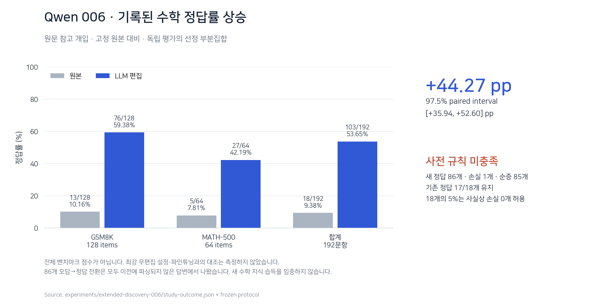
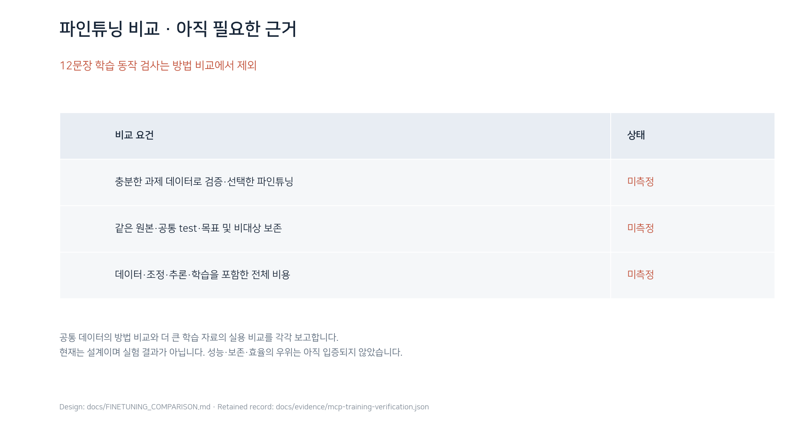

# ForwardEdit 결과와 비교 해설

[프로젝트](../README.ko.md) · [English](RESULTS.md) · [검토 기준](REVIEW_GUIDE.md)

기존 측정치를 설명하는 편집 문서입니다. 새 모델 추론·학습·후보 선택·독립 평가는 실행하지 않습니다. 양성 관측과 실패한 기준을 함께 유지하며, 과거 gradient/optimizer 기록은 현재 무경사 성공 근거에 포함하지 않습니다.

## 어떤 수준에서 성과가 있었는가

| 근거 수준 | 확인한 결과 | 한계 |
|---|---|---|
| 정확한 parameter 반영 | [001 감사](../experiments/direct-values-inference-only-001/host-audit.json): 후보별 6개 값의 수동 계산·저장·로딩 일치, CPU/CUDA 관측 | 두 후보 모두 개발 NLL 악화, 독립 test 없음 |
| 피드백에 근거한 재수정 | [014 감사](../experiments/independent-mcp-014/feedback-flow-audit.json): 부모 관측을 읽은 뒤 3개 값을 복원 | 확인한 후속 수정은 1회이며 보존 기준 실패 |
| 독립 데이터의 고정 원본 대비 점수 상승 | [006 최종 기록](../experiments/extended-discovery-006/study-outcome.json): 정답 18 → 103/192 | 원문 참고 분기, 기존 정답 보존 실패, 최강 무편집 기준선 미측정 |
| 모든 기준을 통과한 모델 채택 | 현재 공개 사례에는 없음 | 도구 통과나 점수 상승만으로는 부족 |

## Qwen 006의 실제 수치



| 독립 평가의 선정 부분집합 | 원본 정답 | 편집 정답 | 정답률 전 → 후 | 차이 |
|---|---:|---:|---:|---:|
| GSM8K, 128문항 | 13 | 76 | 10.1563% → 59.3750% | +49.2188%p |
| MATH-500, 64문항 | 5 | 27 | 7.8125% → 42.1875% | +34.3750%p |
| 합계, 192문항 | 18 | 103 | 9.3750% → 53.6458% | +44.2708%p |

합계 상승의 기록된 97.5% paired 구간은 [+35.9375, +52.6042]%p입니다. 오답→정답 86개, 정답→오답 1개, 정답 유지 17개, 오답/미파싱 유지 88개였습니다. 구제된 86개는 모두 이전에 파싱되지 않은 답변입니다. 모든 파싱 실패를 길이 제한과 동일시하거나 새 수학 지식을 배웠다고 해석하지 않습니다.

기존 정답 손실 **1/18 = 5.5556%**가 [고정 프로토콜](../experiments/extended-discovery-006/artifacts/protocol.json)의 **5%** 한도를 넘었습니다. 전체 192문항을 분모로 사용해 보존 기준을 통과했다고 계산하면 안 됩니다. 전체 채택은 거부됐고 `study_complete`는 false였습니다. 노출된 test로 후보를 재선택하거나 기준을 낮추지 않았습니다.

**저장 값 124,928개 변경**과 **GPU BF16에서 유효한 변경 123,452개**도 구분합니다. 저장 변경률은 기록된 text parameter 752,393,024개의 약 **0.0166041%**입니다. 이 희소성은 수정안을 찾고 평가한 추론·편집기 비용을 포함하지 않습니다.

원래 WSP 개입을 참고한 호스트 분기입니다. 독립적인 재발견, 전체 벤치마크 결과, WSP·파인튜닝·최강 무편집 설정 대비 우위의 근거로 쓰지 않습니다.

## 채택 판정과 망각을 해석하는 법

**측정된 성능 상승과 프로토콜 판정은 다른 질문에 답합니다.** Qwen 006의 고정 원본 대비 정답률 상승은 기록된 성과이며, 원래 거부 판정은 미리 정한 요건을 모두 충족하지 못했다는 뜻입니다. 어느 쪽도 다른 사실을 지우지 않습니다. 실제 용도의 손익 판단은 명시적인 목적과 더 넓은 근거가 필요한 별도 질문입니다.

| 질문 | Qwen 006 관측 | 해석 |
|---|---|---|
| 선정 집합의 정답률이 올랐나? | 정답 18 → 103/192; 새 정답 86개, 손실 1개, 순증 85개 | 고정 원본 대비 상승, 기록된 paired 구간도 양수 |
| 기존 정답을 얼마나 유지했나? | 17/18 = 94.44% 유지, 1/18 = 5.56% 손실 | 같은 집합 안의 보존 측정 |
| 해당 실험의 원래 규칙을 만족했나? | 기존 정답 손실 5% 이하 | 미충족, 원래 판정 유지 |
| 5%가 모든 모델 개선의 보편 기준인가? | 프로토콜은 그런 표준을 입증하지 않음 | 해당 실험의 정책 선택 |
| 관련 없는 다른 능력이 파국적으로 망각됐나? | 광범위한 비대상 과제 비교는 확립되지 않음 | 이 정답 1개 손실만으로 판단 불가 |
| 직접 편집이 파인튜닝보다 더 잘 보존하나? | 동일 조건 보존 비교 없음 | 미입증 |

분모가 중요합니다. `기존 정답 손실률 = 원래 맞혔지만 수정 후 틀린 문항 수 / 원래 맞힌 문항 수`입니다. 기존 정답 18개에서 `0.05 × 18 = 0.9`이므로 정수 손실 수로는 **0개만 허용**됩니다. 1개 손실이 이미 5.56%입니다. 작은 분모에서는 이 고정 규칙이 불연속적이고 엄격합니다. 기록된 프로토콜이 한도를 정했지만, 최적 기준·외부 표준·파인튜닝에 맞춰 조정한 기준임을 입증하지는 않습니다. 기준의 적절성을 논의할 수 있으나 과거 한도를 사후에 바꾸거나 원래 실험이 통과했다고 주장하지는 않습니다.

**파인튜닝에도 망각이 있습니다.** [연속 instruction tuning](https://arxiv.org/abs/2308.08747v5)과 [LoRA 적응](https://arxiv.org/abs/2401.05605)에서도 관측됐고, [LoRA와 전체 파인튜닝 비교](https://arxiv.org/abs/2405.09673v2)는 목표 학습·보존의 절충이 방법에 따라 달라짐을 보고합니다. 이는 양쪽을 대칭적으로 평가할 근거이며, 같은 조건에서 파인튜닝이 ForwardEdit보다 더 많이 망각한다는 증거는 아닙니다.

공정한 비교에서는 두 방법에 같은 목표 성능과 기존 정답 손실 정의를 적용하고, 관련 없는 과제의 보존은 별도로 측정해야 합니다. 상승·회귀·불확실성·자원을 함께 보고합니다. 공통 규칙을 쓴다면 파인튜닝도 그 규칙을 넘을 때 미충족으로 판정해야 합니다. 별도로 남긴 TinyStories 과거 기록에는 두 경로 모두 문항별 paired 기존 정답 손실이 보고되지 않았습니다. 검증 NLL·토큰 정확도로 Qwen 006의 문항별 손실률을 대신 계산할 수 없고, 검증 악화만으로 광범위한 파국적 망각을 입증하지도 못합니다.

따라서 **“정답률 상승과 보존 손실을 함께 관측했으며, 원래 실험의 규칙은 미충족”**이라고 설명해야 합니다. 이를 포괄적인 “성능 개선 실패”로 줄여 표현하지 않습니다. 이 설명 보완은 원래 기록·고정 판정·독립 test 선택을 바꾸지 않습니다.

## 파인튜닝 참고 비교

**방법 비교에서 제외합니다.** 과거 AdamW 검사는 학습 12문장·target token 319개만 사용했습니다. 학습 손실 감소와 검증 악화는 해당 설정의 과적합과 일치합니다. 그러나 데이터 양의 효과를 학습률·갱신 횟수·학습 범위·선행 패치와 분리하지 않았습니다. 충분한 데이터로 제대로 조정한 파인튜닝을 대표하거나 직접 편집의 우위를 뒷받침할 수 없습니다.

아래 측정치는 학습 동작 확인의 독립적인 기록으로 남기며 LLM 후보와 나란히 비교하지 않습니다.

| 과거 TinyStories 검사 | 학습 전 | 학습 후 |
|---|---:|---:|
| 학습 NLL | 2.454778 | 0.479708 |
| 학습 토큰 정확도 | 41.6928% | 93.1034% |
| 검증 NLL | 2.925349 | 4.549406 |
| 검증 토큰 정확도 | 38.5621% | 24.5098% |

[원시 JSON](evidence/mcp-training-verification.json)과 [범위 설명](MCP_TRAINING_VERIFICATION.md): AdamW, 학습률 0.003, weight decay 0, 30회 갱신, 512개 값의 rank-one 패치 후 16,384개 원소의 한 행렬 전체를 학습했습니다. 검증은 12문장·target token 306개입니다. 독립 test·문항별 기존 정답 보존·광범위한 보존은 평가하지 않았습니다. 당시 `passed`는 학습·저장 동작 확인만 의미합니다. 원본 자료와 실패 결과는 그대로 보존하며 gradient·optimizer 기록은 무경사 성공 근거에서 제외합니다.

[직접 값 수정 001 감사](../experiments/direct-values-inference-only-001/host-audit.json)는 별도 근거로 유지합니다. 6개 값을 바꾼 두 후보 모두 개발 NLL 기준에서 실패했고 독립 test 후보로 선택되지 않았습니다. 파인튜닝을 성공적으로 대체했다는 결과가 아닙니다.

유효한 비교에는 **충분한 과제 관련 데이터의 파인튜닝, 검증에 따른 설정·체크포인트 선택, 공통 독립 평가**가 필요합니다. [비교 설계](FINETUNING_COMPARISON.ko.md)에 공통 데이터 비교와 더 큰 데이터의 실용 비교를 정리했습니다. 그런 비교 결과는 현재 없습니다.



## 효율과 공정한 비교

수정 원소가 적다는 사실은 수정안을 발견한 비용을 측정하지 않습니다. 기록에는 방법 간 시간, 대상 모델의 총 추론, 편집기 토큰, GPU 예약, 에너지, 하이퍼파라미터 탐색과 엔지니어링 시간을 맞춘 비교가 없습니다. 속도·금액·에너지 우위는 입증되지 않았습니다.

앞으로 공정하게 비교하려면 동일 원본과 입력 바이트, 각 방법의 관측·튜닝 예산을 묶고 개발/검증에서 선택을 고정한 뒤 같은 decoding으로 독립 품질·기존 정답 보존·불확실성·전체 자원을 확인해야 합니다. 가장 강하게 측정한 무편집·프롬프트·decoding·런타임 제어 기준선도 필요합니다. 이는 미측정 근거의 설명이며 학습을 실행하거나 노출된 test를 다시 열라는 지시가 아닙니다.

## 함께 남기는 음성 결과

| 사례 | 독립 측정치 | 판정 |
|---|---|---|
| [TinyStories 004](../experiments/skill-edit-experiment-004/README.md), 64문장 | 반복률 7.2791% → 7.0812%; 감소의 95% 구간 [-2.9104, +3.2062]%p | 거부, 구간이 0 포함 |
| [TinyStories 005](../experiments/failure-repair-005/README.md), 128문장 | 반복률 6.0597% → 6.5118%; 감소의 95% 구간 [-2.5611, +1.6950]%p | 거부 |
| [MCP 009–014](../experiments/independent-mcp-014/README.md), 192문항 | 정답 25 → 22; 차이 -1.5625%p, 97.5% 구간 [-7.8125, +4.6875]%p; 기존 정답 16/25개 손실 | 거부 |

모집단과 프로토콜이 달라 성공률로 합치거나 편집기·제공사 순위를 매기지 않습니다.

## 그림의 출처와 재사용

`docs/assets/results/`에 Qwen 측정 그림과 파인튜닝 비교 설계 그림의 영문·한글 PNG와 SVG가 있습니다. [그림 데이터](assets/results/figure-data.json)에 선택한 원래 값과 출처 보고서의 SHA-256을 기록합니다. Matplotlib이 설치된 환경에서 다음과 같이 다시 그릴 수 있습니다.

```bash
python3 scripts/build_readme_figures.py
python3 scripts/verify_public_evidence.py
```

첫 명령은 기존 JSON을 읽어 정적인 그림만 그립니다. 체크포인트 로딩, 보관 코드 실행, 통계 재피팅을 하지 않습니다. 두 번째 명령은 공개 증거의 바이트와 형식을 확인하며 성능을 인증하지 않습니다. 원래 실험 산출물과 과거 해시는 바꾸지 않았습니다.

## 이후의 교차 태스크 연구 (미포함)

이후 연구 시리즈(2026-11-08 ~ 11-22)는 수학 외 여러 태스크와 Qwen3.5-2B/4B를 가장 강한 무편집 기준선 및 호스트 전용 LoRA 참고와 비교했습니다. 산출물은 포함하지 않았으며, 범위, 결과, 실패 결과, 미대응 비판은 [교차 태스크 연구 요약](CROSS_TASK_STUDY_1122.ko.md)을 참고하세요.

## Unaddressed criticisms / 미대응 비판

동일 조건에서 조정한 파인튜닝 및 최강 무편집 기준선이 없습니다. 원문 지식, 선정 부분집합, 보존 실패, 작은 표본, 불완전한 재현 자료가 한계입니다. 미파싱 답변 구제는 새 수학 지식이나 유일한 인과 회로의 근거가 아닙니다. 전체 효율은 미측정입니다. README·그림·영상 발췌에도 이 한계를 동일하게 적용합니다.
