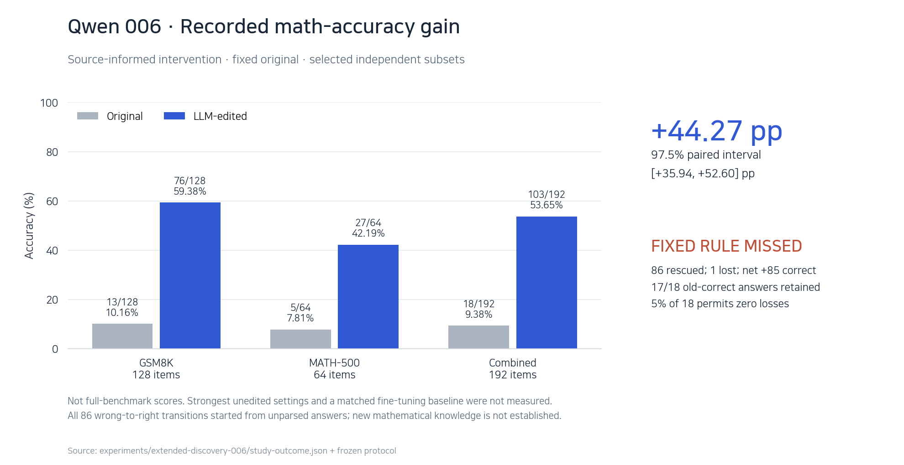
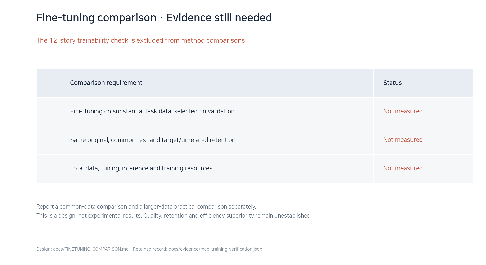

# ForwardEdit results and comparison notes

[Project](../README.md) · [한국어](RESULTS.ko.md) · [Review criteria](REVIEW_GUIDE.md)

This is an editorial guide to retained measurements. It performs no new model experiment, training, selection or independent evaluation. Positive observations retain their original failed gates. Historical training records remain excluded from inference-only success claims.

## What succeeded at each evidence level

| Evidence level | Recorded outcome | Boundary |
|---|---|---|
| Exact parameter application | [001 audit](../experiments/direct-values-inference-only-001/host-audit.json): two six-value edits, exact manual/storage/loaded values, CPU/CUDA observations | Both development NLL comparisons worsened; no held-out test |
| Feedback-dependent revision | [014 audit](../experiments/independent-mcp-014/feedback-flow-audit.json): parent observations were read before restoring three entries | One verified revision, not a long improvement loop; preservation failed |
| Independent fixed-original score gain | [006 outcome](../experiments/extended-discovery-006/study-outcome.json): 18 → 103/192 correct | Source-informed branch; conditional answer-preservation gate failed; strongest unedited baseline not measured |
| Fully accepted model improvement | None among the bundled studies | A passing tool test or a better point estimate is insufficient |

## Qwen 006 in numbers



| Selected independent subset | Original | Edited | Accuracy before → after | Change |
|---|---:|---:|---:|---:|
| GSM8K, 128 items | 13 | 76 | 10.1563% → 59.3750% | +49.2188 pp |
| MATH-500, 64 items | 5 | 27 | 7.8125% → 42.1875% | +34.3750 pp |
| Combined, 192 items | 18 | 103 | 9.3750% → 53.6458% | +44.2708 pp |

The retained 97.5% paired interval for the combined gain is [+35.9375, +52.6042] pp. There were 86 wrong-to-right changes, one right-to-wrong change, 17 retained correct answers and 88 answers that remained incorrect/unparsed. All 86 rescues came from previously unparsed answers. The retained analysis does not equate every parsing failure with truncation or demonstrate newly acquired mathematics.

One originally correct answer was lost: **1/18 = 5.5556%**, exceeding the **5%** limit in the [frozen protocol](../experiments/extended-discovery-006/artifacts/protocol.json). Losing 1/192 of the full set is not the relevant preservation denominator. Overall adoption was rejected; `study_complete` remained false. No threshold was relaxed and no candidate was reselected on the exposed test.

The record distinguishes **124,928 stored changed values** from **123,452 changes effective at GPU BF16 precision**. Stored changes were about **0.0166041%** of the recorded 752,393,024 text parameters. This footprint does not include the inference/editor resources needed to design and evaluate the patch.

The source WSP work informed the host branch. This is not blind rediscovery, a full-benchmark result or a comparison against WSP, fine-tuning or the strongest applicable unedited configuration.

## Interpreting adoption and forgetting

**A measured gain and a protocol decision answer different questions.** The fixed-original accuracy gain in Qwen 006 is recorded; the original rejection records a failure to meet every prespecified requirement. Neither statement cancels the other. A deployment trade-off is a third question, requiring an explicit application objective and broader evidence.

| Question | Qwen 006 observation | Interpretation |
|---|---|---|
| Did accuracy rise on this selected set? | 18 → 103/192; 86 rescues, one regression; net +85 | Yes, against the fixed original; retained paired interval is positive |
| How much of the old-correct subset was retained? | 17/18 = 94.44% retained; 1/18 = 5.56% lost | A within-set retention measurement |
| Did it meet this study's original rule? | At most 5% old-correct loss | No; the original decision remains unchanged |
| Is 5% a universal standard for model improvement? | No such standard is established by the protocol | A study-specific policy choice |
| Did unrelated capabilities catastrophically degrade? | A broad unrelated-task comparison is not established | Not determined by this one within-set regression |
| Does direct editing retain more than fine-tuning? | No matched retention comparison | Not established |

The denominator matters: `old_correct_loss = original-correct answers made wrong / original-correct answers`. With 18 originally correct items, `0.05 × 18 = 0.9`; integer counts therefore allow **zero** losses. One loss is already 5.56%. This makes the fixed rule coarse and strict for this small denominator. The retained protocol supplies the threshold; it does not demonstrate that it is optimal, an external standard or calibrated against fine-tuning. Its suitability can be discussed without retroactively changing the threshold or claiming the old study passed.

**Forgetting also affects fine-tuning.** It has been observed in [continual instruction tuning](https://arxiv.org/abs/2308.08747v5) and [LoRA adaptation](https://arxiv.org/abs/2401.05605). [LoRA/full-fine-tuning comparisons](https://arxiv.org/abs/2405.09673v2) also find different target-learning/retention trade-offs. These findings motivate evaluating both methods symmetrically; they do not establish that fine-tuning forgets more than ForwardEdit under the same conditions.

For a fair comparison, apply the same target-task quality measure and old-correct retention definition to both methods, and separately measure unrelated-task retention. Report gain, regressions, uncertainty and resources together. If a common rule were used, a fine-tuned model that exceeded that rule would fail it too. In the separate historical TinyStories records, paired original-correct item loss was not reported for either method; aggregate validation NLL/token accuracy cannot be substituted for Qwen 006's item-level metric. Validation deterioration alone also does not establish broad catastrophic forgetting.

Current wording should therefore communicate **“accuracy gain with a measured retention trade-off; original study rule not met”**, rather than a blanket claim that editing failed to improve performance. No historical source, frozen decision or independent-test selection is changed by this clarification.

## Fine-tuning reference comparison

**Excluded from method comparisons:** the historical AdamW check used only 12 training stories / 319 target tokens. Its sharply lower training loss and worse validation are consistent with overfitting in that configuration. The report does not isolate the effect of data size from learning rate, update count, trainable scope or the preceding patch. It cannot represent properly tuned fine-tuning on substantial data, or establish a direct-edit advantage.

The measurements below are retained as a standalone trainability record, not a comparison with the LLM candidates.

| Historical TinyStories check | Before training | After training |
|---|---:|---:|
| Training NLL | 2.454778 | 0.479708 |
| Training token accuracy | 41.6928% | 93.1034% |
| Validation NLL | 2.925349 | 4.549406 |
| Validation token accuracy | 38.5621% | 24.5098% |

[Original JSON](evidence/mcp-training-verification.json) and [scope note](MCP_TRAINING_VERIFICATION.md): AdamW, learning rate 0.003, weight decay 0, 30 updates, one 16,384-entry matrix trainable after a 512-entry rank-one patch. Validation used 12 stories / 306 target tokens. There was no independent test, paired old-correct retention or broad preservation evaluation. The historical `passed` field certifies plumbing/trainability only. The source artifact and failed outcome are unchanged; gradients/optimizer history is excluded from inference-only success evidence.

The [direct-value 001 audit](../experiments/direct-values-inference-only-001/host-audit.json) remains separate evidence: two six-value candidates, both failing the development NLL criterion, neither selected for independent test. It is not a successful alternative to fine-tuning.

A useful comparison requires **fine-tuning on substantial task-relevant data, validation-based configuration and checkpoint selection, and common independent evaluation**. See the [comparison design](FINETUNING_COMPARISON.md) for common-data and larger-data practical comparisons. No such result is currently available.



## Efficiency and a fair comparison

The recorded direct patches are sparse. Sparse output alone does not measure the cost of discovering the edit. The retained comparison does not match wall time, total target-model inference, editor tokens, GPU reservation time, energy, hyperparameter search or engineering time across methods. No speedup, dollar saving or energy advantage is established.

A convincing future comparison would bind the same source model and input bytes; document each method's permitted observations and tuning budget; freeze selection on development/validation; and evaluate quality, originally-correct preservation, uncertainty and end-to-end resources under the same decoding conditions. The strongest measured unedited/prompt/decoding/steering baseline must be reported as well. This describes missing evidence; it is not a request to run training or reopen exposed tests.

## Negative results retained

| Study | Recorded independent outcome | Adoption |
|---|---|---|
| [TinyStories 004](../experiments/skill-edit-experiment-004/README.md), 64 stories | Repetition 7.2791% → 7.0812%; reduction 95% interval [-2.9104, +3.2062] pp | Rejected; interval includes zero |
| [TinyStories 005](../experiments/failure-repair-005/README.md), 128 stories | Repetition 6.0597% → 6.5118%; reduction 95% interval [-2.5611, +1.6950] pp | Rejected |
| [MCP 009–014](../experiments/independent-mcp-014/README.md), 192 problems | Correct 25 → 22; accuracy gain -1.5625 pp, 97.5% interval [-7.8125, +4.6875] pp; 16/25 old-correct answers lost | Rejected |

These studies have different populations and protocols. They are not pooled into a success rate or ranked as editor/provider trials.

## Figure provenance and reuse

The Qwen measurement figure and the comparison-design figure have English and Korean PNG/SVG versions in `docs/assets/results/`. [Figure data](assets/results/figure-data.json) contains the selected original values and SHA-256 of the source reports. With Matplotlib installed, rebuild using:

```bash
python3 scripts/build_readme_figures.py
python3 scripts/verify_public_evidence.py
```

The first command reads retained JSON and draws static figures. It never loads checkpoints, executes archived code or refits statistics. The second checks the existing public evidence bundle; it is not a performance certificate. Original experiment artifacts and their historical digests remain unchanged.

## Later cross-task study (not bundled)

A later series (2026-11-08 to 11-22) tested many non-math tasks, plus Qwen3.5-2B/4B, against the strongest unedited baselines and a host-only LoRA reference. Its artifacts are not bundled; see the [cross-task study summary](CROSS_TASK_STUDY_1122.md) for scope, results, negative results and open criticisms.

## Unaddressed criticisms / 미대응 비판

There is no matched, tuned fine-tuning comparison or strongest applicable unedited baseline. Original source knowledge, selected subsets, preservation failures, small samples and incomplete replay assets limit the conclusions. Qwen rescues from unparsed answers do not establish new mathematical knowledge or a unique causal circuit. End-to-end efficiency remains unmeasured. These limitations apply to figures, README summaries and video excerpts alike.
