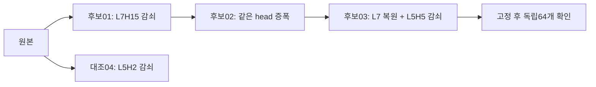

# 새 스킬·MCP의 실제 편집과 독립 성능 확인

> 과거 실행·조사 기록입니다. 본문의 테스트 수·버전·지원 범위는 당시 상태이며 현재 릴리스와 다를 수 있습니다. [공개 사례와 발췌 로그](../experiments/README.md), [현재 구조](../DESIGN.md)를 함께 참고하세요. 공개하지 않은 `runs/` 자료는 로컬 전용으로 표시했습니다. Gradient/optimizer 이력은 현재 방식의 성공 근거에서 제외합니다.

2026-11-04. **파라미터 저장·실제 모델 반영·누적 편집은 확인했다. 독립 데이터에서 성능 개선은 입증하지 못했다.** 모델 채택은 false, 원본 유지다. gradient/optimizer 파인튜닝을 실행한 것은 아니며, 사용자 조건에 따른 LLM의 직접 weight 편집을 시험했다.

## 모델과 데이터

pretrained TinyStories-1M의 원본에서 시작했다. 실제 저장 parameter는 3,745,984개, 추론은 FP32였다. source SHA-256은 `fdb05ba2a15f0439691a37e2708b1a7f7560ee55b885b41a2fe65edb0c0c71d1`이다. 이전 모델 실험들은 종료된 상태를 유지했다.

[공식 TinyStories 데이터](https://huggingface.co/datasets/roneneldan/TinyStories)의 validation 파일을 고정 revision `f54c09fd23315a6f9c86f9dc80f725de7d8f9c64`에서 읽었다. 무작위 source 순서(seed 2026110404)로 중복 없는 완전한 이야기 중 길이 96..240토큰인 128개를 골랐다. 모델 점수로 데이터를 고르지 않았다. 분석 32개, 후보 선택 32개, host-only 독립 확인 64개로 나눴다. [출처·다운로드 hash](../experiments/skill-edit-experiment-004/data-provenance.json)를 보존했다. 이 분리는 편집 실험에 대한 독립성이고, pretrained 모델이 과거에 이 문장을 보지 않았다는 보증은 아니다.

이야기의 첫 24토큰을 생성 prompt로 사용했다. 최대 128개 새 토큰, CUDA greedy, EOS 종료와 KV cache를 원본/후보 모두 동일하게 유지했다. 반복률은 생성 부분의 중복 8-gram 비율을 문장별 평균한 값이다. EOS와 그 뒤는 제외한다. 정상 예측은 완전한 reference 이야기의 teacher-forced NLL·top-1 accuracy로 평가했다.

[protocol](../experiments/skill-edit-experiment-004/protocol.json)은 첫 모델 실행 전에 고정했다. 채택에는 validation과 독립 확인 모두 반복률 2%p 이상 감소, 정상 NLL 증가 0.02 이하, accuracy 하락 1%p 이하, 짧은 출력 비율 증가 5%p 이하, 중앙 길이 `min(32, 0.75×원본 중앙값)` 이상이 필요했다. 독립 확인에서는 paired bootstrap 2000회(seed17)의 반복 감소 95% 구간 하한도 0보다 커야 했다.

## 실제 편집 반복

Codex 호스트가 데이터·원본·검증기를 준비했고, loop-engineering의 Claude Opus 5.5가 새 스킬/MCP로 관측하고 대상·계수·새 값을 판단했다. Claude 모델 실행은 1회, 실제 primary 편집은 3회, 별도 대조 편집은 1회였다. forward 요청 26회를 포함한 worker 도구 요청 36개를 [events](../experiments/skill-edit-experiment-004/events.json)와 untruncated receipts.jsonl에 보존했다. 한 요청 안에는 여러 실제 forward가 있으므로 이를 ‘26번 학습’으로 해석하지 않는다.

1. discovery에서 copy 위치와 가까운 fresh 위치의 활성값을 비교했다. 이는 reference 글 안의 단어쌍/이어지는 토큰 재등장 여부로 정한 관측이며, 병적 반복 전용 회로라는 증거는 아니다. 후보 L7H15에 대한 원본 분석과 `prepare_edit_proposal`은 ready_for_causal_probe였다. 로컬 정상 변화 한도는 관측한 값 이후 정했으며 독립 보존 증거로 취급하지 않는다.
2. 후보01은 layer7 head15 출력의 64×4개 값을 원본의 0.7배로 했다. 반복이 증가해 처음 가설이 반증됐다.
3. 후보02는 실제 후보01을 parent로 `revise_candidate`를 사용해 같은 값을 원본의 1.3배로 했다. 반대 방향도 원본보다 반복이 많아 이 head의 단순 복사 역할 가설을 유지하지 않았다.
4. 후보03은 후보02를 parent로 두고 L7 변경을 정확히 복원했다. 대신 layer5 head5의 64×4개 값을 0.5배로 했다. 대상과 계수는 discovery의 일관된 활성 대비와 source tensor L2 예산으로 판단했다. 점수에 맞춘 자동 fitting이나 strength sweep은 없었다.
5. 후보03을 개발 데이터에서 선택한 뒤, 별도 source 분기로 대조04를 실행했다. 비슷한 norm이지만 copy/fresh 대비가 약한 L5H2를 0.5배로 했다. 정확히 norm을 맞춘 대조는 아니며 크기가 유사한 한 개의 대조다. 그 결과로 고정 후보를 바꾸지 않았다.

| 후보 | validation 반복률 ↓ | reference NLL ↓ | 판정 |
|---|---:|---:|---|
| 원본 | 6.926% | 2.30389 | 기준선 |
| 01: L7H15 감쇠 | 10.266% | 2.30770 | 실패 |
| 02: L7H15 증폭 | 8.311% | 2.30670 | 실패 |
| 03: L7 복원 + L5H5 감쇠 | 4.644% | 2.31372 | 개발 기준 통과 |
| 04: 별도 L5H2 대조 | 약 7.2% | 약 2.3224 | 실패 |

후보03의 개발 반복 감소 2.282%p는 일부 이야기의 큰 개선에 집중됐다. 새 반복도 나타나 독립 확인 전에 개선을 확정하지 않았다. [iterations](../experiments/skill-edit-experiment-004/iterations.json)에 가설·수치 근거·예측·반증·관측을 연결했다. 위 head 이름은 0부터 세는 index다.

## 실제 parameter 업데이트 확인

`revise_candidate`를 통한 실제 parent 체인은 01→02→03이다. 후보03의 원본 대비 최종 변경은 `transformer.h.5.attn.attention.out_proj.weight`의 행 0..63, 열 20..23, **256개 값(전체 약 0.0068%)**이다. L7의 이전 256개 변경은 원본 값으로 복원됐다. 원본 checkpoint는 덮어쓰지 않았다.

실제 값 예:

| 좌표 | 원본 | 최종 후보 |
|---|---:|---:|
| [0,20] | -0.0338795371 | -0.0169397686 |
| [0,21] | 0.00684179459 | 0.00342089729 |

각 후보를 실제 inference adapter에 적용해 내부 출력과 최종 token 확률을 관측했다. 독립 native 검증에서는 최종 모델을 새로 로딩해 실제 parameter 값이 patch와 정확히 같은지 확인했다. 단순히 파일 hash가 달라졌다는 검사가 아니다. [호스트 감사](../experiments/skill-edit-experiment-004/host-audit.json)는 전체 overlay 재계산과 parent의 재수정·복원·신규 값을 확인한다.

훈련·backward·autograd·optimizer·numerical gradient·자동 loss fitting은 실행하지 않았다. 모델 실행과 업데이트는 MCP 도구를 사용했고, 모델 실행 subprocess에 training tripwire를 적용했다. GPU는 frozen 추론에 사용했다.

## 고정 후 독립 확인: 64개 이야기

후보03의 실제 patch hash `0f4923a3c5d32bd0476f13614b5c24e7d8b8e10579505f8ef45e195ae3c84757`를 [frozen-choice](../experiments/skill-edit-experiment-004/frozen-choice.json)에 고정하고 native 모델 작업을 종료했다. 이후에만 별도 데이터 64개를 열어 원본과 후보를 비교했다. 생성 16회와 reference 확인 1회, 총 17개 host 도구 요청을 모두 완료했다. test 결과 이후 후보·값·기준을 변경하거나 차점 후보를 평가하지 않았다.

| 독립 평가 | 원본 | 수정 후보 |
|---|---:|---:|
| 반복률 ↓ | 7.279% | 7.081% |
| 정상 reference NLL ↓ | 2.157865 | 2.164254 |
| reference accuracy ↑ | 51.191% | 51.073% |
| 중앙 생성 길이 | 128 | 128 |

평균 반복 감소는 **0.198%p**, paired 95% 구간은 **[-2.910, 3.206]%p**다. 최소 감소 2%p와 양의 신뢰구간 조건을 모두 실패했다. NLL 증가 +0.006389, accuracy 변화 -0.118%p는 보존 한도 안이지만 실제 정상 예측 수치는 약간 악화했다.

반복 지표가 좋아진 이야기는 25개, 나빠진 이야기는 26개, 같은 것은 13개였다. 일부 개선 사례도 기존 문장 반복이 다른 문장 반복으로 바뀌는 수준이었다. [대표 원본/후보 생성](../experiments/skill-edit-experiment-004/qualitative-examples.json)을 보존했다. 반복 지표 감소를 문장 품질 개선으로 자동 해석할 수 없다.

최종 [heldout-result](../experiments/skill-edit-experiment-004/heldout-result.json)의 **adoption_passed=false**다. 개발 데이터의 개선은 관측됐지만 독립 데이터에서 일반화된 성능 개선이나 파인튜닝 성공은 입증하지 못했다. 이 결과가 모든 모델에서 gradient-free 편집이 불가능하다는 뜻은 아니다.

## 실행 검증과 한계

이번에는 처음부터 보호된 verifier와 requirement별 case mapping을 선언했다. 유효한 원본/개선 fixture를 허용하고, 고정 데이터 1byte 변경·identity를 개선으로 주장·NLL 손상·짧은 EOS 출력은 거부하는 로컬 대조도 확인했다. 대조 fixture의 통과를 실제 모델 성능 증거로 사용하지 않는다.

native 서비스가 실제 current artifact에서 다음 **4개 command, 8개 case**를 실행해 모두 통과했다.

- source/config/protocol/data/도구 구현 hash와 제한된 frozen 추론 기록
- 실제 관측한 parent의 연속 수정과 새로 로딩한 모델의 parameter 값
- 첫 편집 전 proposal과 모든 후보의 수정 후 내부 관측
- 전체 후보의 개발 지표·gate 재계산과 새 CPU reference 측정

[loop-result](../experiments/skill-edit-experiment-004/loop-result.json)의 실행 영수증에 각 requirement의 check_id/evidence_id가 결합돼 있다. native 상태 succeeded는 실험 수행·검증의 완료이며, host review가 개입해 verified:false로 남는다. **실험 파이프라인 검증 통과와 성능 채택 실패는 서로 다른 결과다.** 이전 실험의 승인 미완료 상태를 바꾸거나 기존 루프를 재개하지 않았다.

가중치의 의미 역할과 완전한 회로 인과는 확인하지 못했다. 일부 reference copy 위치를 실패와 연결한 초기 가설도 개발 가설이다. trace의 연결은 부분 관측이고, 고정 greedy 128토큰·작은 데이터·한 모델에 한정된다. 프로젝트 도구의 기존 87개 테스트 통과는 별도 소프트웨어 검증이며 학습 성공 증거가 아니다. [verification-summary](../experiments/skill-edit-experiment-004/verification-summary.json)에 이번 실행·성능 결론을 분리해 저장했다.
