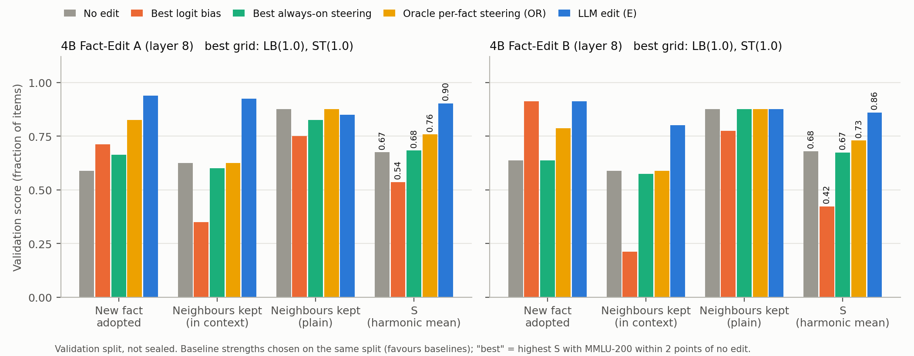
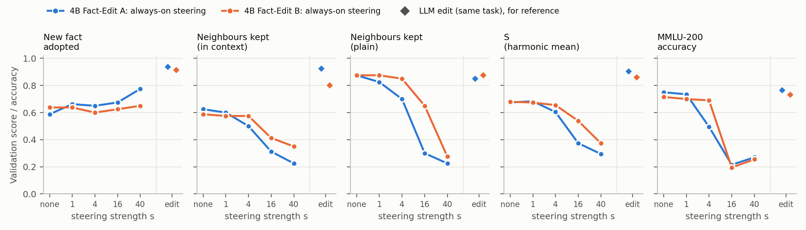
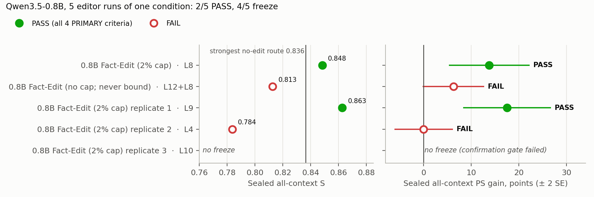
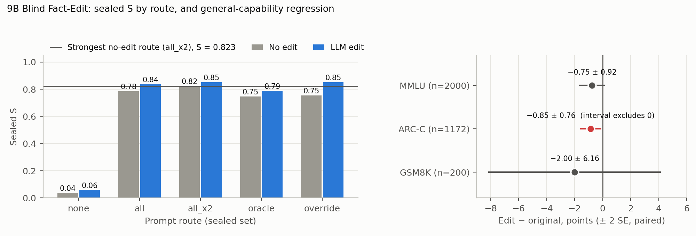
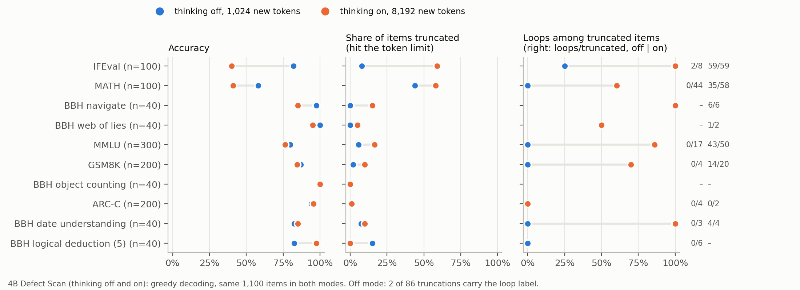

# Where LLM-Written Weight Edits Stand: Pre-Registered Comparisons with Prompting, Steering and Fitted Editors

**Status.** Revised working draft (v2.2), 2026-11-25; v2.1 (2026-11-24) followed an independent review (`review_v2.md`; the change log is at the end of that file). The pre-review text is kept unchanged as `manuscript_v2_pre_review.md`, and the cross-task draft of 2026-11-23 (`manuscript.md`) is also kept unchanged. Numbers come from a host-held evidence ledger that traces each value to a raw result file. **The run artifacts are not bundled in this repository** (Section 9). Values marked † come from the 2026-11-23 draft, where they were taken from host evaluation files, and were not re-traced in the 2026-11-24 ledger. Values marked ‡ appear only in a host summary or analysis document, or in an editor notebook record, and have no raw JSON result. Results marked ◊ are **pending** a control declared in Section 3.8. The controls for 4B Fact-Edit A and 4B Fact-Edit B ran on 2026-11-25 (extended-grid ladder, specificity controls, E_qonly, oracle-position controls, a one-shot sealed ladder and an overlap-free re-scoring), and their markers are resolved in this revision. The 4B defect-audit decoding comparison is now final. ◊ remains on: (i) sealed values of 4B Fact-Edit (no-context design), 9B Blind Fact-Edit and the 0.8B cap study, which have not been re-scored without overlapping items; (ii) the oracle-route sealed values of 4B Fact-Edit A and 4B Fact-Edit B, which the re-scoring summary does not report; and (iii) the specificity controls on the 0.8B patches, which have not been run. These results are reported as measured, and their interpretation may change. Experiments are referred to by readable names; Appendix C maps each name to the internal identifier used in the evidence ledger (glossary: `docs/EXPERIMENT_NAMES.md`).

## Abstract

Weight-Space Programming (WSP) lets a frontier LLM write another network's weights; critics argue its gains amount to removing decoding pathologies or to steering. Under an inference-only contract (no backward pass, optimizer or solver), an LLM editor (Claude Opus) edited Qwen3.5 models. We ask how such edits compare with the alternatives, and what kind of change they are. We read results at three tiers. The primary tier compares the original and edited model under the same deployment settings, and the edit with other weight-modification methods (LoRA, ROME, MEMIT). The second tier compares edit plus the strongest inference-time method with that method alone. Inference-time-only methods (prompting, steering, budget forcing) are a third, reference tier. The tiers were adopted after most results were known; pre-registered verdicts are quoted unchanged.

We contribute a pre-registration protocol with four data roles: discovery, validation, confirmation and sealed. On two 4B CounterFact arms run with recipe notes from earlier sessions, and with facts in context, a post-hoc host analysis on the validation split (on which the edits were also selected) found that the frozen edits make large writes at the edited layer mainly at subject tokens. They are not sparse. On 1,000 generic MMLU questions, the edit changes the layer output by more than 1% at 99% of tokens, and by more than 5% at only 2.1% and 1.5% of tokens. It makes a small change almost everywhere and a large change rarely. Their validation S (.903 and .860) exceeded every strength of a global logit bias and of always-on steering, on a grid extended down to 0.0625. No baseline beat the unedited model (.675 and .680) by more than .01. Random, permuted and sign-flipped values on the same neurons scored far below the edit in S. By the pre-declared rule the edit is only partially specific: the strongest control reached 36–39% of the edit's PS gain. Controls declared before running then compared the edit with oracle steering that writes each fact's vector at every subject mention. The two were statistically indistinguishable (sealed S .920 vs .918 and .897 vs .908). The edit thus moves per-fact writes at subject mentions into the weights without position labels; it does not exceed that oracle. With the 40 efficacy prompts removed, the sealed criterion-1 margins of the all-context route stayed above zero: +.173 [.111, .240] and +.125 [.067, .182]. The no-context route of the same edits was not robust. At the primary tier the edit loses: without context, it (sealed S .682◊) scores below host-only ROME (.806), MEMIT (.897, from a log) and LoRA (.898), and below the strongest prompt (.763). In greedy 8-token generation on the validation split with no context, the no-context edit began with the new object on 2.5% of prompts, against 26% for MEMIT and 29% for ROME. Under this prefix-match metric, the unedited model begins with its own true object on only 6–9% of prompts.

The two 4B edits that passed were made with recipe notes from earlier sessions. Blind runs produced no sealed result at 4B (0/2 froze) and passed 2 of 5 at 0.8B (2 of 4 in the strictly pre-registered capped condition), each on a different layer, with criterion-1 margins below one standard error. At 9B (nf4, with edited linears in bf16), the first 9B freeze passed three sealed criteria but failed regression (ARC −0.85 ± 0.38). By CounterFact design the sealed efficacy prompts are also edit-construction prompts, and a few sealed neighbourhood prompts overlap development splits. Only the two 4B recipe-informed arms have been re-scored without these items. A defect audit of the 4B model under greedy thinking-mode decoding, which the model card advises against, found that 162 of 201 truncations are repetition loops. In a pre-declared comparison, greedy decoding with presence penalty 1.5 was chosen on one half of the items and run once on the other half. Accuracy rose from .775 to .862 and truncation fell from 18.5% to 8.0%. This decoding is the tier-1 baseline for any 4B loop edit. On sealed IFEval at 0.8B, a rank-1 loop-repair edit raised thinking-mode accuracy under the recommended sampling from 20.8% to 65.6% (+44.8 ± 3.9). It scored 52.5% with thinking off, against 57.9% for the original. Alone it approaches budget forcing on the original (66.1–70.1%), and combined with budget forcing it scored 4–6 points below budget forcing alone. It moves loop-stopping into the weights; it is error repair, not a capability gain. We report every failed gate. The edit's possible value lies in its small footprint, not in its accuracy; we have not measured whether it is easier to audit.

## 1. Introduction

Weight-Space Programming (WSP) [@takehi2026wsp] proposed that a frontier LLM can inspect a neural network and write its parameters directly, without an optimizer. Follow-up work reported large gains from very localized edits to small Qwen models [@hu2026wspscope]. These demonstrations prompted two strong critiques [@hn2026wspthread; @honnibal2026misleading; @wang2026closerlook; @barry2026lp]:

- **(A) Steering.** The edits are steering vectors, abliteration or logit bias in another form.
- **(B) Pathology removal.** The headline math gains come from removing thinking-mode repetition loops. A thinking-off baseline recovers most of them.

Our earlier cross-task series (Section 4.1) addressed critique (B). On WSP-Scope's own IFEval test split, turning thinking off with no edit recovered about 95% of the reported gain (56.1% vs 58.1%)†. On every skill-type task where an edit passed its sealed test, a thinking or brief chain-of-thought (CoT) prompt beat the edit (6/6)†. Critique (A) had not been tested, and neither the comparison with training- or solver-based knowledge editors nor run-to-run variance had been measured. A direction review on 2026-11-23 narrowed the question to:

> In a resource-limited setting, where do *gated*, LLM-chosen, inference-only edits stand against logit bias, steering, prompting and training/solver-based editors, and how reproducible are they?

This paper reports the answer, including every failed gate.

That question placed prompting and steering beside fitted editors as equal comparators. After most results were in, we adopted a three-tier reading (Section 3.9). The main comparator for any claim is now tier 1: the original model under the same deployment settings (the vendor-recommended decoding for the mode), other weight-modification methods (LoRA, ROME, MEMIT), and every usage mode. Prompting, steering and budget forcing enter as tier 2 (edit plus the method against the method alone) and tier 3 (reference). On tier 1 the knowledge edit loses clearly: with no context, LoRA (.898) and MEMIT (.897) beat it (.682◊). The context routes of the knowledge edits are tier-2 tests (edit plus new facts in context against context alone). At 9B, the edit raised sealed all-ctx S from .784 to .836, and beat the strongest no-edit route (.823), but failed regression (Section 4.5).

**Contributions.**

1. **Protocol.** We describe a pre-registration protocol for inference-only LLM weight editing with four data roles: *discovery*, *validation*, *confirmation* and *sealed*. Tool-side guards enforce it: a reserve guard, a one-shot confirmation gate, a cap on dose variants, and quantized loading that keeps edited tensors exact (Section 3).
2. **Locality of the edits (post hoc, with pre-declared controls).** For two recipe-informed 4B CounterFact arms, the frozen edits are subject-selective in their large writes but not sparse: they change the edited layer's output slightly at almost every token (Section 4.2). They outscored logit bias and always-on steering at every strength of a grid extended down to 0.0625. Random, permuted and sign-flipped values fell far below the edit in S, though the strongest control reached 36–39% of the edit's PS gain (partially specific). The edit matched, but did not exceed, oracle steering that writes each fact's vector at every subject mention, including mentions in the context. Removing the edit's effect at context positions cut validation S from .903 to .741 and from .860 to .715. A sealed ladder was run once. It is post hoc relative to the original arms but was declared before it ran (Sections 3.8 and 4.2).
3. **Honest comparison with training- and solver-based editors (tier 1).** On no-context insertion, host-only MEMIT, ROME and LoRA comparators beat the LLM edit. Generation-based evaluation widens the gap (Section 4.3).
4. **Run-to-run variance.** Five blind editor runs at 0.8B passed 2 of 5, each on a different layer. Strictly, four of them share the pre-registered condition, and 2 of those 4 passed; pooling the fifth was decided after the results. Both passes cleared criterion 1 by less than one standard error. Results of this kind must be reported as pass rates and distributions (Section 4.4).
5. **Scale.** At Qwen3.5-9B (nf4, with edited linears patched in bf16), the first 9B freeze, under the four-role split, passed sealed criteria 1–3 and failed the regression criterion. We also report a quantization survival check, and feasibility (not edits) for a 27B dense model and a 36B MoE model on one 24 GB GPU (Section 4.5).
6. **Defect discovery and one loop repair.** We confirm the model card's warning: under greedy thinking-mode decoding with an 8,192-token cap, the dominant defect of the 4B model is repetition looping. In a pre-declared comparison of cheap decoding fixes, the frozen choice (greedy + presence penalty 1.5) raised accuracy on the report half from .775 to .862 and cut truncation from 18.5% to 8.0%. Residual truncation remains on MATH (38%) and IFEval (28%). At 0.8B, a rank-1 loop-repair edit passes tier 1 in thinking mode on sealed IFEval (+44.8 ± 3.9), but loses accuracy with thinking off and fails tier 2 against budget forcing (Section 4.6).
7. **Gradient audit.** No autograd was used. However, the editor's value directions are analytically a first-order output-gradient direction, and candidate revision included small dose searches. In response, we capped dose variants at two (Section 4.7).
8. **Small-network reproduction.** We reproduce the Sparks weight-reading experiments on tiny networks with a no-tool Claude. Reading works (4/4, 3/3) and collapses to 1/4 under a row-permutation control (Section 4.8).

**Explicit non-claims.** We do not claim:

- that LLM-written edits create new capabilities or new knowledge beyond the facts written;
- that the editor understands the model better than a solver or gradient method does (our comparators suggest otherwise);
- superiority over WSP or its follow-ups;
- superhuman interpretation or recursive self-improvement;
- efficiency in wall-clock time or tokens;
- causality for any semantic role that has not been tested by intervention.

Throughout, we separate three levels: **exact writes** (the stated numbers were written to the stated coordinates), **predicted behaviour change** (the edit does what its mechanism hypothesis predicts on development data) and **task improvement** (a frozen edit beats the strongest measured no-edit baseline on a sealed set). Task-improvement claims are stated per comparison tier (Section 3.9).

## 2. Related work

### 2.1 LLM-driven weight editing and its critiques

**WSP and follow-ups.**

- **WSP** [@takehi2026wsp], from MIT CSAIL, has a frontier model (GPT-6 Astra) inspect networks and write parameters. Its best-known language-model result is a loop repair on Qwen3.5-0.8B under thinking mode, which raised MATH-500 from 7.9% to 48.1%. The repair subtracts a direction from 64 `down_proj` columns in each of two layers. This experiment used code execution and forward runs, not raw weights alone. The same caveat applies to our MCP setup, so we do not adopt the source's "natively read and write" description.
- **WSP-Scope** [@hu2026wspscope] ran 16 editing trajectories on Qwen3.5-0.8B and 9B. It reported large gains from very localized edits (29.45 points from 1,023 parameters), uneven transfer, and 6 of 16 trajectories that never validated an improvement.
- **Ok and Lee** [@ok2026wspnotransformer] have LLMs generate weights and architectures *from scratch*. We instead edit pretrained models.

**Critiques.**

- Public critiques argue that the headline gains reflect the removal of a decoding pathology and missing baselines [@hn2026wspthread; @honnibal2026misleading].
- Wang et al. [@wang2026closerlook] report that turning thinking off, with no edit, recovers most of the gain: 53.3% against 57.7% for the edit and 12.3% for the base model with thinking on (numbers as reported by the source).
- Barry [@barry2026lp] reports two findings. A sparse rank-1 edit found by a linear program matches the LLM's edit, and its mean push, applied as a 1× steering vector, recovers essentially the whole fix.
- Ahmed [@ahmed2026wspaudit] audits weight-reading claims with label-permutation controls and calls for pre-registration.

We take these critiques as design requirements: strongest-baseline comparison, steering and logit-bias ladders, pre-registration, replicates and permutation controls. Where we have not met one, we say so (Section 8). Barry's steering critique concerns a single-behaviour loop edit. For 40 different facts, one global steering vector is not a serious alternative, so our knowledge-edit ladder does not test critique (A) as originally posed; the per-fact oracle arm (Section 4.2) is the more relevant comparison.

### 2.2 Knowledge editing and its evaluation

**Methods.**

- ROME [@meng2022rome] and MEMIT [@meng2023memit] locate factual associations in mid-layer MLPs and write closed-form updates. ROME also introduced the CounterFact benchmark used here.
- MEND [@mitchell2022mend] trains a hypernetwork that produces edits.
- AlphaEdit [@fang2025alphaedit] projects MEMIT updates onto the null space of preserved knowledge.

**Evaluation.** Yang et al. [@yang2025mirage] show that teacher-forced, truncated scoring greatly overstates editing success compared with autoregressive generation.

**How we compare.**

- Our successful knowledge edits also sit in mid-layer MLPs, but they are written differently. The LLM allocates subject-keyed MLP slots or subject-keyed low-rank writes and sets their values by explicit arithmetic, with no covariance solve.
- In effect size, these edits are weaker. We ran ROME and MEMIT as host-only comparators. They are our own reimplementations, use GPT-J default hyperparameters and a single seed, and were run in a single setting (Section 4.3).

### 2.3 Activation steering, directional ablation and logit bias

**Steering.** Steering adds a fixed direction to the residual stream at inference [@turner2023actadd; @zou2023repe; @rimsky2024caa]. Several works write such directions into weights:

- Arditi et al. [@arditi2024refusal] orthogonalize every residual writer against one direction.
- Steer2Edit [@sun2026steer2edit] converts steering vectors into rank-1 component edits.
- Xu et al. [@xu2026whysteering] formalize steering as a bias-only parameter update.
- Adila et al. [@adila2026activationshifts] relate fine-tuning to activation shifts.

**Logit bias.** Decode-time logit bias is the simplest output-side baseline. NoWait [@wang2025nowait] applies it to reasoning.

**Implication for us.** Together, these results imply that any *always-on* rank-1 write is close to a steering vector, and the WSP loop fix appears to be one [@barry2026lp]. One measurable difference between an edit and steering is therefore *when* the edit is active. We measure gate activity for knowledge edits (Section 4.2). For two 4B knowledge edits, controls separate firing position from the written values: both matter. The edits are not sparse; their large writes are subject-selective (Section 4.2). We have not measured gate activity for skill or format edits.

### 2.4 Parameter-efficient fine-tuning

LoRA [@hu2022lora] is our reference for what gradient training achieves on the same rows. The host alone runs it, and it is never offered to the editor. Our setting differs from fine-tuning in compute: GPU use is inference only, with no backward pass and no optimizer state. This matters mainly when training memory is the binding constraint.

### 2.5 Reasoning-model looping

Small and distilled reasoning models overthink [@chen2024overthinking]. They also fall into repetition loops, more often at small scale and low temperature [@pipis2026loops]. The Qwen3.5 model card warns about thinking loops [@qwen35modelcard].

Training-free remedies include:

- budget forcing [@muennighoff2025s1];
- suppression of reflection tokens [@wang2025nowait];
- steering away from reflection states [@chen2025seal];
- projecting out a short-reasoning direction from attention heads [@sun2025thinkedit].

For a loop-repair edit, these remedies are tier-2 partners and tier-3 references (Sections 3.9 and 4.6).

## 3. Method

### 3.1 Inference-only contract

The editor (Claude Opus, run as an agent) accesses the target model only through an MCP server.

- **Observations.** The editor can read:
  - weights and module structure;
  - stored activations;
  - signed attribution of residual writers to an output (`writers`);
  - output-embedding error vectors (`errors`);
  - causal tracing;
  - aggregate scores of candidates on permitted data roles.
- **Writes.** Explicit operations specified by the editor, which the tool executes as stated CPU arithmetic: scale, project_out, replace_block, low_rank and set_values. Every write records the source and parent hashes and the old and new values.
- **Prohibited.** The GPU runs inference only. The contract forbids:
  - backward passes, autograd, numerical gradients and finite differences;
  - optimizers and training;
  - least-squares or pseudoinverse solves;
  - iterative fitting to a loss;
  - random search and coordinate or strength sweeps.

  The tool code installs inference guards, and a test tripwire rejects backward, autograd and optimizer calls on the tested paths. This is not an OS sandbox.
- **Allowed exception.** One LLM-designed, one-shot multi-error update built from observed keys and output-embedding error vectors. The LLM specifies the layers, examples, coefficients and the CPU formula.
- **Budget.** Each arm has 20–24 forward-pass "passes" (logical jobs), a tool-call budget (250 in the later arms) and up to 3 rounds.

**Host-only comparators.** LoRA, ROME, MEMIT and the neuron-budget arms (Section 4.3) are gradient- or solver-based. The host runs them to bound what other methods achieve. They write only to host folders and are never shown to the editor.

### 3.2 Tasks, routes and metrics

**CounterFact rewriting.** Each knowledge arm draws 40 CounterFact facts [@meng2022rome] that the base model knows. The edit must make the model prefer a new object over the true one.

**Per-prompt scoring.** For each prompt we compare the mean per-token NLL of " new" with that of " true":

- **ES** (efficacy): the share of rewrite prompts on which the model prefers the new object.
- **PS** (paraphrase): the same share on paraphrased prompts.
- **NS** (neighbourhood): the share of prompts about *other* subjects with the same relation on which the model still prefers the true object.
- **S**: on the sealed set, the harmonic mean of ES, PS and NS.

**Validation S is a different metric.** On the validation split, S is the harmonic mean of the available sources: PS, NS and plain-NS for 4B Fact-Edit A and 4B Fact-Edit B, and PS and NS for 4B Fact-Edit (no-context design). It contains no ES and is not comparable in level with sealed S. Validation S is used for the baseline ladder, for selecting the LoRA, MEMIT and ROME settings, and in the quantization check (Tables 1 and 7).

**Sealed set sizes.** At 4B the sealed sets contain 40 ES, 80 PS and 200 NS prompts. The 0.8B cap study arms and 9B Blind Fact-Edit have 160 NS prompts.

**What is unseen in the sealed set.** ES uses the requested rewrite prompt, which is also an edit-construction (discovery) row: in every CounterFact arm, all 40 sealed ES prompts appear verbatim in discovery. Only PS and NS are unseen wordings, and all sealed items concern the same 40 edited facts. Between 0 and 11 sealed neighbourhood prompts per arm also appear in a development split, and one 4B Fact-Edit (no-context design) neighbour targets an edited subject (Section 3.7). Sealed S therefore averages one edit-construction component with two mostly held-out components. A re-scoring of the PRIMARY criteria with the overlapping items removed is a sensitivity analysis on the frozen candidates, not a reselection (Section 3.8). It has been run for 4B Fact-Edit A and 4B Fact-Edit B only. For the other arms, sealed S values are marked ◊ where a conclusion depends on them.

**Context routes.** A route is the text placed before each prompt:

- **none** (no-ctx): no context.
- **all** (all-ctx): all 40 rewritten facts.
- **all_x2**: the fact list given twice.
- **oracle**: only the queried fact.
- **override**: all facts behind an explicit instruction that they replace prior knowledge.

The strongest no-edit route on the sealed set is the bar for any improvement claim.

**PRIMARY criteria (CounterFact arms, pre-registered).** A frozen edit must satisfy all four:

1. Edit S on the all-ctx route exceeds the strongest no-edit route S.
2. The all-ctx PS gain exceeds 2 SE (paired).
3. The all-ctx NS loss is not significant.
4. Regression is clean: no loss over 2 SE on MMLU-2000 [@hendrycks2021mmlu], ARC-Challenge [@clark2018arc] or GSM8K-200 [@cobbe2021gsm8k], each paired against the original model.

The no-context arm, 4B Fact-Edit (no-context design), used the same criteria on the none route. Paired differences are reported in points ± SE, with wrong→right/right→wrong counts where available.

**Statistical structure of the rule.** Criterion 1 compares point estimates of S without uncertainty. A delta-method approximation gives an unpaired SE of about .02 for each sealed S at these sample sizes, so about .03 for the difference of two S values. Paired case-cluster bootstrap intervals exist only for 4B Fact-Edit A and 4B Fact-Edit B (Section 3.8). The evaluation harness itself is not perfectly reproducible: the same no-edit route on the same items scored .7629 and .7598 for 4B Fact-Edit (no-context design) all_x2, and .7221 and .7285 for 4B Fact-Edit B all, in two evaluation passes, and the bf16 4B Fact-Edit A edit scored validation S .9025 and .9064 in two scripts. Run-to-run drift of up to about .006 S is therefore expected. Criterion 4 applies three uncorrected 2 SE tests, so an edit with no true effect fails it by chance more often than a single 2 SE test would suggest. Criterion 3 is a non-significance condition with limited power (NS SE 1.0–3.0 points). We keep the pre-registered verdicts. Where a correction would change a verdict, we report it only to show how sensitive the verdict is to the rule (Section 4.5).

### 3.3 Four-role data protocol

The earlier protocol had three roles: discovery, blind validation and a sealed test. Under it, two blind 4B arms failed to freeze. The tool required "unexposed" evidence for its freeze decision, and exploration had consumed the unexposed items (Section 4.4). On 2026-11-23 we moved to four roles, consistent with the repository's data-separation protocol:

| Role | Use | Editor access |
|---|---|---|
| **Discovery** | Error analysis, activations, edit design, revisions | Full |
| **Validation** | Select at most 2 candidates | Aggregates only (blind validation) |
| **Confirmation** | **One-shot freeze gate.** One candidate; each source is measured once; the tool applies the freeze rule to these jobs alone | Aggregates only |
| **Sealed** | Final test, run once by the host on the frozen candidate; regression run once | None |

**Confirmation sources at 9B** (9B Blind Fact-Edit, as an example): 80 new paraphrase wordings, 80 neighbours, 40 plain neighbours, MMLU 30, multiple-choice 100 and GSM8K 100.

**Freeze rule.** The pooled target gain must exceed 2 SE. No preserve source may show a significant loss, and GSM8K may not drop by more than a fixed 3.0 points. At least 100 GSM8K preserve items must be measured.

If no candidate passes confirmation within budget, the arm is a **failure to freeze**, and its sealed set is never opened.

### 3.4 Tool-side guards

- **Reserve guard.** The tool refuses any measurement request that would leave fewer unexposed preserve items than the freeze rule needs. A refused request costs no pass. The editor can override it only with an explicit flag, which is logged. This guard was added after 4B Blind Fact-Edit 1 exhausted its GSM8K reserve.
- **Confirmation gate.** Freezing requires one confirmation run that passes the freeze rule. Validation can only rank candidates. Exposed confirmation items cannot be reused as fresh evidence.
- **Dose cap.** The tool rejects a third strength variant of the same design (WSL_DOSE_CAP = 2, active from 9B Blind Fact-Edit). The cap answers the gradient audit (Section 4.7): repeated strength revision on observed scores is a coarse zeroth-order search.
- **Quantized loading.** At 9B and above, unedited linears load in nf4 (or int8). Every linear touched by a candidate is kept in **exact bf16 on both the original and the edited side**, so no paired comparison mixes quantization error with the edit. A smoke test confirmed exact patching (Section 4.5).
- **Freeze rule in the tool.** The freeze decision is made by tool code, not by the editor's judgement.

### 3.5 Baseline ladder (host only, validation split)

For the frozen 4B knowledge edits (4B Fact-Edit A, 4B Fact-Edit B), the host compared four alternatives on the **validation** split. The validation split has 80 paraphrase, 80 neighbour and 40 plain-neighbour prompts, plus MMLU-200 as a cheap preservation check. This analysis was added on 2026-11-23, after the sealed results of 4B Fact-Edit A and 4B Fact-Edit B were known, and neither arm has a ladder pre-registration.

Let w_i be the change that the edit makes to the edited layer's (L8) output at fact i's subject token, measured on fact i's rewrite prompt.

- **Global logit bias LB(b):** +b on the first token of every edited fact's new object and −b on every old object, at every position (subject-agnostic). Grid: b ∈ {1, 2, 4, 8}.
- **Always-on steering ST(s):** s · mean_i w_i added to the L8 output at every position. This is the **mean, over the 40 facts, of the edit's per-fact write at the subject token**, not any single fact's write. The 40 per-fact writes are nearly orthogonal (mean pairwise cosine −0.023 for 4B Fact-Edit A and −0.014 for 4B Fact-Edit B), so at s = 1 each fact's own component is roughly 1/40 of its write. ST therefore tests one global vector for 40 different facts. Grid: s ∈ {1, 4, 16, 40}.
- **Oracle per-fact steering (OR):** w_i added at L8 only at the subject token of fact i **in the queried prompt**. The host supplies the subject position, which a real system would not know. OR does not inject at subject mentions inside the context, where the edit also fires.
- **Gate activity:** a token counts as active when the edit changes the L8 block output by more than 10% of the median subject-token write norm (threshold 2.245 for 4B Fact-Edit A and 0.544 for 4B Fact-Edit B). Generic text is 100 MMLU test questions (seeded sample), each truncated to 256 tokens. "Non-subject" tokens are the rewrite-prompt tokens outside a mask that covers only the last 4 tokens of the subject span. Only this one threshold was computed in the original ladder. The controls later reported a curve across thresholds (Section 4.2), which withdraws the sparsity reading.

Selection rule: "best" means the highest validation S among grid values with MMLU-200 within 2 points of the unedited model. For both families and both arms, S was highest at the smallest tested strength (1) and fell from there, and no tested strength beat the unedited model by more than .01 S. The best of each family on this grid is therefore indistinguishable from no edit. Both the edits (blind validation) and the baseline strengths were selected on this split. The extended grid (strengths down to 0.0625), an oracle that also fires at context mentions, specificity controls and a one-shot sealed ladder were declared on 2026-11-24 and run on 2026-11-25 (Section 3.8).

### 3.6 Arms and protocol versions

| Arm | Model | Design | Protocol | Editor prompt | Sealed ES = edit prompt? | Ladder run? |
|---|---|---|---|---|---|---|
| 4B Fact-Edit A, 4B Fact-Edit B | Qwen3.5-4B | all-ctx | 3 roles | contained recipe notes from earlier sessions | yes (40/40) | yes (validation, post hoc; extended controls and sealed once, 11-25) |
| 4B Fact-Edit (no-context design) | 4B | no-ctx PRIMARY | 3 roles | recipe notes | yes (40/40) | no |
| 4B Blind Fact-Edit 1, 4B Blind Fact-Edit 2 | 4B | all-ctx, blind | 3 roles + unexposed-evidence rule | no recipe | sealed not opened | no |
| 0.8B Fact-Edit (2% cap), 0.8B Fact-Edit (no cap), 0.8B Fact-Edit (2% cap) replicates 1–3 | Qwen3.5-0.8B | all-ctx | **4 roles** | no recipe | yes (40/40) | no |
| 9B Blind Fact-Edit | Qwen3.5-9B (nf4 + bf16 patches) | all-ctx, blind | **4 roles** + dose cap | no recipe | yes (40/40) | no |

The recipe notes in 4B Fact-Edit A, 4B Fact-Edit B and 4B Fact-Edit (no-context design) carried earlier layer and neuron choices. The 4B PASS results are therefore recipe transfer, not blind discovery (Section 8). The arms that carry the locality analysis (4B Fact-Edit A and 4B Fact-Edit B) are three-role and recipe-informed; the four-role arms (0.8B cap study, 9B Blind Fact-Edit) have no ladder. "Blind" means no recipe text in the prompt. It does not mean no recipe-shaped tooling: the `errors` tool, the neuron-allocation helpers and `low_rank` were built during recipe development.

### 3.7 Data-role overlap in the sealed sets

The sealed sets were not filtered against development prompts or against edited subjects. A CPU check of the stored item files found the following.

| Arm | Sealed ES prompts in discovery | Sealed NS prompts that also occur in a development split | Duplicate NS prompts within sealed | NS prompt that is another case's edit prompt |
|---|---|---|---|---|
| 4B Fact-Edit A | 40/40 | 7/200 (discovery 5, validation 2) | 3 | none |
| 4B Fact-Edit B | 40/40 | 0/200 | 1 | none |
| 4B Fact-Edit (no-context design) | 40/40 | 2/200 (discovery 1, validation 1) | 1 | "Dennis Rodman plays" (expected basketball; another case rewrites it to hockey) |
| 9B Blind Fact-Edit | 40/40 | 2/160 (discovery 1, confirmation 1) | 2 | none |
| 0.8B cap study (all five runs) | 40/40 | 11/160 (across discovery, validation and confirmation) | 4 | none |

The ES overlap is a property of the CounterFact design (the requested rewrite prompt is both the edit target and the efficacy item). The neighbour overlaps conflict with the repository's data-separation protocol, and the 4B Fact-Edit (no-context design) conflict is an item that a working edit cannot satisfy. The PRIMARY verdicts reported below are the pre-registered ones. Only 4B Fact-Edit A and 4B Fact-Edit B have been re-scored with these items removed (Section 3.8).

### 3.8 Controls (pre-declared before running)

The following controls were declared on 2026-11-24, in response to the independent review, **before any of them was run**. The 4B parts ran on 2026-11-25 under a separate pre-registration addendum (`bench/CONTROLS_PREREG.md`), with no re-tuning. Each is a fixed analysis of already frozen candidates; none selects or revises an edit, and none reopens a sealed set for selection.

1. **Extended baseline ladder (validation).** LB(b) and ST(s) with b, s ∈ {0.125, 0.25, 0.5} added to the existing grid; per-fact steering without a gate at matched norm (the sum of the per-fact writes, not their mean); and the oracle per-fact write injected also at subject mentions inside the context, not only at the queried subject. The edit with its effect zeroed at context positions (query positions kept) will separate context-side firing from query-side firing.
2. **Specificity controls (validation)** on the frozen 4B Fact-Edit A and 4B Fact-Edit B patches and the 0.8B Fact-Edit (2% cap) and 0.8B Fact-Edit (2% cap) replicate 1 patches: (a) sign-flipped values; (b) random value directions at matched norm on the same neurons and keys; (c) permuted key/value pairing across facts (fact i's value at fact j's key), a label-permutation control in the sense of Ahmed [@ahmed2026wspaudit].
3. **Sealed ladder, run once.** For 4B Fact-Edit A and 4B Fact-Edit B, the baseline strengths will first be frozen on validation (by the rule in Section 3.5, over the extended grid), and the frozen baselines will then be scored once on the sealed set. This is a fixed-baseline comparison, not a selection.
4. **Gate activity across thresholds.** Active fractions at 1%, 5%, 10% and 20% of the median subject-write norm, on the existing generic text and on a larger generic corpus.
5. **Sealed re-scoring.** Per-item re-scoring of 4B Fact-Edit A, 4B Fact-Edit B, 4B Fact-Edit (no-context design), 9B Blind Fact-Edit, 0.8B Fact-Edit (2% cap), 0.8B Fact-Edit (no cap), 0.8B Fact-Edit (2% cap) replicate 1 and 0.8B Fact-Edit (2% cap) replicate 2 with the overlapping or contradictory neighbour items of Section 3.7 removed, reported both with and without ES, with paired bootstrap confidence intervals for every criterion-1 margin and for S. This is a sensitivity analysis on the frozen candidates; the pre-registered verdicts stand regardless of its outcome.

**What ran (2026-11-25).** For 4B Fact-Edit A and 4B Fact-Edit B only:

- Item 1, on validation. The addendum fixed the grids at 0.0625–4 for logit bias (LB), steering with the mean write (ST) and steering with the sum of writes (ST_sum). It added oracle steering at the queried subject only (ORq) and at every subject mention, context included (ORctx), at strengths 0.5, 1 and 2. It also added E_qonly: the edit is on, but at context positions the layer-8 MLP output is replaced by the original output.
- Item 2, on validation: sign-flipped values (SF_value; SF_all also negates keys), random values on the same keys (RND_value), random low-rank deltas of matched spectrum (RND_lowrank) and value permutation across facts (PERM_value), with three seeds for each random or permuted control.
- Item 3: the sealed ladder, run once. The validation-frozen best LB, ST, ST_sum, ORq and ORctx were scored with the original and the edit. This is post hoc relative to the original arms, but it was declared before it ran.
- Item 5: re-scoring without overlapping items. F1 drops sealed items whose prompt equals a development prompt (all 40 ES items, plus 7 NS items in 4B Fact-Edit A). F2 also drops neighbours that name an edited subject; it gave the same result. With ES removed, S is the harmonic mean of PS and NS. Margins carry paired case-cluster bootstrap 95% intervals.

**Not yet available.** Item 2 on the 0.8B patches and item 5 for the other arms have not been run. Item 4 (the gate-activity curve) ran with a different threshold set than listed above (Table 1d). Results that depend on the missing items are marked ◊.

### 3.9 Comparison tiers

A weight edit changes the model. An inference-time method (prompting, few-shot, CoT, decoding settings, budget forcing, steering at inference) changes how the model is called. These are different categories, so inference-time methods are not the primary comparator for an edit. An edit that only bakes an inference-time trick into the weights must still be identified as such. We therefore read every result at three tiers:

1. **Model level (primary).** The original against the edited model under the same deployment settings. "Default settings" means the vendor's recommended decoding for the mode in use (for Qwen3.5 thinking mode: T 0.6, top-p 0.95, top-k 20, presence penalty 1.5 [@qwen35modelcard]), not greedy decoding that makes the original look weak. Tier 1 also compares the edit with other weight-modification methods on the same data (LoRA, ROME, MEMIT; host-only comparators), and requires no loss in any supported usage mode (for example, thinking on and off).
2. **Combination.** The edited model plus the strongest inference-time method against the original plus the same method, at every declared setting of that method. A positive result here is the strongest evidence that an edit adds something inference-time methods cannot.
3. **Reference.** Inference-time-only scores, reported for context. An edit that matches but does not exceed them is described as **moving that behaviour into the weights** (no serving change needed), not as a capability gain.

**Timing.** The tiers were adopted on 2026-11-24, after most experiments in this paper had run and their results were known. They apply prospectively. Verdicts pre-registered under earlier rules are **not re-judged**. Where we re-read an earlier result through the tiers, we quote its original verdict. The CounterFact PRIMARY criteria (Section 3.2) already contain a combination test: criterion 1 compares the edit with new facts in context against the strongest no-edit context route. The protocol text is in `docs/EDIT_EVALUATION_PROTOCOL.md` ("Comparison tiers").

## 4. Experiments and results

### 4.1 Background: the cross-task series (2026-11-08 to 11-22)†

The earlier series edited Qwen3.5-0.8B, 2B and 4B and Qwen2.5-0.5B-Instruct on more than 15 tasks. Each task had a sealed test, a regression check and a strongest-baseline comparison. We summarize the series here because it motivates the narrower focus of this paper. These values were not re-traced in the 11-24 ledger, and no conclusion of this paper rests on the † values in this table.

| Category | Representative sealed result† | Strongest no-edit / host LoRA† | Reading |
|---|---|---|---|
| Arithmetic (0.8B) | +4.8 to +6.8 points; 2/2 blind runs found the same L22 attention head | brief CoT 95.5% vs edit 67.75%; edit −8.25/−11.0 under CoT | erased by reasoning |
| Letter and word skills (0.8B, 2B) | +4.0 to +26.75 | thinking or CoT beats the edit in 6/6 sealed passes | erased by reasoning |
| Loop repair, IFEval (0.8B) | +44.8 | thinking-budget forcing 70.1% | defect removal (Section 4.6.1) |
| Knowledge insertion (0.8B) | 58 irregular past tenses +46.6 | 3-shot 33.6%; edit + 3-shot 74.1%; LoRA +84.5 | adds to prompting; LoRA stronger |
| CounterFact all-ctx (4B) | S .922 / .894 (2/2 PRIMARY PASS) | best no-edit .760 / .785†; LoRA .989 / .987 | robust niche, but LoRA stronger |
| Format and persona (0.8B) | lowercase, no-comma | other-format or GSM8K losses (fail) | preservation failures |
| BBH (2B, 4B) [@suzgun2022bbh] | dyck +8.0 on official wording, −3.0 on unseen wording | GSM8K −9.0 (fail) | wording-bound |

The sealed CounterFact S values .922 and .894 and the LoRA values .989 and .987 are ledger-verified. So is the 4B Fact-Edit B LoRA's MMLU loss of −1.55 ± 0.77 (2.0 SE). Applied on their strongest no-edit route (oracle), the 4B Fact-Edit A and 4B Fact-Edit B edits score sealed S .848 and .845, against .760 and .785 with no edit◊.

The series supported one main conclusion: **skill edits are erased by reasoning baselines, while stored associations remain editable at 4B.** The rest of this paper examines that niche, asks whether it is just steering, and compares it with stronger editors, across replicates and at larger scale.

### 4.2 Contribution 2: locality of the knowledge edits (validation only, post hoc)

**Hypothesis (stated in the analysis script before it was run, 2026-11-23; not pre-registered).** If the edit were equivalent to logit bias or constant steering, it could not tell subjects apart. It would then raise PS only by damaging neighbours (NS). A subject-gated write would raise PS while keeping NS.

**Table 1.** Baseline ladder, validation split, 4B (n = 80 / 80 / 40 / 200). S here is validation S, the harmonic mean of PS, NS and plain NS (no ES; Section 3.2). A token is counted active when the edit changes the layer-8 block output by more than 10% of the median subject-token write norm (2.245 for 4B Fact-Edit A, 0.544 for 4B Fact-Edit B). Generic text is 100 MMLU questions (≤ 256 tokens each). The subject mask covers only the last 4 subject tokens. The activity rows hold at this one threshold only; across thresholds the edit is not sparse (Table 1d).

| Arm | 4B Fact-Edit A: S (PS / NS / plain NS / MMLU-200) | 4B Fact-Edit B: S (PS / NS / plain NS / MMLU-200) |
|---|---|---|
| No edit | .675 (.588 / .625 / .875 / .750) | .680 (.638 / .588 / .875 / .715) |
| Logit bias, b = 1 (original grid; S falls monotonically with b) | .536 (.713 / .350 / .750 / .750) | .423 (.913 / .213 / .775 / .715) |
| Logit bias LB(8) | .190 (NS .125) | .055 (NS .025) |
| Steering with the mean of the 40 per-fact writes, s = 1 (original grid; within .01 of no edit) | .684 (.663 / .600 / .825 / .735) | .674 (.638 / .575 / .875 / .700) |
| Oracle per-fact steering (queried subject only) | .759 (.825 / .625 / .875 / .750) | .729 (.788 / .588 / .875 / .715) |
| **LLM edit** | **.903** (.938 / .925 / .850 / .765) | **.860** (.913 / .800 / .875 / .730) |
| Edit active, generic MMLU text | **0.0%** | **0.68%** |
| Edit active, non-subject rewrite-prompt tokens | 0.63% | **7.91%** |

*Figure 1. Baseline ladder (validation split, original grid). "Best" in the figure legend means the highest S on the original grid, which was the smallest strength (1) for both families. The figure does not show the extended grid of Table 1b. The steering arm is the mean of the 40 per-fact writes. Both the edits and the baseline strengths were selected on this split.*

**Table 1b.** Pre-declared controls, 2026-11-25 (validation S; 4B Fact-Edit A / 4B Fact-Edit B). Grids for LB, ST and ST_sum are 0.0625–4. Ranges cover three seeds. The edit is .903 / .860; no edit is .675 / .680.

| Control | 4B Fact-Edit A | 4B Fact-Edit B |
|---|---|---|
| Best logit bias (LB) | .665 | .656 |
| Best steering, mean of writes (ST) | .684 | .680 |
| Best steering, sum of writes, no gate (ST_sum) | ≤ .670 | ≤ .670 |
| Sign-flipped values (SF_value) | .641 | .610 |
| Sign-flipped keys and values (SF_all; MMLU about .21–.24) | .438 | .561 |
| Random values on the edit's keys (RND_value) | .728–.763 | .687–.712 |
| Random low-rank delta, matched spectrum (RND_lowrank) | .680–.691 | .662–.674 |
| Values permuted across facts (PERM_value) | .698–.731 | .679–.716 |
| Edit active only at query positions (E_qonly) | .741 | .715 |
| Oracle per-fact write at every subject mention (ORctx) | .928 | .871 |

**Logit bias.** On 4B Fact-Edit B, logit bias at b = 1 matches the edit on new-fact adoption (PS .913 for both). It does so by pushing the new object everywhere, which drops in-context NS to .213 (4B Fact-Edit A: .350). S falls monotonically as b rises (4B Fact-Edit A: .536, .355, .306, .190 for b = 1, 2, 4, 8), and even b = 1 scores below no edit. Smaller biases do not help. Down to b = 0.0625, the best logit bias scores .665 and .656, still below no edit (Table 1b).

**Always-on steering (mean of the 40 writes).** Raising the steering strength (Table 2, Figure 2) moves PS only modestly. On 4B Fact-Edit A, PS rises from .588 to .775 at strength 40, still well below the edit's .938. On 4B Fact-Edit B it stays between .600 and .650. Meanwhile NS and MMLU collapse: MMLU-200 falls to .215 and .195 at strength 16. Because the steering vector averages 40 nearly orthogonal per-fact writes, this family cannot carry 40 different facts by construction. The controls therefore added ST_sum, which adds every fact's full write at every position with no gate. Its best S was at most .670 on both arms, and the extended grid did not lift ST above .684 (Table 1b).

**Table 2.** Always-on steering dose (validation).

| Strength | 4B Fact-Edit A: PS | 4B Fact-Edit A: MMLU-200 | 4B Fact-Edit B: PS | 4B Fact-Edit B: MMLU-200 |
|---|---|---|---|---|
| none | .588 | .750 | .638 | .715 |
| 1 | .663 | .735 | .638 | .700 |
| 4 | .650 | .495 | .600 | .690 |
| 16 | .675 | .215 | .625 | .195 |
| 40 | .775 | .270 | .650 | .255 |
| edit | .938 | .765 | .913 | .730 |

*Figure 2. Always-on steering with the mean, over the 40 facts, of the edit's per-fact write at the subject token. Rewrite adoption rises modestly on 4B Fact-Edit A (to .775 at strength 40) but stays below the edit, while neighbours and MMLU collapse.*

**Oracle steering.** Oracle per-fact steering writes each fact's own direction at the queried subject token, yet it reaches only .759 and .729. The edit differs from this oracle in two ways: it also fires at subject mentions inside the context, and the size and shape of its write differ. The controls separate these.

- **Firing at context mentions carries most of the effect (H2: SUPPORTED).** ORctx writes the per-fact vector at every subject mention, context included. It reaches .928 and .871 on validation, at or above the edit. E_qonly keeps the edit but removes its effect at context positions. It falls to .741 and .715, a drop of .162 and .145 from the edit. By the pre-declared rule, a drop of at least .05 means context-position firing contributes. ORctx exceeds ORq by .169 and .131. On validation the oracle is slightly above the edit: −.025 [−.052, −.004] (A) and −.011 [−.030, .007] (B).
- **The specific values matter, but only partly.** Random, permuted and sign-flipped values on the same neurons fall far below the edit in S (Table 1b). Random values on the edit's keys still score above no edit on 4B Fact-Edit A (.728–.763 vs .675), so the keys and support carry some effect alone. The pre-declared specificity verdict (H3) is **partially specific** for both arms. The strongest control, a value permutation, reached .39 (A) and .36 (B) of the edit's PS gain. None reached .5. "Subject-gated memory" is therefore not fully distinguished from "a write of this norm on these neurons".

**Extended ladder (H1: PASS).** On validation the edit beats the best extended-grid baseline by +.219 [.154, .283] (A) and +.180 [.127, .237] (B). The best logit bias sits at the grid edge (0.0625), so it is indistinguishable from no edit.

**Sealed ladder, run once (H5: PASS).** Baseline strengths were frozen on validation and scored once on the sealed set, all-context route (Table 1c). The edit scored .920 and .897. These agree with the pre-registered sealed values (.922 and .894) within the harness drift of Section 3.2. The edit beats the best no-edit and ladder arms with intervals above zero, on the full set and on F1.

**Gate activity across thresholds (H4: FAIL).** The pre-declared rule kept the claim "the edit fires on almost no generic tokens" only if the active fraction on MMLU-1000 was at most 5% at 0.01 × the median write norm and at most 1% at ‖Δy‖/‖y‖ > 0.01. Both conditions fail, so the claim is **withdrawn** (Table 1d). The edit makes a small change at almost every token and a large change rarely. The 0.0% and 0.68% of Table 1 hold only at the ladder threshold.

**Table 1d.** Active fraction of generic tokens (MMLU-1000, ≤ 256 tokens each) at the layer-8 output, 4B Fact-Edit A / 4B Fact-Edit B.

| Threshold | 4B Fact-Edit A | 4B Fact-Edit B |
|---|---|---|
| ‖Δy‖ > 0.01 × median subject-write norm | 52.8% | 100% |
| ‖Δy‖/‖y‖ > 0.01 | 99.2% | 99.0% |
| ‖Δy‖/‖y‖ > 0.05 | 2.1% | 1.5% |
| ‖Δy‖ > 0.1 × median subject-write norm (ladder threshold) | 0.07% | 0.5% |

**Table 1c.** Sealed ladder, all-context route, run once (S with ES). Ranges cover the families or strengths shown.

| Arm | 4B Fact-Edit A | 4B Fact-Edit B |
|---|---|---|
| Best LB, ST, ST_sum | .736–.749 | .716–.749 |
| ORq (queried subject only; not deployable) | .773–.813 | .766–.838 |
| ORctx (every subject mention; not deployable) | .918 | .908 |
| **LLM edit** | **.920** | **.897** |

**Overlap-free re-scoring.** Filter F1 removes the 40 ES discovery prompts and the overlapping neighbours (Section 3.8). On F1, the all-context edit beats the best no-edit route (PRIMARY criterion 1) by +.173 [.111, .240] on 4B Fact-Edit A and +.125 [.067, .182] on 4B Fact-Edit B. Both intervals exclude zero, so the criterion-1 margin is robust by the addendum's rule. Against the best oracle steering arm, the margins are −.002 [−.036, .017] and −.016 [−.044, .000]. The edit is statistically indistinguishable from the oracle that writes each per-fact vector at every subject mention. The no-context route is not robust: on F1 its margin is +.026 [−.074, .118] on 4B Fact-Edit A, and on the full set 4B Fact-Edit B's no-context margin is −.38.

**Interpretation.** On two sets of 40 facts, the frozen edits are not sparse. They change the edited layer's output by more than 1% at about 99% of generic tokens, and by more than 5% at only 2.1% and 1.5%. Barry reports that the LP loop edit he reproduced was active on 89% of tokens [@barry2026lp];[^barry] his threshold differs from ours, so the figures are not comparable. We describe the edits as **subject-selective in their large writes**, not as sparse. The controls support "the edits win because of *when* they fire", with a condition: they must also write the right per-fact values. The edit puts per-fact writes at subject mentions into the weights. It needs no position labels, while the oracle does. It does not exceed that oracle.

**Limits of this result.**

- The validation ladder and controls use the split on which the edits were also selected. The original ladder was added after the sealed results were known.
- The sealed ladder ran once. It is post hoc relative to the original arms, though it was declared in the controls addendum before it ran.
- The baseline vectors are the edit's own measured writes, so the steering and oracle arms are edit-informed. This favours the baselines.
- The earlier sparsity claim is withdrawn (H4 FAIL). Activity fractions depend strongly on the threshold and are reported per threshold only.
- 4B Fact-Edit B writes large changes more often than 4B Fact-Edit A on rewrite prompts: 7.9% of non-subject tokens are active at the ladder threshold.
- Both arms used recipe notes; the four-role arms (0.8B cap study, 9B Blind Fact-Edit) have no ladder.
- This is a functional description, not a circuit account. None of it transfers to skill or format edits, where we have no ladder.

[^barry]: The 89% figure is Barry's measurement of his LP loop edit (his Fig. 9), taken from a summary document and not re-checked against the post. Earlier internal summaries wrongly attributed it to the WSP edit itself.

### 4.3 Contribution 3: comparison with training- and solver-based editors

**Setting.** 4B Fact-Edit (no-context design) pre-registered **no-context** persistence as the PRIMARY target: 40 new facts, with development rows that carry no context. The strongest no-edit route on the sealed set is all_x2 with S .763. Each host comparator was selected on validation and sealed once.

**Table 3.** No-context sealed results, 4B Fact-Edit (no-context design) (ES n = 40, PS 80, NS 200). Sealed S values are ◊ (Section 3.7: ES prompts are discovery rows for the LLM edit and training rows for the fitted comparators; 2 NS prompts overlap development splits and one contradicts another case's edit).

| Arm | ES | PS | NS | S (none) | S (all-ctx) | General ability |
|---|---|---|---|---|---|---|
| Original | .05 | .0875 | .90 | .092 | .750 | MMLU-2000 .7245 (paired harness) / .7255 (comparator harness); ARC-C .9121[^harness] |
| **LLM edit** (38 L8 neurons) | .625 | .600 | .885 | **.682** | .939 | MMLU +0.15 ± 0.19; ARC +0.09 ± 0.19; GSM +1.0 ± 1.41 (paired) |
| ROME (L6, rank-1 per fact, sequential) | .95 | .875 | .655 | .806 | .721 | MMLU .7015 (−2.4, unpaired); ARC .9087 |
| MEMIT (L4–8, λ 1.5e4)[^memit] | .975 | .85 | .875 | .897 | .920 | MMLU .7215 (−0.4, unpaired); ARC .9044 |
| LoRA on editing rows (lr 3e-4, 8 epochs) | 1.00 | .7875 | .935 | **.898** | .927 | MMLU −0.25 ± 0.47; ARC 0.0 ± 0.34 (paired) |
| LoRA on chat rows | .875 | .4125 | .45 | .518 | .675 | MMLU −0.1 ± 0.25 |
| N-edit: the editor's 38 neurons, trained from its values | 1.00 | .775 | .905 | .884 | .929 | MMLU .7285; ARC .9138 (unpaired) |
| N-orig: the same 38 neurons, trained from the original values | .975 | .425 | .90 | .668 | .890 | MMLU .719; ARC .9078 (unpaired) |

[^memit]: The MEMIT sealed numbers come from the final log line before an out-of-memory crash in the subsequent ROME phase. No JSON was written (log only), and ROME was rerun separately. The covariance was estimated from 124,537 tokens rather than the pre-registered ~200k. ROME and MEMIT are our own reimplementations with GPT-J default hyperparameters and one seed. Their general-ability numbers are unpaired and have no SE. Validation S chose MEMIT L4–8 at λ 1.5e4 (.892, against .862, .831 and .757 for the other three settings) and ROME at L6 (.750, against .686 at L8 and .702 at L10). The 4B Fact-Edit (no-context design) LoRA selection used S = 3/Σ(1/x) over two sources, so its recorded selection values exceed 1 (a since-fixed bug). This is a constant multiple (1.5×) of the harmonic mean and does not change the selected setting.

[^harness]: Unpaired comparator deltas (ROME, MEMIT, N-edit, N-orig) use the comparator harness's original value (.7255). The paired regression harness gives the original model .7245 on the same items. The two harnesses differ by 0.1 MMLU points on the same model, which is a quarter of the MEMIT difference. The ROME script's own record lists the original's ARC-C as .913, which equals the edited model's ARC-C in the paired harness; we use .9121.

**Findings.**

- **PRIMARY fails.** The edit's no-context S of .682 is below the strongest no-edit route (.763). Relative to the original model it is a large write (.092 → .682), but it is not an improvement over prompting.
- **Edit vs comparators.** The edit is also below ROME (.806), MEMIT (.897) and LoRA (.898). Methods that *fit* the written values to data beat values set by explicit LLM arithmetic.
- **ROME's cost.** ROME wins on ES and PS but loses neighbours (NS .655) and 2.4 MMLU points (unpaired).
- **Structure vs values.** The neuron-budget arms separate the edit's *structure* from its *values*. Trained from the editor's values, the editor's 38 neurons reach .884. Trained from the original values, the same neurons reach only .668. This is consistent with the editor choosing a useful location and gating while setting weak values. It does not show that gradient training *cannot* find that structure. It shows only that it did not in this budget, from this initialization.
- **With context.** On the all-ctx route the edit (.939) is comparable to MEMIT (.920), LoRA (.927) and N-edit (.929); the differences are within the noise of these single runs.

**Generation-based evaluation.** Following Yang et al. [@yang2025mirage], the host generated 8 greedy tokens (no chat template) on the validation split. An item scores when the normalized output **starts with** the new object (prefix match). Under this metric the unedited model begins with its own *true* object on only 6–9% of no-context prompts (rewrite_old_rate .0625–.0875), so the metric is near its floor and largely measures answer format. At least one edit sample (" 1623 in France.") contains the new object but scores 0. A containment-based metric has not been computed.

**Table 4.** Generation-based scoring, validation split (n = 80 rewrites / 80 neighbours).

| Arm / route | 4B Fact-Edit A | 4B Fact-Edit B | 4B Fact-Edit (no-context design) |
|---|---|---|---|
| Original, stored context | .2375 | .1625 | — |
| LLM edit, stored context | .425 | .40 | — |
| Original, no context | 0 | 0 | 0 |
| **LLM edit, no context** | **.0375** | **.0125** | **.025** |
| MEMIT, no context | — | — | .2625 |
| ROME, no context | — | — | .2875 (neighbours not new .9125) |
| LLM edit, stored context: neighbour not new / neighbour old | .975 / .3375 | .975 / .4125 | — |

The like-for-like comparison is 4B Fact-Edit (no-context design), the only no-context edit, and the only arm on which MEMIT and ROME were run. In greedy 8-token generation on the validation split, with no context, the 4B Fact-Edit (no-context design) edit began with the new object on 2.5% of prompts, against 26% for MEMIT and 29% for ROME. 4B Fact-Edit A and 4B Fact-Edit B were designed for all-context use; their no-context rows (3.75% and 1.25%) are out-of-design evaluations and are not comparable with MEMIT or ROME. With stored context, the 4B Fact-Edit A and 4B Fact-Edit B edits roughly double generation of the new object (.2375 → .425, .1625 → .40) while keeping neighbours from switching to it (.975).

**Caveats.**

- The prefix-match metric is near its floor (see above); a containment metric and a chat-template run are needed before reading the size of the gap.
- MEMIT and ROME were selected on this same validation split.
- No sealed generation evaluation exists.
- None was run for 9B Blind Fact-Edit.

### 4.4 Contribution 4: run-to-run variance and blind discovery

**Replicates.** The 0.8B cap study (Qwen3.5-0.8B, four-role split, all-ctx CounterFact) was planned as an ablation of a 2%-changed-parameter cap. The cap never bound: the largest frozen edit changed .0163% of parameters, and no candidate exceeded 2%. The ablation is therefore uninformative about the cap. Together with three replicates of the capped condition, it gives five blind editor runs. Strictly, the pre-registration defines 0.8B Fact-Edit (2% cap) and 0.8B Fact-Edit (no cap) as different conditions (cap 0.02 vs 1.0, visible to the editor through `protocol.json` and tool errors), so the capped condition has four runs (0.8B Fact-Edit (2% cap) and replicates 1–3), of which 2 passed. Counting 0.8B Fact-Edit (no cap) as a fifth run of the same condition is a post-hoc decision, written into the outcome section after the results, and justified only because the cap never bound. The PRIMARY bar is the strongest no-edit route, all_x2, at S .836.

**Table 5.** Five blind editor runs at 0.8B (sealed; NS n = 160). 0.8B Fact-Edit (no cap) is pooled post hoc. Sealed S values and criterion-1 margins are ◊ (Section 3.7: 11 sealed NS prompts overlap development splits).

| Run | Frozen design | Layer(s) | Changed | All-ctx S | PS gain (w2r/r2w) | NS | Regression (paired) | PRIMARY |
|---|---|---|---|---|---|---|---|---|
| 0.8B Fact-Edit (2% cap) | gated neurons, 40 | L8 | .0163% | **.848** | +13.75 ± 4.24 (12/1) | 0.0 ± 1.53 | MMLU −0.20 ± .46; ARC −0.68 ± .55; GSM +3.5 ± 3.03 | **PASS** (margin .012) |
| 0.8B Fact-Edit (no cap) | sharpened neurons, 27 + 6 | L12 + L8 | .0135% | .813 | +6.25 ± 3.23 (6/1) | −2.5 ± 1.23 (0/4) | MMLU −0.90 ± .45; **ARC −1.28 ± .52**; GSM −3.5 ± 3.19 | FAIL (1, 2, 3, 4) |
| 0.8B Fact-Edit (2% cap) replicate 1 | memory neurons, 40 | L9 | .0163% | **.863** | +17.5 ± 4.6 (15/1) | +0.62 ± 1.08 | MMLU +.35 ± .48; ARC +.43 ± .49; GSM +.5 ± 2.96 | **PASS** |
| 0.8B Fact-Edit (2% cap) replicate 2 | repeated-key neurons, 40 | L4 | .0163% | .784 | 0.0 ± 3.06 (3/3) | −1.25 ± 1.25 | not computed[^replicate2] | FAIL |
| 0.8B Fact-Edit (2% cap) replicate 3 | gated neurons | L10‡ | — | — | — | — | — | no freeze: confirmation GSM −4.0 (SE 4.0) exceeded the fixed 3.0-point bound, although rewrite z was 4.62‡ |

[^replicate2]: 0.8B Fact-Edit (2% cap) replicate 2 froze a candidate and has a sealed evaluation. A host summary script parsed an incomplete record and listed this run as "no freeze", so its regression and nf4-survival rows were never computed. The run had passed confirmation (rewrite +12.5 ± 4.5, z 2.8)‡ before failing on the sealed set.

*Figure 3. Five blind editor runs at 0.8B (0.8B Fact-Edit (no cap) pooled post hoc; the figure title's "one condition" reflects that pooling): 2/5 PASS (2/4 in the strictly pre-registered capped condition), 4/5 freeze, five different layers.*

**Uncertainty of the passes.** Criterion 1 compares point estimates without uncertainty. The margins (.012 for 0.8B Fact-Edit (2% cap), .026 for 0.8B Fact-Edit (2% cap) replicate 1, and .013 for 9B Blind Fact-Edit in Section 4.5) are below one standard error of the S difference (about .03, unpaired) and only about two to four times the evaluation's own run-to-run variation (≤ .006; Section 3.2). For 0.8B Fact-Edit (2% cap), applying the edit together with the strongest prompt route lowers S (.834 vs .836) and costs neighbours (NS −5.0 ± 1.94, 1/9). 0.8B Fact-Edit (2% cap) replicate 1 applied on the all_x2 route raises S (.853 vs .836; NS −1.88 ± 2.25), and 0.8B Fact-Edit (2% cap) replicate 2 on all_x2 loses neighbours heavily (NS −13.75 ± 2.72, 0/22). The pre-registered verdicts are unchanged, but these passes should not be read as reliable improvements◊.

**Summary.**

- **Rates.** The pass rate is 2/5 with 0.8B Fact-Edit (no cap) pooled, and 2/4 strictly; the freeze rate is 4/5. With every result a single draw from a distribution with roughly a 40–50% pass rate, a single run at any scale is weak evidence.
- **Layers.** The five runs chose five different layers or layer sets: L8, L12+L8, L9, L4 and L10.
- **Effect spread.** Among frozen edits, sealed PS gains range from 0 to +17.5 points, and both passes were narrow (criterion-1 margins .012 and .026, both below one SE).
- **Confirmation does not guarantee sealed success.** 0.8B Fact-Edit (2% cap) replicate 2 passed confirmation and then showed zero sealed PS gain.

A single editor run is not a reliable estimate. **Results of this protocol must be reported as pass rates and distributions.** All 4B and 9B results in this paper are single runs and should be read in that light.

**Protocol deviation.** At the user's request, the 0.8B cap study arms and replicates ran in parallel on one GPU. This contradicts their own pre-registration ("one editor arm at a time"). The first 0.8B cap study sealed evaluation crashed out of memory before producing numbers and was rerun.

**Blind discovery at 4B: two failures to freeze.** 4B Blind Fact-Edit 1 and 4B Blind Fact-Edit 2 removed all recipe notes from the editor prompt and used the three-role protocol with an "unexposed evidence" freeze requirement.

**Table 6.** Blind 4B arms. Neither sealed set was opened.

| | 4B Blind Fact-Edit 1 | 4B Blind Fact-Edit 2 |
|---|---|---|
| No-edit sealed baselines (none / all / all_x2 / oracle / override) | .000 / .772 / .775 / .674 / **.780** | .060 / **.752** / .714 / .732 / .679 |
| Passes / candidates / frozen | 24 / 6 / no | 24 / 7 / no |
| Structure found‡ | rank-40 subject-keyed low_rank on L10 down_proj (dense, rel. L2 .14) | erasure writes at L6 / L10 / L14 down_proj |
| Best candidate, **unexposed** paraphrase‡ | +8.75 ± 3.2 (7/0) | **+22.5 ± 5.9 (22/4)** |
| Same, all items including exposed‡ | +10.8 ± 2.9 (13/0) | +23.3 ± 4.7 (33/5) |
| Other sources (unexposed)‡ | neighbour +3.75 ± 2.8; MC −0.5 ± 0.87 | neighbour +11.25 ± 4.0; MC −1.0 ± 1.6; GSM −0.56 ± 1.7 |
| Reason for freeze refusal | exploratory candidate consumed all 120 discovery GSM items; 60 left, 100 required | later ablations re-measured the same items; nothing unexposed left |
| Incidents | host login expiry at pass 18; resumed under an amendment | one editor job failed during host GPU contention; counted against the budget |

Both blind runs found structures on their own that differ from the recipe: a low-rank write and erasure writes, instead of neuron allocation. Both raised unexposed paraphrase scores. Neither produced sealed evidence, so **blind discovery at 4B has 0/2 sealed results**. The +22.5 figure for 4B Blind Fact-Edit 2 is the unexposed pool. An earlier summary reported the all-items value (+23.3) as unexposed. These failures motivated the four-role split and the reserve guard (Section 3.3). Under the new split, 4 of 5 0.8B cap study runs (all on 2026-11-23) and then 9B Blind Fact-Edit (2026-11-24) froze.

### 4.5 Contribution 5: scale and quantization

**Quantization survival (4B, validation).** The host applied the frozen 4B Fact-Edit A edit under three precisions.

**Table 7.** Quantization check, 4B Fact-Edit A edit, validation paraphrase (n = 80).

| Precision | Edit gain, points (w2r/r2w) | Agreement with bf16 edit | S orig → edit |
|---|---|---|---|
| bf16 | +35.0 ± 5.37 (28/0) | — | .675 → .906 |
| int8 | +33.75 ± 5.32 (27/0) | .975 | .679 → .885 |
| nf4 | +36.25 ± 5.41 (29/0) | .975 | .664 → .890 |
| nf4 with edited tensors in bf16 | +33.75 ± 5.32 | .975 | .670 → .886 |

**Delta survival.**

- The 4B Fact-Edit A L8 row deltas (40 neurons) survive quantization: cosine with the bf16 delta is ≥ .9845 under nf4 and ≥ .996 under int8 (3 tensors).
- A **dense small delta** (4B Blind Fact-Edit 1's low-rank candidate, relative norm .14) does **not** survive nf4: cosine .751, norm ×1.326. Under int8 its cosine is .9945.
- This finding is why the tool keeps every edited linear in exact bf16 on both sides (Section 3.4).

A 4B nf4 overlay smoke test confirmed exact patching. Rewrite accuracy moved from .708 to .958 on 24 items.

**9B Blind Fact-Edit: first freeze at 9B.** The arm used Qwen3.5-9B in nf4 with patched linears in bf16 and a blind prompt, under the four-role split. It ran 3 rounds, 24 passes and 7 candidates, and froze in round 2.

- **Frozen edit.** A rank-40 low_rank write on L13 `down_proj`. Its keys are the subjects' last-token inputs with 128 generic-token principal components projected out.
- **Confirmation (freeze gate)‡.** Paraphrase +25.0 ± 5.2 (21/1, z 4.9; n 80). Neighbours −2.5 ± 5.0 (80). GSM −3.0 ± 2.6 (100), exactly at the fixed 3.0-point bound. MMLU −3.3 ± 5.7 (30). Multiple-choice +1.0 (100). (These come from the pre-registration's outcome section, a host summary, not from a confirmation JSON.)

**Table 8.** 9B Blind Fact-Edit sealed results (no-edit and edit evaluated in the same run with identical bf16 patched linears; PS n = 80, NS n = 160). Sealed S values are ◊ (Section 3.7: 2 NS prompts overlap development splits, one of them in confirmation).

| Route | No-edit S | Edit S | PS diff | NS diff |
|---|---|---|---|---|
| none | .037 | .059 | +7.5 ± 2.94 | — |
| **all** | .784 | **.836** | **+16.25 ± 4.12 (13/0)** | 0.0 ± 2.93 (11/11) |
| all_x2 (strongest no-edit) | **.823** | .852 | +12.5 ± 4.1 | −3.75 ± 2.32 |
| oracle | .747 | .787 | +13.75 ± 4.24 (ES −5.0 ± 3.45) | — |
| override | .754 | .851 | +18.75 ± 4.71 | +5.62 ± 3.09 |

**Regression** (paired; the original scores MMLU .7585, ARC-C .9386 and GSM .745):

- MMLU-2000: −0.75 ± 0.46 (34/49; 1.6 SE)
- **ARC-C (1,172): −0.85 ± 0.38 (5/15; 2.2 SE)**
- GSM8K-200: −2.0 ± 3.08

**Verdict.** Criterion 1 passes (.836 > .823, margin .013), and so do criterion 2 (PS +16.25 > 2 SE) and criterion 3 (NS 0.0). Criterion 4 fails, because the ARC loss (2.24 SE) crosses the pre-registered, uncorrected 2 SE bound. **The pre-registered verdict is FAIL.** No re-tuning was done.[^bar]

**Sensitivity to the rule (not a verdict).** The criterion-1 margin of .013 is below one SE of the S difference (about .03, unpaired) and about twice the harness drift (Section 3.2)◊. Criterion 4 runs three tests at 2 SE each. Under a Holm correction across the three benchmarks at the same family-wise level, the smallest p-value (ARC) would need about 2.4 SE, so 9B Blind Fact-Edit would pass criterion 4. We report this only to show how sensitive the verdict is to the rule; the pre-registered uncorrected rule decides, and the verdict stays FAIL. The edit applied on the strongest no-edit route (all_x2) also raises S (.852 vs .823), at NS −3.75 ± 2.32.

*Figure 4. 9B Blind Fact-Edit. Left: sealed S by route. Right: paired regression (± 2 SE). The ARC-C interval excludes zero.*

**Two lessons from the 9B Blind Fact-Edit.**

- **The confirmation preserve sources were too small** (MMLU 30, GSM 100) to detect the ~1-point MMLU and ARC loss that the regression found.
- **A fixed 3.0-point GSM bound, not an SE-based bound, decided the freeze.** The candidate sat exactly at the bound. 0.8B Fact-Edit (2% cap) replicate 3 was refused at −4.0 with SE 4.0, whose uncertainty is larger than its distance from the bound.

Both lessons point to SE-scaled preserve bounds and larger confirmation preserve sets. The no-context S at 9B is only .059. The SECONDARY ladder and generation evaluation were not run.

[^bar]: The pre-launch baseline file, with every linear in nf4, gives all_x2 .815. The PRIMARY comparison uses the same-run value of .823, in which the patched linears are bf16 on both sides. The criterion-1 conclusion is the same either way.

**Large-model feasibility on one 24 GB GPU (no edits, no edit claims).**

**Table 9.** Load and forward smoke tests.

| Model | Configuration | Result |
|---|---|---|
| Qwen3.5-9B | nf4 / int8 | peak 8.04 GB / 15.04 GB |
| Qwen3.5-27B (64 layers) | nf4, fully on GPU | peak 19.11 GB; 5 facts in 33.1 s |
| Qwen3.5-27B | bf16 with CPU offload | peak 21.24 GB; 61.3 s; 22 device-map entries on GPU, 46 on CPU |
| Qwen3.5-27B | nf4 vs bf16 answer NLL, absolute difference | .002–.277 (5 facts) |
| MoVA-36B-A4B (MoE) | nf4, one GPU | OOM at load‡ |
| MoVA-36B-A4B | first offload retry | meta-tensor error (router weights on offloaded layers)‡ |
| MoVA-36B-A4B | third retry | loads: peak 8.62 GB; 84 modules on GPU, 288 on CPU; 26.8B parameters not 4-bit; one forward pass 74.5 s; NLL Paris .116, Tokyo .141, wrong "Rome" 8.49 (3 facts) |

These results show only that **inference-only observation and patched evaluation fit on one 24 GB GPU** up to 27B dense parameters. The 27B nf4/bf16 NLL gap (up to .277) means that any 27B edit selected in nf4 would need a bf16 re-check. MoVA loads only with most modules on the CPU and is slow. We make no edit claims at 27B or 36B.

### 4.6 Contribution 6: defect discovery in the 4B model and a 0.8B loop repair

**Motivation.** Every broad gain we or others observed came from removing a shared defect, not from adding ability. We therefore treat *defect discovery* as an explicit, inference-only task. Find what the model gets wrong at a stated decoding setting. Then measure any edit against the original under the recommended decoding (tier 1), and against and together with the cheap fixes for that defect (tiers 3 and 2; Section 3.9).

**Design.** The host built a development mix of 1,100 items, disjoint from all sealed and regression items:

- MMLU-val 300
- ARC-C train/val 200
- GSM8K train 200
- MATH train 100 [@hendrycks2021math]
- IFEval 100 [@zhou2023ifeval], not the WSP-Scope test split
- BBH, 5 tasks × 40

The host scanned Qwen3.5-4B with greedy decoding in two settings: thinking off with 1,024 new tokens, and thinking on with 8,192 tokens. Greedy thinking-mode decoding is not the recommended setting: the model card recommends sampling (T 0.6, top-p 0.95, top-k 20) for thinking mode and warns against greedy decoding [@qwen35modelcard]. A reply is labelled a loop when a 16-token window repeats at 64 or more consecutive start positions. With thinking on, 213 replies carry the loop label: 162 truncated and 51 finished (IFEval: 80 loops, 59 of them truncated). **All of this is development data:** it may guide a future edit, and no result here is a test result.

**Table 10.** 4B Defect Scan (thinking off and on), Qwen3.5-4B, greedy, the same 1,100 items in both settings.

| Measure | Thinking off, 1,024 tokens | Thinking on, 8,192 tokens |
|---|---|---|
| Overall accuracy | **.842** | **.777** |
| Truncated (finish = length) | 86 (7.8%) | **201 (18.3%)** |
| Accuracy on finished answers | .903 (916/1,014) | **.949 (853/899)** |
| Truncations that are repetition loops | 2/86 | **162/201** |
| IFEval: acc / truncated / finished acc | .82 / 8 / .848 | **.40** / 59 (all loops) / .976 |
| MATH: acc / truncated / finished acc | .58 / 44 / .946 (53/56) | .41 / 58 (35 loops) / .952 |
| MMLU: acc / truncated / finished acc | .797 / 17 / .841 | .763 / 50 (43 loops) / .916 |
| GSM8K: acc / truncated / finished acc | .87 / 4 / .888 | .845 / 20 (14 loops) / .933 |
| ARC-C: acc / truncated / finished acc | .94 / 4 / .959 | .955 / 2 / .965 |

With thinking on, the BBH tasks score: date .85, logical deduction .975, navigate .85, object counting 1.0, web of lies .95. Of 117 truncated IFEval and MATH outputs, only 1 ever closed `</think>`. The 46 wrong finished answers carry overlapping labels: last-step arithmetic 12, distractor copy 10, loop 6, unlabeled 19.

*Figure 5. 4B Defect Scan (thinking off and on). Thinking on at 8,192 tokens lowers overall accuracy because 162 of 201 truncations are repetition loops. Finished answers are highly accurate.*

**Reading.**

- **The thinking-off scan at 1,024 tokens measured the token cap, not the model.** On MATH, 53 of 56 finished answers were correct.
- **Under thinking mode with greedy decoding and an 8,192-token cap (the model card recommends sampling instead), the dominant defect is repetition looping.** This confirms the model card's warning rather than discovering a new defect. It costs IFEval 42 points relative to thinking off (.82 → .40), and finished-answer accuracy stays at .949.
- This is the same family of defect as the WSP and Barry loop fixes. Qwen's model card recommends sampling and a presence penalty for thinking mode [@qwen35modelcard], so these cheap fixes must come first.
- **No capability-defect edit target has been identified yet.**

**Stage 2: cheap-fix comparison (final).** The following was declared before any run.

- **Variants** (`thinking_decode` family):
  1. Qwen-recommended sampling: T 0.6, top-p 0.95, top-k 20, seed 0.
  2. The same sampling plus presence penalty 1.5.
  3. Greedy decoding plus presence penalty 1.5.
- **No-fix arm.** It reuses the rescan records, which have identical settings.
- **Split.** Devmix rows are divided into SELECT and REPORT halves by a stable hash of the item id, stratified per task.
- **Selection.** On SELECT, the chosen variant maximizes mean per-task accuracy, subject to no task dropping more than 2 SE below no-fix. The chosen variant and the no-fix arm then run once on REPORT, at 8,192 tokens on all 10 tasks.
- **Decision rule.** If a cheap fix removes most of the loop cost with no task dropping more than 2 SE, looping is *not* an edit target at the recommended decoding. The remaining candidates are then the residual errors (last-step arithmetic, distractor copying) and the accuracy-versus-token-budget curve under the recommended decoding.
- **Not yet measured.** The token-budget curves: MATH + GSM8K, 300 items, budgets 512–8,192, thinking off and on.

**Stage 2 selection (SELECT half).** The rows below are the SELECT-half values first reported as interim. The greedy + presence row was then partial. Greedy + presence 1.5 was frozen on SELECT on 2026-11-24 at 23:17, before REPORT ran. These are development data.

**Table 10a.** Stage 2 selection, SELECT split (550 items), Qwen3.5-4B, thinking on, 8,192 tokens.

| Decoding | Accuracy | Truncated | IFEval | MATH |
|---|---|---|---|---|
| Greedy (no fix; default of the scan) | .780 | 18% | .40 | .40 |
| Qwen-recommended sampling (T 0.6, top-p 0.95, top-k 20) | .847 | 11% | .62 | .44 |
| Recommended sampling + presence penalty 1.5 (the model card's recommended thinking setting) | **.885** | **6%** | **.86** | .66 |
| Greedy + presence penalty 1.5 (partial: 256 of 550 items) | .898 | 6% | .78 | .78 |

The greedy + presence row is partial and is not comparable item for item with the other rows.

**Stage 2 final result (REPORT half, run once).** The frozen choice and the no-fix arm ran once on the REPORT half (550 items).

**Table 10a-R.** Stage 2 final, REPORT split (550 items), Qwen3.5-4B, thinking on, 8,192 tokens. Greedy (no fix) against the frozen choice, greedy + presence penalty 1.5.

| Measure | Greedy (no fix) | Greedy + presence 1.5 |
|---|---|---|
| Overall accuracy | .775 | **.862** |
| Items wrong → right / right → wrong | — | 56 / 8 |
| Truncated | 18.5% | **8.0%** |
| IFEval: acc (truncated) | .40 (.60) | **.70** (.28) |
| MATH: acc (truncated) | .42 (.54) | **.58** (.38) |
| MMLU | .75 | **.85** |
| GSM8K | .86 | **.89** |
| ARC-C | .94 | **.97** |
| BBH tasks | — | each ≥ no fix |

**Reading.** Presence-penalty repetition suppression removes much of the 4B loop defect. Truncation fell by more than half, and no task fell. This decoding is the **tier-1 baseline for any 4B loop edit**: an edit must beat the original at this setting, not under plain greedy decoding. The remaining edit-target candidates are the residual truncation (38% on MATH, 28% on IFEval), the residual finished-answer errors and the token-budget curve. The frozen choice uses greedy decoding with the card's presence penalty, not the card's sampling.

#### 4.6.1 0.8B Thinking IFEval Loop Repair

This arm edited Qwen3.5-0.8B to stop thinking-mode loops on IFEval. The edit is **one rank-1 update of the layer-12 MLP down-projection**, keyed on "loop newlines". Sealed evaluation used 221 IFEval items, thinking on with Qwen-recommended sampling (T 0.6, top-p 0.95, top-k 20, presence penalty 1.5) and 16k new tokens. Regression ran with thinking off.

**Table 10b.** 0.8B Thinking IFEval Loop Repair, sealed IFEval (221 items).

| Setting | Original | Edited | Paired diff |
|---|---|---|---|
| Thinking on, recommended sampling, 16k | 20.8% (164 truncated) | **65.6%** (10 truncated) | **+44.8 ± 3.9** |
| Thinking off (original: greedy + repetition penalty 1.05) | **57.9%** | 52.5% | — |
| Thinking on + budget forcing 1,024 | 66.1% | 60.2% | −5.9 ± 3.6 |
| Thinking on + budget forcing 2,048 | 68.8% | 63.8% | −5.0 ± 3.3 |
| Thinking on + budget forcing 4,096 | 70.1% | 65.6% | −4.1 ± 3.3 |
| Thinking on + budget forcing 8,192 | 69.7% | 64.7% | −5.0 ± 3.3 |

The edited-model budget-forcing runs were declared after the sealed thinking-on result was known. All four budgets are reported.

**Regression** (thinking off, paired): MMLU +0.05 ± 0.48, ARC −0.26 ± 0.52, GSM8K +1.5 ± 3.0.

**Tier reading** (Section 3.9).

- **Tier 1 (model level).** Passes in thinking mode under the recommended sampling (+44.8 ± 3.9), with clean thinking-off regression on MMLU, ARC and GSM8K. Fails in the other usage mode: with thinking off, the edited model scores 52.5% on IFEval, against 57.9% for the original. No LoRA or other weight-modification comparator was run.
- **Tier 2 (combination).** Fails. Edit plus budget forcing is 4–6 points below budget forcing alone at every budget.
- **Tier 3 (reference).** The edit alone (65.6%) matches or approaches budget forcing on the original (66.1–70.1%) but does not exceed it. It moves loop-stopping into the weights, with no serving change needed. We describe it as **error repair, not a capability gain**.

**Unaddressed criticisms.** The budget levels were chosen with the sealed split in view; the 70.1% reference is the best of four budgets on that split. The result is one run on one model. The combination test was declared post hoc.

### 4.7 Contribution 7: gradient audit and selection cost

Critics argue that "inference-only" editing may smuggle in gradient-like computation. We audited the tool code and the editor's procedures.

**Table 11.** Gradient audit.

| Question | Finding | Status |
|---|---|---|
| Autograd, optimizer or solver calls in tool code? | None. A search for `.backward(`, `torch.optim`, `lstsq`, `pinv`, `linalg.solve` and `enable_grad` matches only the guard definition. | verified by code search |
| Inference guards installed? | Yes, in the standalone server, the research worker and the generation worker | verified by code search |
| Guard tests | 5/5; suite 269 passed, 1 skipped | ‡ (not rerun for this draft) |
| Gradient comparators isolated? | LoRA, neuron-budget, ROME and MEMIT outputs exist only in host folders; editor workspaces never mention them | ‡ |
| Are the editor's values gradient-like? | **Yes, analytically.** The value direction, a scaled unit vector along E_new − E_true (output-embedding difference), is the first-order gradient of the logit margin with respect to the final hidden state. The write ΔW = v kᵀ has the form of one delta-rule step. | analytic argument ‡ |
| Did selection include dose search? | **Yes.** Iterative candidate revision on observed scores is a coarse zeroth-order search. Across 18 arms, 34 of 121 candidates (28%) were dose variants. In 6 of 14 freezes the frozen candidate was not the discovery argmax, and 3 of those 6 failed sealed. | ‡ (host summary table; arithmetic re-checked) |

**Provenance of the audit.** The code search was run on a separate development checkout of the tool code, not on this repository's tree, and the commit or tree hash of the tool code used by each arm was not recorded. The guard-test counts were not rerun for this draft.

**Conclusion.** The correct description is a **forward-only, one-step, delta-rule-shaped write**, not "no gradient-like computation". No backward pass is ever run, but the direction the editor writes coincides with a first-order gradient direction that it computes in closed form from observed embeddings. In response, the tool now caps dose variants at two per design (active from 9B Blind Fact-Edit). We continue to disclose dose variants and argmax mismatches.

### 4.8 Contribution 8: Sparks small-network reproduction

To test whether an LLM can read weights at all, independent of any tooling, we reproduced Sparks experiments 1 and 2 [@takehi2026wsp]:

- **exp1:** identify which Atari-style game a small policy network was trained on, from its weights alone.
- **exp2:** identify which shape a small classifier detects.

The reader was Claude Opus with no tools, in a working directory whose name does not reveal the answer.

**Table 12.** Sparks reproduction (15 valid runs; tool uses 0 in all; total cost $8.35).

| Arm | Correct | Stated confidence (%) |
|---|---|---|
| exp1 main (breakout / freeway / pacman / pong) | **4/4** | 75 / 72 / 70 / 65 |
| exp2 main (circle / square / triangle) | **3/3** | 45 / 55 / 62 |
| C1: channel meanings removed | 4/4 | 80 / 72 / 72 / 55 |
| C2/C3: first-layer (W1) rows permuted | **1/4** | 35 / 35 / 25 / 50 |

Weight reading works on these tiny networks, and destroying W1's structure collapses it to 1/4. The answers therefore depend on the weights, not on the prompt.

Two caveats apply:

- The first 12 runs were invalid, because the working-directory name leaked the answer. They are kept separately and excluded.
- This result does not transfer to LLM-scale models. In the public Sparks logs, weights-only reading of LLMs scored 0/4 (exp7)‡.

We also checked two public Sparks claims against their released logs. In the exp8 p50c run, 85 of 96 items were cut at 32k tokens, and the pooled confirmation gain was +49.8 ± 1.5 pp (579 rescues, 5 losses). The released profile code states that 92% of MATH-500 hit 32,768 tokens with thinking on. Both claims matched. This is consistent with our reading that the Sparks math gain is largely loop removal.

## 5. Negative results and failed gates

The following table is complete with respect to the evidence ledger and the issues raised by the independent review (rows 22–25 were added after that review; rows 26–28 were added with the comparison tiers of Section 3.9; rows 29–30 were added with the 11-25 controls). Pass rates elsewhere in this paper are computed with these failures in the denominator.

**Table 13.** Negative results and failed gates.

| # | Result | Numbers |
|---|---|---|
| 1 | 4B Fact-Edit (no-context design) PRIMARY **FAIL** (no-context) | edit S .682 < strongest no-edit .763 |
| 2 | LLM-chosen values lose to learned or solved values without context | edit .682 < ROME .806 < MEMIT .897 (log only) ≈ LoRA .898; N-edit .884 |
| 3 | Generation evaluation: NLL gains largely do not appear as generated answers | 4B Fact-Edit (no-context design) edit 2.5% vs MEMIT 26%, ROME 29% (prefix match; unedited model starts with its true object on only 6–9%); with context, 4B Fact-Edit A and 4B Fact-Edit B edits 40–43% |
| 4 | 4B Fact-Edit B writes large changes on more non-subject tokens than 4B Fact-Edit A | 7.9% of non-subject rewrite-prompt tokens active at the ladder threshold (4B Fact-Edit A 0.6%) |
| 5 | 4B Blind Fact-Edit 1 **failure to freeze** (GSM reserve exhausted; login-expiry interruption) | best unexposed +8.75 ± 3.2; sealed unopened |
| 6 | 4B Blind Fact-Edit 2 **failure to freeze** (unexposed items consumed by later ablations); 1 job lost to host GPU contention | best unexposed +22.5 ± 5.9; sealed unopened |
| 7 | Blind-recipe discovery has **no sealed evidence at 4B** | 0/2 sealed |
| 8 | 0.8B Fact-Edit (no cap) **FAIL** | S .813 < .836; PS z 1.9; NS −2.5 ± 1.23; ARC −1.28 ± .52 |
| 9 | 0.8B Fact-Edit (2% cap) replicate 2 **FAIL** after passing confirmation | sealed PS 0.0 ± 3.06; S .784 |
| 10 | 0.8B Fact-Edit (2% cap) replicate 3 **no freeze** | confirmation GSM −4.0 |
| 11 | Blind 0.8B pass rate **2/5** (2/4 strictly; pooling 0.8B Fact-Edit (no cap) decided post hoc); five different layers; passes within noise | PS 0 to +17.5; criterion-1 margins .012 and .026, below one SE (≈ .03) |
| 12 | The cap ablation is **uninformative** | the cap never bound; edits ≈ 100× below 2% |
| 13 | 9B Blind Fact-Edit **FAIL, criterion 4** | ARC −0.85 ± 0.38 (2.2 SE); MMLU −0.75 (1.6 SE); criterion-1 margin .013; no-ctx S .059 |
| 14 | Confirmation preserve sets too small to detect the regression-level loss | MMLU 30, GSM 100 vs ~1-point MMLU/ARC loss |
| 15 | A dense small-delta edit does not survive nf4 | 4B Blind Fact-Edit 1 candidate cosine .751, norm ×1.33 |
| 16 | MoVA-36B does not fit one 24 GB GPU in nf4; first offload retry crashed | loads only with 288 of 372 modules on CPU |
| 17 | Sparks weight reading fails once W1 structure is destroyed; first 12 runs invalid; no transfer to LLMs | C2/C3 1/4; Sparks exp7 0/4 (external)‡ |
| 18 | Gradient audit: values are a first-order output-gradient direction; selection included dose search | 34/121 (28%) dose variants; 6/14 freezes not the discovery argmax, 3 of these failed sealed‡ |
| 19 | 4B with thinking on (greedy, 8,192-token cap; the model card recommends sampling instead) scores **lower** than thinking off | .777 vs .842; IFEval .40 vs .82; 162/201 truncations are loops; no capability-defect edit target yet |
| 20 | Comparator-side regressions | 4B Fact-Edit B LoRA MMLU −1.55 ± 0.77; ROME MMLU −2.4 (unpaired) |
| 21 | Protocol deviations | 0.8B cap study arms ran in parallel; 9B Blind Fact-Edit amendment allowing a concurrent host job (not exercised); MEMIT run crashed with OOM and ROME was rerun; first 0.8B cap study sealed evaluation crashed with OOM and was rerun (no numbers seen) |
| 22 | Sealed ES prompts are edit-construction (discovery) prompts; some sealed neighbours overlap development splits | ES 40/40 in every arm; NS overlap 0–11 per arm; one 4B Fact-Edit (no-context design) neighbour contradicts another case's edit (Section 3.7). Re-scored for 4B Fact-Edit A and B only: all-ctx criterion-1 margins +.173 [.111, .240] and +.125 [.067, .182] (robust); no-context route not robust (+.026 [−.074, .118]; B −.38). Other arms pending◊ |
| 23 | Off-route neighbour losses of PASS or near-PASS edits | 0.8B Fact-Edit (2% cap) on all_x2: S .834 < .836, NS −5.0 ± 1.94; 4B Fact-Edit (no-context design) on oracle: NS −4.0 ± 2.1; 9B Blind Fact-Edit on all_x2: NS −3.75 ± 2.32; 0.8B Fact-Edit (2% cap) replicate 2 on all_x2: NS −13.75 ± 2.72 |
| 24 | Original baseline ladder truncated at strength 1; steering arm was the mean of 40 per-fact writes | Extended grid (0.0625–4) and ungated sum steering did not help: best LB .665 / .656, ST .684 / .680, ST_sum ≤ .670 (Section 4.2). The edit does not exceed oracle steering at every subject mention (sealed .920 vs .918; .897 vs .908) |
| 25 | Number errors in the pre-review draft | Table 3 "Original" mixed harnesses (now .7245 / .7255; ARC .9121); 0.8B Fact-Edit (2% cap) replicate 1 margin .027 → .026; 4B regression bound statement omitted 4B Fact-Edit A and 4B Fact-Edit B; 9B Blind Fact-Edit called the first four-role freeze (the 0.8B cap study froze first) |
| 26 | 0.8B Thinking IFEval Loop Repair loses in another usage mode (tier 1) | thinking off: edited 52.5% vs original 57.9% (IFEval, sealed) |
| 27 | 0.8B Thinking IFEval Loop Repair **fails tier 2** against budget forcing (declared post hoc) | edit + forcing vs forcing alone: −5.9 ± 3.6, −5.0 ± 3.3, −4.1 ± 3.3, −5.0 ± 3.3 at 1,024–8,192 tokens |
| 28 | The 4B loop defect is largely a decoding artifact (final, REPORT half, run once) | greedy + presence 1.5: accuracy .862 vs greedy .775; truncated 8.0% vs 18.5%; residual truncation MATH 38%, IFEval 28% |
| 29 | **Withdrawn claim:** the 4B knowledge edits "fire on almost no generic tokens" (H4 FAIL) | MMLU-1000 active fraction at ‖Δy‖/‖y‖ > 0.01: 99.2% / 99.0%; at 0.01 × median write norm: 52.8% / 100%; at ‖Δy‖/‖y‖ > 0.05: 2.1% / 1.5%. The earlier 0.0% / 0.68% hold at the ladder threshold only |
| 30 | 4B knowledge edits only partially specific (H3) | strongest control (value permutation) reached .39 / .36 of the edit's PS gain |

**Earlier summaries corrected in this revision.**

- 4B Blind Fact-Edit 2's unexposed gain is +22.5 ± 5.9. The +23.3 ± 4.7 figure includes exposed items.
- The 89% active-token figure belongs to Barry's LP edit, not the WSP edit.
- The 4B Fact-Edit (no-context design) LoRA used lr 3e-4 for 8 epochs, not 1e-3.
- Qwen3.5-27B has 64 hidden layers. "68" was the number of device-map entries.
- The no-context generation rate of the edit is 1.25–3.75%, not "3–4%".
- MoVA does load after the third retry.
- 0.8B Fact-Edit (2% cap) replicate 2 did freeze.
- The Sparks C1 breakout confidence is 80, and the total cost is $8.35.
- The number of wrong finished answers is 46, not 49.

## 6. Discussion

### 6.1 What the edit is

Across two recipe-informed 4B fact sets, the evidence supports a modest functional claim: the LLM-written knowledge edits are **subject-selective in their large writes**. They are not sparse: they change the edited layer's output slightly at almost every token, and by more than 5% at only 2.1% and 1.5% of generic tokens. The earlier "near-silent" claim is withdrawn (H4 FAIL). The pre-declared controls (Section 4.2) separate what was open before:

- **Global baselines fail.** Logit bias, mean steering and ungated sum steering did not beat no edit on a grid extended down to 0.0625.
- **The values matter, partly.** Random, permuted and sign-flipped values fall far below the edit in S, but the strongest control reached 36–39% of its PS gain (partially specific).
- **The firing position matters.** Removing the edit's effect at context mentions cuts validation S by .162 and .145.
- **The edit equals a strong oracle, not more.** Oracle steering that writes each fact's vector at every subject mention is statistically indistinguishable from the edit on the sealed set (.918 vs .920; .908 vs .897; overlap-free margins −.002 [−.036, .017] and −.016 [−.044, .000]).

So "the edits win because of *when* they fire" is supported, together with *what* they write. The edit moves per-fact writes at subject mentions into the weights, without the position labels the oracle needs. It does not exceed that oracle. At the tiers of Section 3.9, this is a tier-2 result for the all-context route: its overlap-free criterion-1 margins are +.173 [.111, .240] and +.125 [.067, .182]. The no-context route of the same edits is not robust, and at tier 1 fitted editors win (Section 4.3). The sealed ladder was run once and is post hoc relative to the original arms, though declared before running. This bears on critique (A) for knowledge edits only. It does not answer it for skill, format or loop edits. There, Barry's evidence and our own earlier results suggest that edits often *are* steering or defect removal.

### 6.2 When is editing worth it?

We answer by tier (Section 3.9). The tiers were adopted after these results were known, so this is a re-reading; the pre-registered verdicts stand as quoted.

**Tier 1 (model level): not for accuracy.** Whenever a training- or solver-based comparator was run under matched conditions (so far only on one 4B arm, 4B Fact-Edit (no-context design)), it inserted knowledge more strongly. The examples are LoRA (.898), MEMIT (.897) and ROME (.806), against the edit's .682 with no context (pre-registered verdict: FAIL). The generation gap is larger still. The 0.8B Thinking IFEval Loop Repair passes tier 1 in thinking mode (+44.8 ± 3.9 under the recommended sampling) but loses with thinking off (52.5% vs 57.9%), and no weight-modification comparator was run for it.

**Tier 2 (combination): only for knowledge edits.** The CounterFact PRIMARY criterion 1 is a combination test: edit plus facts in context against the strongest context route alone. 4B Fact-Edit A and 4B Fact-Edit B passed it on the sealed set (recipe-informed, PASS). With overlapping items removed, their margins stay above zero: +.173 [.111, .240] and +.125 [.067, .182]. They do not exceed oracle steering at every subject mention (Section 4.2). At 9B the frozen edit raised sealed all-ctx S from .784 to .836 and beat the strongest route (.823) by .013, below one SE, and failed regression (FAIL)◊. In the earlier series, the 0.8B past-tense insertion scored 74.1% with 3-shot prompting, against 33.6% for 3-shot alone†. Elsewhere the combination fails: the 0.8B arithmetic edit lost 8.25 and 11.0 points under CoT†, and the 0.8B loop repair lost 4–6 points under budget forcing.

**Tier 3 (reference): edits that move behaviour into the weights.** Skill edits were erased by reasoning prompts in the earlier series. The 0.8B loop repair alone approaches budget forcing (65.6% vs 66.1–70.1%) without exceeding it. Its value, if any, is that loop-stopping no longer needs a serving change. At 4B, greedy + presence 1.5 already raises accuracy from .775 to .862 (final, REPORT half), so a 4B loop edit has little room at tier 1. Its room is the residual truncation (MATH 38%, IFEval 28%).

**Possibly for footprint and audit.** A frozen edit:

- touches tens of neurons, or one rank-40 matrix, in one layer;
- leaves an explicit record of each coordinate, its old and new value and the editor's mechanism hypothesis;
- stayed within the 2 SE regression bounds at 4B (4B Fact-Edit A, 4B Fact-Edit B, 4B Fact-Edit (no-context design)) and in 2 of the 3 0.8B runs whose regression was computed (0.8B Fact-Edit (2% cap) replicate 2's was not computed; 0.8B Fact-Edit (2% cap) replicate 3 did not freeze), and failed them at 9B.

Compared with a dense LoRA over 96 matrices, this should be easier to inspect and revert. We did not measure whether this record helps anyone audit or revert an edit. The neuron-budget result suggests a practical division of labour. The LLM chooses a location and gating; a host-side fitting step, which is outside our contract, could then set the values. We do not test that hybrid here.

### 6.3 The resource-limited setting

The direction review argued that inference-only editing matters most when training memory is the binding constraint. Our feasibility results support only the premise. A 9B model can be observed and patched in nf4 at 8 GB, and a 27B model fits on one 24 GB GPU (19.1 GB in nf4; 21.2 GB in bf16 with offload). We have not shown an edit at 27B. We have not compared our approach with QLoRA, which also fits on such hardware. Our editor runs are not cheaper in time: 45–90 minutes and 0.3–0.8M new input tokens per run†, against 10–30 minutes of LoRA training†. The resource argument is therefore about peak memory and the absence of optimizer state. It is not about cost.

### 6.4 Protocol lessons

The four-role split fixed the freeze failures that the unexposed-pool bookkeeping caused: 5 of 6 four-role arms froze. It did not make single runs reliable. Replicate variance (2/5, or 2/4 strictly) and a confirmation pass followed by a sealed null (0.8B Fact-Edit (2% cap) replicate 2) show that **confirmation is a necessary filter, not a predictor**. Two changes follow from 9B Blind Fact-Edit and 0.8B Fact-Edit (2% cap) replicate 3:

- preserve bounds should scale with SE rather than being fixed point drops;
- confirmation preserve sets must be large enough to detect the size of loss that regression tests for;
- sealed sets need automatic overlap checks against all development splits, including neighbour prompts that target edited subjects, and every sealed evaluation should store per-item results so that bootstrap intervals can be computed.

Finally, reporting the three levels separately clarifies claims. Every frozen edit achieved its *exact write*. Most achieved their *predicted behaviour* on development data. Among the knowledge arms in Sections 4.2–4.5, only 4B Fact-Edit A, 4B Fact-Edit B, 0.8B Fact-Edit (2% cap) and 0.8B Fact-Edit (2% cap) replicate 1 met all pre-registered criteria on a sealed set. The two 4B passes survive overlap removal with intervals above zero. The two 0.8B passes have margins below one SE and have not been re-scored◊. Each was either narrow (0.8B Fact-Edit (2% cap) and 0.8B Fact-Edit (2% cap) replicate 1, margins .012 and .026) or beaten by a host LoRA (4B Fact-Edit A and 4B Fact-Edit B), and the sealed ES component of every one of them is an edit-construction prompt (Section 3.7). 9B Blind Fact-Edit met criterion 1 but failed regression.

## 7. Limitations

- **Single runs at 4B and 9B.** Replicates exist only at 0.8B (n = 5, or 4 strictly in one pre-registered condition).
- **Margins within noise.** The criterion-1 margins of 0.8B Fact-Edit (2% cap) (.012), 0.8B Fact-Edit (2% cap) replicate 1 (.026) and 9B Blind Fact-Edit (.013) are below one SE of the S difference, and the harness drifts by up to about .006 S between evaluation passes. Bootstrap intervals exist only for 4B Fact-Edit A and 4B Fact-Edit B (Section 3.8).
- **Sealed/development overlap.** Sealed ES prompts are discovery rows in every arm, and 0–11 sealed neighbour prompts per arm overlap development splits (Section 3.7). Only 4B Fact-Edit A and 4B Fact-Edit B have been re-scored without these items; the other arms are pending◊.
- **Multiple comparisons.** Criterion 4 uses three uncorrected 2 SE tests, and criterion 3 is a low-power non-significance condition. Under Holm, 9B Blind Fact-Edit would pass criterion 4; the pre-registered verdict (FAIL) stands.
- **Tokenizer warning.** Every 4B log prints a transformers warning about an incorrect regex pattern that may cause incorrect tokenization. It is likely a false positive for Qwen, but we have not separately verified tokenization for this draft.
- **One editor family and one prompt lineage.** The 4B PASS results (4B Fact-Edit A and 4B Fact-Edit B) were obtained with recipe notes from earlier sessions. They are recipe transfer, not blind discovery. Blind runs at 4B produced no sealed evidence.
- **Post-hoc ladder and validation-only generation evaluation.** The ladder controls were selected on the validation split on which the edits were also selected. The sealed ladder ran once, for 4B Fact-Edit A and 4B Fact-Edit B only. It is post hoc relative to those arms, though declared before running. Its baseline vectors are the edit's own writes. The edit matches but does not exceed oracle steering at every subject mention. No ladder or specificity control was run for 9B Blind Fact-Edit or the 0.8B cap study arms◊. The generation metric is a near-floor prefix match.
- **Context-dependent result.** The robust 4B margin is for the all-context route. Without context, the same edits are not robust (4B Fact-Edit A F1 margin +.026 [−.074, .118]; 4B Fact-Edit B −.38 on the full set).
- **Comparator quality.** ROME and MEMIT are reimplementations with GPT-J defaults and one seed. The MEMIT sealed result exists only as a log line, and its covariance used 124,537 tokens rather than the pre-registered ~200k. ROME and MEMIT general-ability numbers are unpaired and have no SE.
- **Small sealed sets.** The sealed sets are 40–80 cases for ES and PS. Confirmation preserve sources are small.
- **Fixed-point freeze bound.** A fixed 3.0-point GSM bound, not an SE-based bound, decided two freezes.
- **Earlier series not re-traced.** Values marked † were not re-traced for this revision. Values marked ‡ have no raw JSON.
- **Host task selection.** Pre-registered gates mitigate this but do not remove it.
- **Defect audit partial.** The Stage 2 decoding comparison is final (REPORT half, run once), but the token-budget curves are pending. The audit covers one 4B model, and its items are development data for any future edit.
- **Loop repair evidence is thin.** The 0.8B Thinking IFEval Loop Repair is one run on one model, with no LoRA or other weight-modification comparator, and its combination test was declared post hoc.
- **Tiers adopted late.** The comparison tiers (Section 3.9) were adopted after most results were known.

## 8. Unaddressed criticisms / 미대응 비판

1. **"It is just steering."** No logit-bias or steering ladder has been run for skill, format or loop edits. For the two 4B knowledge edits, the extended grid, ungated per-fact sum steering and a context-mention oracle have now been run. Global baselines fail, but the edit is statistically indistinguishable from oracle steering at every subject mention. Critique (A) is therefore partly right: the edit is per-fact steering at subject positions, moved into the weights without position labels. It is not more than that oracle, and it is not sparse (H4 FAIL).
2. **Missing random-direction, sign-flip and label-permutation controls.** For 4B Fact-Edit A and 4B Fact-Edit B, sign-flipped, random and permuted values (the permutation control proposed by Ahmed [@ahmed2026wspaudit]) all fall far below the edit. The addendum's PS-gain classification is not summarized here. The controls have not been run on the 0.8B patches or at 9B◊.
3. **Single trajectories and selection.** Pass rates exist only at 0.8B. At 4B and 9B every result is one trajectory. Selection included dose search (28% of candidates), and in 6 of 14 freezes the frozen candidate was not the discovery argmax.
4. **Prior knowledge and prompt leakage.** The 4B PASS edits were made with recipe notes in the prompt. The blind runs found other structures but never froze at 4B. "Blind" means no recipe text; the tools themselves (`errors` returning E_new − E_true, neuron-allocation helpers, `low_rank`) were built during recipe development and carry recipe-shaped priors.
5. **"LLMs do not understand weights."** Weight reading worked on tiny networks with a permutation control, but it did not transfer to LLM-scale reading in the public Sparks logs. Our editors rely on forward observations and tools, not raw weight reading.
6. **Solver and training superiority.** Conceded for no-context insertion and for generated answers. We claim footprint and auditability instead, and we have not shown that these are worth the accuracy loss to any user.
7. **Evaluation by teacher forcing.** Generation evaluation shows a large gap, but it exists only on validation. Sealed sets were not reused for it.
8. **Gradient-likeness.** The value direction is a first-order gradient direction computed in closed form. "Inference-only" describes the compute path, not the absence of gradient information.
9. **Reproducibility.** Artifacts are not public (Section 9).
10. **Protocol deviations.** The 0.8B cap study arms ran in parallel against their pre-registration. One 4B Blind Fact-Edit 2 job failed during host GPU contention.
11. **Resource argument untested against QLoRA.** The 27B result is load and forward feasibility only.
12. **Data-role blur in the sealed sets.** ES prompts are edit-construction prompts, and a few sealed neighbours overlap development splits (Section 3.7). Re-scoring has been run for 4B Fact-Edit A and 4B Fact-Edit B only. The all-context margins survive; the no-context route does not. The other arms are pending◊.
13. **Criterion-1 passes within noise.** No pass margin of a four-role arm exceeds one SE, and these arms have no bootstrap intervals yet◊. Only the two three-role 4B arms have robust intervals.
14. **Fitted comparators only at 4B no-context.** "Fitted editors win" rests on one arm (4B Fact-Edit (no-context design)) with single-seed comparators; none was run for the four-role arms.
15. **Post-hoc framing.** The three comparison tiers (Section 3.9) were adopted on 2026-11-24, after most results were known. A framing chosen with the results in view can flatter them. We keep every pre-registered verdict unchanged and quote it beside the tier reading, but the tier reading itself was not pre-registered.
16. **No tier-2 pass outside knowledge edits.** Outside knowledge insertion, no edit in this paper has passed tier 2. The only tier-2 positives are the knowledge-edit context routes: CounterFact with facts in context (4B recipe-informed passes, robust to overlap removal but not above oracle steering at every subject mention; the 9B sealed margin of .013 is below one SE, and the 9B edit failed regression) and the earlier 0.8B past-tense insertion with 3-shot prompting†. The one real-benchmark combination test, the 0.8B Thinking IFEval Loop Repair under budget forcing, failed.
17. **0.8B Thinking IFEval Loop Repair.** The budget-forcing levels were selected with the sealed split in view. The result is one run on one model. The combination test was declared after the sealed thinking-on result was known.
18. **Withdrawn sparsity claim.** Earlier drafts called the 4B knowledge edits sparse and near-silent on generic text (0.0% and 0.68%). Those figures held at one threshold only. Across pre-declared thresholds the claim failed (H4) and is withdrawn: a small change at almost every token, a large change rarely (Section 4.2). Specificity is partial (H3), so "subject-gated memory" is a cautious description, not an established mechanism.

## 9. Reproducibility and artifact availability

- **Host-held artifacts.** Run workspaces, editor transcripts, frozen patches with source and patch hashes, sealed and confirmation item lists, evaluation JSON and logs are held by the host. **They are not in this repository.** Several 4B Blind Fact-Edit 1, 4B Blind Fact-Edit 2 and 0.8B Fact-Edit (2% cap) replicate 3 numbers can be recovered only from editor notebook entries inside session transcripts.
- **Evidence ledger.** Each number in this draft is traced to a specific host file, with a status code: raw JSON, raw log or notebook, summary only, or mismatch. Mismatches between earlier summaries and raw files are listed and corrected in Section 5.
- **Publication plan.** Any public release will be a deliberate, redaction-reviewed subset. It will record original-source and published-byte SHA-256 digests separately and document all omissions, following the repository's review guide. Published sealed items become exposed and cannot serve as a fresh test.
- **What is in the repository.** The repository contains the editing and evaluation tool code, the inference-guard tests, the data-separation protocol and the figure CSVs used here (the values plotted in Figures 1–5).
- **Status.** Until a curated release exists, this draft should not be cited as verified evidence.

## Appendix A. Pre-registered predictions and outcomes

| Arm | Prediction stated before launch | Outcome |
|---|---|---|
| 4B Fact-Edit A | PRIMARY pass probability about 40% | PASS |
| 4B Fact-Edit B | PRIMARY pass probability about 65% (after 4B Fact-Edit A passed) | PASS |
| 4B Fact-Edit (no-context design) | Full PRIMARY about 40%; criterion 1 hard | FAIL on criterion 1 (.682 < .763) |
| 0.8B cap study | 0.8B Fact-Edit (no cap) more likely to write dense or whole-matrix edits | Not observed: 0.8B Fact-Edit (no cap) never proposed a dense edit; the cap never bound |
| 0.8B cap study | Target gain similar or slightly higher for 0.8B Fact-Edit (no cap) | Not observed: sealed PS gain +6.25 (off) vs +13.75 (on) |
| 0.8B cap study | 0.8B Fact-Edit (no cap) shows larger collateral loss and worse nf4 survival | Collateral loss larger on sealed (NS −2.5 ± 1.23; ARC −1.28 ± .52, vs no significant loss for 0.8B Fact-Edit (2% cap)); nf4 survival not re-traced here |

With one run per arm, these outcomes cannot calibrate the stated probabilities; they are listed so readers can compare what was expected with what happened.

## Appendix B. Patch and sealed-file hashes

SHA-256 digests as recorded in each sealed evaluation (`patch_sha256`) and of each arm's sealed item file. The five 0.8B cap study runs share one sealed file. Split-file hashes for the discovery, validation and confirmation roles are held in the host ledger and will be published with any curated release.

| Arm | Frozen patch SHA-256 | Sealed item file SHA-256 |
|---|---|---|
| 4B Fact-Edit A | `fb2b4cb2f834a697a692115631dd36ee4b6774727c2eb92b80b135f91e9ade5e` | `0a244309e95289827131ce7937d7c1c9775fffe040b730b84c3562d7e7582ca8` |
| 4B Fact-Edit B | `b095cdf05f4512af8bef8006e8868135139ee4a5ed56be3c9eb0a7029b7ca79f` | `5bc83b0c08f3e0ed345346996a312875e032338dbb6bb18775cd775efa98a73d` |
| 4B Fact-Edit (no-context design) | `8ff7fb4340f25fe04eeb9f27de37b4cf587c8a01014df904096b41de2e25a3e0` | `c9666b6796eb148ed99ecb46f74ddd5959eb457a58ca6e955e1df238371808cf` |
| 9B Blind Fact-Edit | `35325ed842a3eb6fe197ed34a7eb3b9cd62b8b43bf5b365e47fb223cf2ff9010` | `4310296c1678d05b2302efb05a3255675be404adb4e377c5b46b27d49a6807ce` |
| 0.8B Fact-Edit (2% cap) | `632cf22e1f91843219c48f96e30eb13f21d81903db65a8013055283cad2595e7` | `4b1aa3abc375ac2e6034e711199ee882836b8164831303be39a3c23505df86b6` |
| 0.8B Fact-Edit (no cap) | `545c78dff34135f511dc41aa434ac6a08c11b28b91b9e9a7637fb242033d2ee8` | (same as 0.8B Fact-Edit (2% cap)) |
| 0.8B Fact-Edit (2% cap) replicate 1 | `39e7eedffc372604dd980a574094513625385b93c55bd931ffe3e3de178a4460` | (same as 0.8B Fact-Edit (2% cap)) |
| 0.8B Fact-Edit (2% cap) replicate 2 | `35b4461bd758ee33c1fda748b58f551c30f68c3912a49c4eedd6e3f15370fff7` | (same as 0.8B Fact-Edit (2% cap)) |

## Appendix C. Experiment identifiers

Readable names used in this paper and the internal identifiers under which the host evidence ledger, pre-registrations and result files are stored. The full glossary, with Korean names, is `docs/EXPERIMENT_NAMES.md`.

| Readable name | Identifier | Model |
|---|---|---|
| 4B Fact-Edit A | `qcf15_4b` | Qwen3.5-4B |
| 4B Fact-Edit B | `qcf16_4b` | Qwen3.5-4B |
| 4B Fact-Edit (no-context design) | `qcf17_4b` | Qwen3.5-4B |
| 4B Blind Fact-Edit 1 | `qcf18_4b` | Qwen3.5-4B |
| 4B Blind Fact-Edit 2 | `qcf19_4b` | Qwen3.5-4B |
| 9B Blind Fact-Edit | `qcf20_9b` | Qwen3.5-9B (nf4 + bf16 patches) |
| 0.8B cap study (all five runs below) | `qcap_08b` | Qwen3.5-0.8B |
| 0.8B Fact-Edit (2% cap) | `qcap_on` | Qwen3.5-0.8B |
| 0.8B Fact-Edit (no cap) | `qcap_off` | Qwen3.5-0.8B |
| 0.8B Fact-Edit (2% cap) replicate 1 | `qcap_rep1` | Qwen3.5-0.8B |
| 0.8B Fact-Edit (2% cap) replicate 2 | `qcap_rep2` | Qwen3.5-0.8B |
| 0.8B Fact-Edit (2% cap) replicate 3 | `qcap_rep3` | Qwen3.5-0.8B |
| 4B Defect Scan (thinking off) | `scan_4b_off` | Qwen3.5-4B |
| 4B Defect Scan (thinking on) | `scan_4b_on8k` | Qwen3.5-4B |
| 0.8B Thinking IFEval Loop Repair | `qthink_claude` (`qthink`) | Qwen3.5-0.8B |

## References

Citation keys refer to `paper/references.bib` and `paper/cross-task/references_add_1124.bib`.

- [@takehi2026wsp] Takehi, Teoh, Zhang, Khattab (2026). *Sparks of Weight-Space Programming.* Research blog.
- [@hu2026wspscope] Hu et al. (2026). *Exploring Weight-Space Programming: Capabilities, Generalization, and Limitations.* arXiv:2611.09382.
- [@ok2026wspnotransformer] Ok and Lee (2026). *Weight-Space Programming Doesn't Need Transformers.* arXiv:2611.22055.
- [@ahmed2026wspaudit] Ahmed (2026). *Can an LLM Actually Reason and Program about Neural Network's Weights …?* arXiv:2611.08070.
- [@barry2026lp] Barry (2026). *Can a Linear Program Do Weight-Space Programming?* Blog post.
- [@wang2026closerlook] Wang, Hsu, Wang, Belkin (2026). *A closer look at "Sparks of Weight-Space Programming".* LessWrong.
- [@honnibal2026misleading] Honnibal (2026). *The "Astra can read and write weights to improve Qwen" post is misleading.* Blog post.
- [@hn2026wspthread] Hacker News (2026). Discussion thread on the Astra/Qwen post.
- [@meng2022rome] Meng, Bau, Andonian, Belinkov (2022). *Locating and Editing Factual Associations in GPT.* NeurIPS.
- [@meng2023memit] Meng, Sharma, Andonian, Belinkov, Bau (2023). *Mass-Editing Memory in a Transformer.* ICLR.
- [@mitchell2022mend] Mitchell et al. (2022). *Fast Model Editing at Scale.* ICLR.
- [@fang2025alphaedit] Fang et al. (2025). *AlphaEdit: Null-Space Constrained Knowledge Editing for Language Models.* ICLR.
- [@yang2025mirage] Yang et al. (2025). *The Mirage of Model Editing: Revisiting Evaluation in the Wild.* ACL.
- [@turner2023actadd] Turner et al. (2023). *Steering Language Models With Activation Engineering.* arXiv:2308.10248.
- [@zou2023repe] Zou et al. (2023). *Representation Engineering: A Top-Down Approach to AI Transparency.* arXiv:2310.01405.
- [@rimsky2024caa] Rimsky (Panickssery) et al. (2024). *Steering Llama 2 via Contrastive Activation Addition.* ACL.
- [@arditi2024refusal] Arditi et al. (2024). *Refusal in Language Models Is Mediated by a Single Direction.* NeurIPS (venue to be confirmed).
- [@sun2026steer2edit] Sun, Yan, Wang, Weng (2026). *Steer2Edit: From Activation Steering to Component-Level Editing.* NeurIPS.
- [@xu2026whysteering] Xu et al. (2026). *Why Steering Works: Toward a Unified View of Language Model Parameter Dynamics.* ACL.
- [@adila2026activationshifts] Adila et al. (2026). *Weight Updates as Activation Shifts: A Principled Framework for Steering.* arXiv:2603.00425.
- [@hu2022lora] Hu et al. (2022). *LoRA: Low-Rank Adaptation of Large Language Models.* ICLR.
- [@chen2024overthinking] Chen et al. (2024). *Do NOT Think That Much for 2+3=? On the Overthinking of o1-Like LLMs.* arXiv:2412.21187.
- [@muennighoff2025s1] Muennighoff et al. (2025). *s1: Simple test-time scaling.* EMNLP.
- [@wang2025nowait] Wang et al. (2025). *Wait, We Don't Need to "Wait"! Removing Thinking Tokens Improves Reasoning Efficiency.* arXiv:2506.08343.
- [@chen2025seal] Chen et al. (2025). *SEAL: Steerable Reasoning Calibration of Large Language Models for Free.* arXiv:2504.07986.
- [@sun2025thinkedit] Sun, Yan, Weng (2025). *ThinkEdit: Interpretable Weight Editing to Mitigate Overly Short Thinking in Reasoning Models.* EMNLP (track to be confirmed).
- [@pipis2026loops] Pipis et al. (2026). *Wait, Wait, Wait... Why Do Reasoning Models Loop?* ICML.
- [@qwen35modelcard] Qwen Team. *Qwen3.5-0.8B Model Card.*
- [@suzgun2022bbh] Suzgun et al. (2022). *Challenging BIG-Bench Tasks and Whether Chain-of-Thought Can Solve Them.* arXiv:2210.09261.
- [@zhou2023ifeval] Zhou et al. (2023). *Instruction-Following Evaluation for Large Language Models.* arXiv:2311.07911.
- [@cobbe2021gsm8k] Cobbe et al. (2021). *Training Verifiers to Solve Math Word Problems.* arXiv:2110.14168.
- [@hendrycks2021mmlu] Hendrycks et al. (2021). *Measuring Massive Multitask Language Understanding.* ICLR.
- [@hendrycks2021math] Hendrycks et al. (2021). *Measuring Mathematical Problem Solving With the MATH Dataset.* NeurIPS.
- [@clark2018arc] Clark et al. (2018). *Think you have Solved Question Answering? Try ARC, the AI2 Reasoning Challenge.* arXiv:1803.05457.
