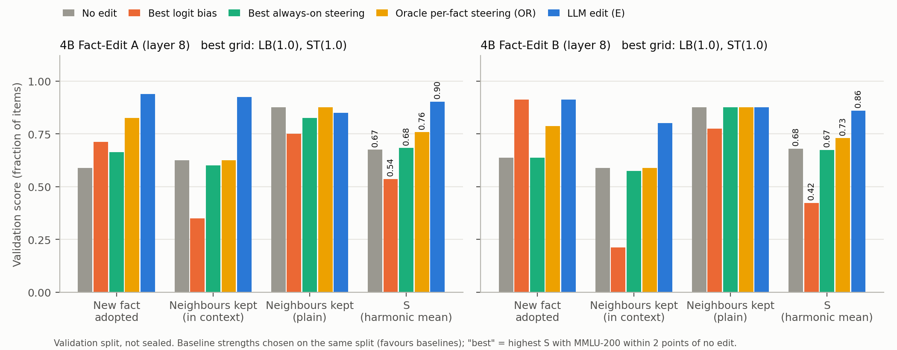
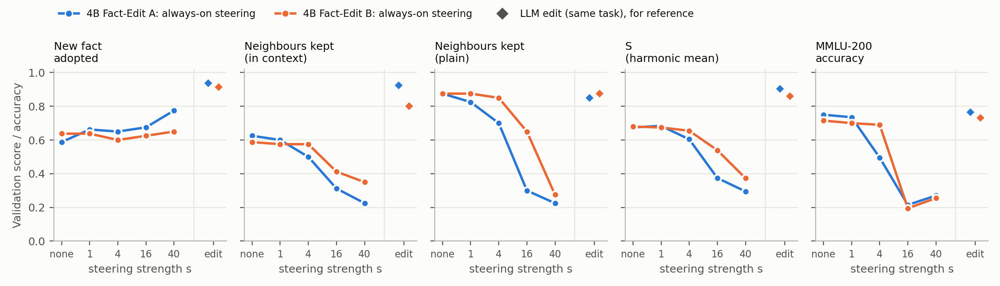
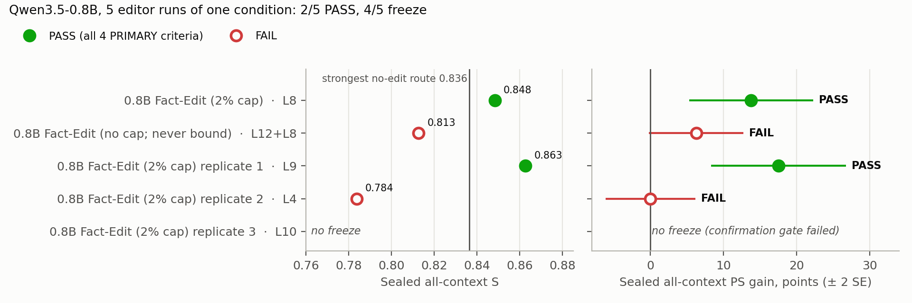
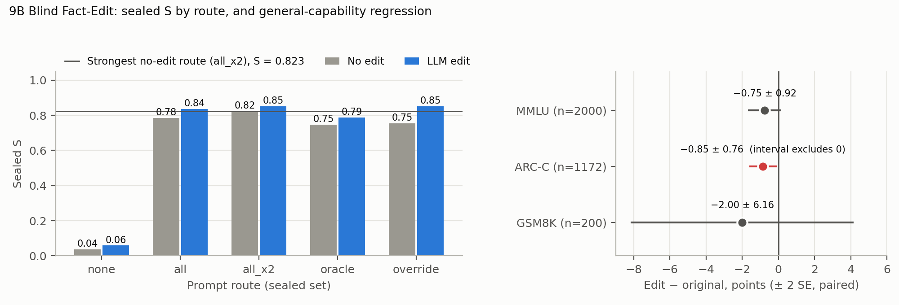
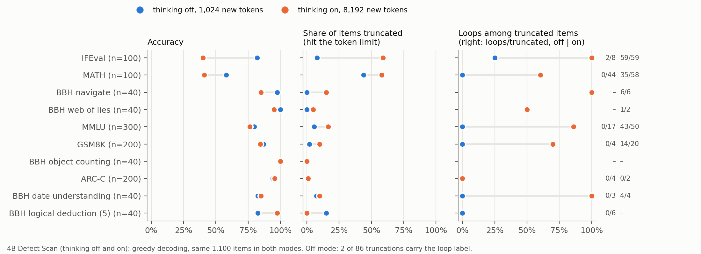

# Gated Sparse Memory Writes, Not New Capabilities: A Pre-Registered Four-Role Study of Inference-Only LLM Weight Editing

**Status.** Revised working draft (v2), 2026-11-24. It supersedes the cross-task draft of 2026-11-23 (`manuscript.md`), which is kept unchanged. Numbers come from a host-held evidence ledger that traces each value to a raw result file. **The run artifacts are not bundled in this repository** (Section 9). Values marked † come from the 2026-11-23 draft, where they were taken from host evaluation files, and were not re-traced in the 2026-11-24 ledger. Values marked ‡ appear only in a host summary or analysis document, or in an editor notebook record, and have no raw JSON result.

## Abstract

Weight-Space Programming (WSP) lets a frontier LLM write another network's weights; critics argue its gains amount to removing decoding pathologies or to steering. Under an inference-only contract (no backward pass, optimizer or solver), an LLM editor (Claude Opus) edited Qwen3.5 models. We ask what kind of change the edit is and how it compares with the strongest unedited and training-based alternatives.

We contribute a pre-registration protocol with four data roles: discovery, validation, confirmation and sealed. On 4B CounterFact rewrites with facts in context, frozen edits behave as gated sparse memory writes. Their validation S is .903 and .860, against .536 and .423 for the best global logit bias and .684 and .674 for always-on steering. The edits fire on 0.0% and 0.68% of generic-text tokens. Without context, the edit (sealed S .682) loses to the strongest prompt (.763) and to host-only ROME (.806), MEMIT (.897, from a log) and LoRA (.898). In generation-based scoring, the edit emits the new object for 1.25–3.75% of prompts, against 26–29% for MEMIT and ROME.

At 0.8B, five same-condition editor runs passed 2 of 5, each on a different layer. At 9B (nf4, with edited linears in bf16), the first four-role freeze passed three sealed criteria but failed regression (ARC −0.85 ± 0.38). A defect audit of the 4B model found that 162 of 201 truncations under greedy thinking-mode decoding are repetition loops. We report every failed gate. We argue that the edit's value lies in its footprint and auditability, not in its accuracy.

## 1. Introduction

Weight-Space Programming (WSP) [@takehi2026wsp] proposed that a frontier LLM can inspect a neural network and write its parameters directly, without an optimizer. Follow-up work reported large gains from very localized edits to small Qwen models [@hu2026wspscope]. These demonstrations prompted two strong critiques [@hn2026wspthread; @honnibal2026misleading; @wang2026closerlook; @barry2026lp]:

- **(A) Steering.** The edits are steering vectors, abliteration or logit bias in another form.
- **(B) Pathology removal.** The headline math gains come from removing thinking-mode repetition loops. A thinking-off baseline recovers most of them.

Our earlier cross-task series (Section 4.1) addressed critique (B). On WSP-Scope's own IFEval test split, turning thinking off with no edit recovered about 95% of the reported gain (56.1% vs 58.1%)†. On every skill-type task where an edit passed its sealed test, a thinking or brief chain-of-thought (CoT) prompt beat the edit (6/6)†. Critique (A) had not been tested, and neither the comparison with training- or solver-based knowledge editors nor run-to-run variance had been measured. A direction review on 2026-11-23 narrowed the question to:

> In a resource-limited setting, where do *gated*, LLM-chosen, inference-only edits stand against logit bias, steering, prompting and training/solver-based editors, and how reproducible are they?

This paper reports the answer, including every failed gate.

**Contributions.**

1. **Protocol.** We describe a pre-registration protocol for inference-only LLM weight editing with four data roles: *discovery*, *validation*, *confirmation* and *sealed*. Tool-side guards enforce it: a reserve guard, a one-shot confirmation gate, a cap on dose variants, and quantized loading that keeps edited tensors exact (Section 3).
2. **Edit type.** For 4B CounterFact rewrites, the LLM-written edits act as **gated sparse memory writes**, not as logit bias or constant steering. Evidence comes from a baseline ladder on two independent fact sets and from measured gate activity. The baseline strengths were tuned on the same split, which favours the baselines (Section 4.2).
3. **Honest comparison with training- and solver-based editors.** On no-context insertion, host-only MEMIT, ROME and LoRA comparators beat the LLM edit. Generation-based evaluation widens the gap (Section 4.3).
4. **Run-to-run variance.** Five same-condition editor runs at 0.8B passed 2 of 5, each on a different layer. Results of this kind must be reported as pass rates and distributions (Section 4.4).
5. **Scale.** At Qwen3.5-9B (nf4, with edited linears patched in bf16), the first freeze under the four-role split passed sealed criteria 1–3 and failed the regression criterion. We also report a quantization survival check, and feasibility (not edits) for a 27B dense model and a 36B MoE model on one 24 GB GPU (Section 4.5).
6. **Defect discovery.** At near-official settings, the dominant defect of the 4B model is thinking-mode repetition looping under greedy decoding. A pre-declared comparison of cheap decoding fixes is in progress (Section 4.6).
7. **Gradient audit.** No autograd was used. However, the editor's value directions are analytically a first-order output-gradient direction, and candidate revision included small dose searches. In response, we capped dose variants at two (Section 4.7).
8. **Small-network reproduction.** We reproduce the Sparks weight-reading experiments on tiny networks with a no-tool Claude. Reading works (4/4, 3/3) and collapses to 1/4 under a row-permutation control (Section 4.8).

**Explicit non-claims.** We do not claim:

- that LLM-written edits create new capabilities or new knowledge beyond the facts written;
- that the editor understands the model better than a solver or gradient method does (our comparators suggest otherwise);
- superiority over WSP or its follow-ups;
- superhuman interpretation or recursive self-improvement;
- efficiency in wall-clock time or tokens;
- causality for any semantic role that has not been tested by intervention.

Throughout, we separate three levels: **exact writes** (the stated numbers were written to the stated coordinates), **predicted behaviour change** (the edit does what its mechanism hypothesis predicts on development data) and **task improvement** (a frozen edit beats the strongest measured no-edit baseline on a sealed set).

## 2. Related work

### 2.1 LLM-driven weight editing and its critiques

**WSP and follow-ups.**

- **WSP** [@takehi2026wsp], from MIT CSAIL, has a frontier model (GPT-6 Astra) inspect networks and write parameters. Its best-known language-model result is a loop repair on Qwen3.5-0.8B under thinking mode, which raised MATH-500 from 7.9% to 48.1%. The repair subtracts a direction from 64 `down_proj` columns in each of two layers. This experiment used code execution and forward runs, not raw weights alone. The same caveat applies to our MCP setup, so we do not adopt the source's "natively read and write" description.
- **WSP-Scope** [@hu2026wspscope] ran 16 editing trajectories on Qwen3.5-0.8B and 9B. It reported large gains from very localized edits (29.45 points from 1,023 parameters), uneven transfer, and 6 of 16 trajectories that never validated an improvement.
- **Ok and Lee** [@ok2026wspnotransformer] have LLMs generate weights and architectures *from scratch*. We instead edit pretrained models.

**Critiques.**

- Public critiques argue that the headline gains reflect the removal of a decoding pathology and missing baselines [@hn2026wspthread; @honnibal2026misleading].
- Wang et al. [@wang2026closerlook] report that turning thinking off, with no edit, recovers most of the gain: 53.3% against 57.7% for the edit and 12.3% for the base model with thinking on (numbers as reported by the source).
- Barry [@barry2026lp] reports two findings. A sparse rank-1 edit found by a linear program matches the LLM's edit, and its mean push, applied as a 1× steering vector, recovers essentially the whole fix.
- Ahmed [@ahmed2026wspaudit] audits weight-reading claims with label-permutation controls and calls for pre-registration.

We take these critiques as design requirements: strongest-baseline comparison, steering and logit-bias ladders, pre-registration, replicates and permutation controls. Where we have not met one, we say so (Section 8).

### 2.2 Knowledge editing and its evaluation

**Methods.**

- ROME [@meng2022rome] and MEMIT [@meng2023memit] locate factual associations in mid-layer MLPs and write closed-form updates. ROME also introduced the CounterFact benchmark used here.
- MEND [@mitchell2022mend] trains a hypernetwork that produces edits.
- AlphaEdit [@fang2025alphaedit] projects MEMIT updates onto the null space of preserved knowledge.

**Evaluation.** Yang et al. [@yang2025mirage] show that teacher-forced, truncated scoring greatly overstates editing success compared with autoregressive generation.

**How we compare.**

- Our successful knowledge edits also sit in mid-layer MLPs, but they are written differently. The LLM allocates subject-gated MLP slots or subject-keyed low-rank writes and sets their values by explicit arithmetic, with no covariance solve.
- In effect size, these edits are weaker. We ran ROME and MEMIT as host-only comparators. They are our own reimplementations, use GPT-J default hyperparameters and a single seed, and were run in a single setting (Section 4.3).

### 2.3 Activation steering, directional ablation and logit bias

**Steering.** Steering adds a fixed direction to the residual stream at inference [@turner2023actadd; @zou2023repe; @rimsky2024caa]. Several works write such directions into weights:

- Arditi et al. [@arditi2024refusal] orthogonalize every residual writer against one direction.
- Steer2Edit [@sun2026steer2edit] converts steering vectors into rank-1 component edits.
- Xu et al. [@xu2026whysteering] formalize steering as a bias-only parameter update.
- Adila et al. [@adila2026activationshifts] relate fine-tuning to activation shifts.

**Logit bias.** Decode-time logit bias is the simplest output-side baseline. NoWait [@wang2025nowait] applies it to reasoning.

**Implication for us.** Together, these results imply that any *always-on* rank-1 write is close to a steering vector, and the WSP loop fix appears to be one [@barry2026lp]. The measurable difference between an edit and steering is therefore *when* the edit is active. We measure this directly for knowledge edits (Section 4.2). We have not done so for skill or format edits.

### 2.4 Parameter-efficient fine-tuning

LoRA [@hu2022lora] is our reference for what gradient training achieves on the same rows. The host alone runs it, and it is never offered to the editor. Our setting differs from fine-tuning in compute: GPU use is inference only, with no backward pass and no optimizer state. This matters mainly when training memory is the binding constraint.

### 2.5 Reasoning-model looping

Small and distilled reasoning models overthink [@chen2024overthinking]. They also fall into repetition loops, more often at small scale and low temperature [@pipis2026loops]. The Qwen3.5 model card warns about thinking loops [@qwen35modelcard].

Training-free remedies include:

- budget forcing [@muennighoff2025s1];
- suppression of reflection tokens [@wang2025nowait];
- steering away from reflection states [@chen2025seal];
- projecting out a short-reasoning direction from attention heads [@sun2025thinkedit].

These remedies are the cheap baselines that any loop-repair edit must beat (Section 4.6).

## 3. Method

### 3.1 Inference-only contract

The editor (Claude Opus, run as an agent) accesses the target model only through an MCP server.

- **Observations.** The editor can read:
  - weights and module structure;
  - stored activations;
  - signed attribution of residual writers to an output (`writers`);
  - output-embedding error vectors (`errors`);
  - causal tracing;
  - aggregate scores of candidates on permitted data roles.
- **Writes.** Explicit operations specified by the editor, which the tool executes as stated CPU arithmetic: scale, project_out, replace_block, low_rank and set_values. Every write records the source and parent hashes and the old and new values.
- **Prohibited.** The GPU runs inference only. The contract forbids:
  - backward passes, autograd, numerical gradients and finite differences;
  - optimizers and training;
  - least-squares or pseudoinverse solves;
  - iterative fitting to a loss;
  - random search and coordinate or strength sweeps.

  The tool code installs inference guards, and a test tripwire rejects backward, autograd and optimizer calls on the tested paths. This is not an OS sandbox.
- **Allowed exception.** One LLM-designed, one-shot multi-error update built from observed keys and output-embedding error vectors. The LLM specifies the layers, examples, coefficients and the CPU formula.
- **Budget.** Each arm has 20–24 forward-pass "passes" (logical jobs), a tool-call budget (250 in the later arms) and up to 3 rounds.

**Host-only comparators.** LoRA, ROME, MEMIT and the neuron-budget arms (Section 4.3) are gradient- or solver-based. The host runs them to bound what other methods achieve. They write only to host folders and are never shown to the editor.

### 3.2 Tasks, routes and metrics

**CounterFact rewriting.** Each knowledge arm draws 40 CounterFact facts [@meng2022rome] that the base model knows. The edit must make the model prefer a new object over the true one.

**Per-prompt scoring.** For each prompt we compare the mean per-token NLL of " new" with that of " true":

- **ES** (efficacy): the share of rewrite prompts on which the model prefers the new object.
- **PS** (paraphrase): the same share on paraphrased prompts.
- **NS** (neighbourhood): the share of prompts about *other* subjects with the same relation on which the model still prefers the true object.
- **S**: the harmonic mean of ES, PS and NS.

**Sealed set sizes.** At 4B the sealed sets contain 40 ES, 80 PS and 200 NS prompts. The qcap arms and qcf20 have 160 NS prompts.

**Context routes.** A route is the text placed before each prompt:

- **none** (no-ctx): no context.
- **all** (all-ctx): all 40 rewritten facts.
- **all_x2**: the fact list given twice.
- **oracle**: only the queried fact.
- **override**: all facts behind an explicit instruction that they replace prior knowledge.

The strongest no-edit route on the sealed set is the bar for any improvement claim.

**PRIMARY criteria (CounterFact arms, pre-registered).** A frozen edit must satisfy all four:

1. Edit S on the all-ctx route exceeds the strongest no-edit route S.
2. The all-ctx PS gain exceeds 2 SE (paired).
3. The all-ctx NS loss is not significant.
4. Regression is clean: no loss over 2 SE on MMLU-2000 [@hendrycks2021mmlu], ARC-Challenge [@clark2018arc] or GSM8K-200 [@cobbe2021gsm8k], each paired against the original model.

The no-context arm qcf17 used the same criteria on the none route. Paired differences are reported in points ± SE, with wrong→right/right→wrong counts where available.

### 3.3 Four-role data protocol

The earlier protocol had three roles: discovery, blind validation and a sealed test. Under it, two blind 4B arms failed to freeze. The tool required "unexposed" evidence for its freeze decision, and exploration had consumed the unexposed items (Section 4.4). On 2026-11-23 we moved to four roles, consistent with the repository's data-separation protocol:

| Role | Use | Editor access |
|---|---|---|
| **Discovery** | Error analysis, activations, edit design, revisions | Full |
| **Validation** | Select at most 2 candidates | Aggregates only (blind validation) |
| **Confirmation** | **One-shot freeze gate.** One candidate; each source is measured once; the tool applies the freeze rule to these jobs alone | Aggregates only |
| **Sealed** | Final test, run once by the host on the frozen candidate; regression run once | None |

**Confirmation sources at 9B** (qcf20, as an example): 80 new paraphrase wordings, 80 neighbours, 40 plain neighbours, MMLU 30, multiple-choice 100 and GSM8K 100.

**Freeze rule.** The pooled target gain must exceed 2 SE. No preserve source may show a significant loss, and GSM8K may not drop by more than a fixed 3.0 points. At least 100 GSM8K preserve items must be measured.

If no candidate passes confirmation within budget, the arm is a **failure to freeze**, and its sealed set is never opened.

### 3.4 Tool-side guards

- **Reserve guard.** The tool refuses any measurement request that would leave fewer unexposed preserve items than the freeze rule needs. A refused request costs no pass. The editor can override it only with an explicit flag, which is logged. This guard was added after qcf18 exhausted its GSM8K reserve.
- **Confirmation gate.** Freezing requires one confirmation run that passes the freeze rule. Validation can only rank candidates. Exposed confirmation items cannot be reused as fresh evidence.
- **Dose cap.** The tool rejects a third strength variant of the same design (WSL_DOSE_CAP = 2, active from qcf20). The cap answers the gradient audit (Section 4.7): repeated strength revision on observed scores is a coarse zeroth-order search.
- **Quantized loading.** At 9B and above, unedited linears load in nf4 (or int8). Every linear touched by a candidate is kept in **exact bf16 on both the original and the edited side**, so no paired comparison mixes quantization error with the edit. A smoke test confirmed exact patching (Section 4.5).
- **Freeze rule in the tool.** The freeze decision is made by tool code, not by the editor's judgement.

### 3.5 Baseline ladder (host only, validation split)

For the frozen 4B knowledge edits (qcf15, qcf16), the host compared four alternatives on the **validation** split. The validation split has 80 paraphrase, 80 neighbour and 40 plain-neighbour prompts, plus MMLU-200 as a cheap preservation check.

- **Global logit bias LB(b):** +b on the new object's tokens and −b on the old object's, at every position.
- **Always-on steering ST(s):** the edit's write vector added at s× strength at every token.
- **Oracle per-fact steering (OR):** each fact's write applied only at that fact's subject token. The host supplies the subject position, which a real system would not know.
- **Gate activity:** the fraction of tokens on which the edit's gated units are active, on generic MMLU text and on non-subject tokens of rewrite prompts.

Strengths were swept on the same split, and "best" means the highest S with MMLU-200 within 2 points of the unedited model. This favours the baselines. **No sealed-set ladder exists.**

### 3.6 Arms and protocol versions

| Arm | Model | Design | Protocol | Editor prompt |
|---|---|---|---|---|
| qcf15, qcf16 | Qwen3.5-4B | all-ctx | 3 roles | contained recipe notes from earlier sessions |
| qcf17 | 4B | no-ctx PRIMARY | 3 roles | recipe notes |
| qcf18, qcf19 | 4B | all-ctx, blind | 3 roles + unexposed-evidence rule | no recipe |
| qcap_on, qcap_off, rep1–3 | Qwen3.5-0.8B | all-ctx | **4 roles** | no recipe |
| qcf20 | Qwen3.5-9B (nf4 + bf16 patches) | all-ctx, blind | **4 roles** + dose cap | no recipe |

The recipe notes in qcf15–17 carried earlier layer and neuron choices. The 4B PASS results are therefore recipe transfer, not blind discovery (Section 8).

## 4. Experiments and results

### 4.1 Background: the cross-task series (2026-11-08 to 11-22)†

The earlier series edited Qwen3.5-0.8B, 2B and 4B and Qwen2.5-0.5B-Instruct on more than 15 tasks. Each task had a sealed test, a regression check and a strongest-baseline comparison. We summarize the series here because it motivates the narrower focus of this paper. These values were not re-traced in the 11-24 ledger.

| Category | Representative sealed result† | Strongest no-edit / host LoRA† | Reading |
|---|---|---|---|
| Arithmetic (0.8B) | +4.8 to +6.8 points; 2/2 blind runs found the same L22 attention head | brief CoT 95.5% vs edit 67.75%; edit −8.25/−11.0 under CoT | erased by reasoning |
| Letter and word skills (0.8B, 2B) | +4.0 to +26.75 | thinking or CoT beats the edit in 6/6 sealed passes | erased by reasoning |
| Loop repair, IFEval (0.8B) | +44.8 | thinking-budget forcing 70.1% | defect removal |
| Knowledge insertion (0.8B) | 58 irregular past tenses +46.6 | 3-shot 33.6%; edit + 3-shot 74.1%; LoRA +84.5 | adds to prompting; LoRA stronger |
| CounterFact all-ctx (4B) | S .922 / .894 (2/2 PRIMARY PASS) | best no-edit .760 / .785†; LoRA .989 / .987 | robust niche, but LoRA stronger |
| Format and persona (0.8B) | lowercase, no-comma | other-format or GSM8K losses (fail) | preservation failures |
| BBH (2B, 4B) [@suzgun2022bbh] | dyck +8.0 on official wording, −3.0 on unseen wording | GSM8K −9.0 (fail) | wording-bound |

The sealed CounterFact S values .922 and .894 and the LoRA values .989 and .987 are ledger-verified. So is the qcf16 LoRA's MMLU loss of −1.55 ± 0.77 (2.0 SE).

The series supported one main conclusion: **skill edits are erased by reasoning baselines, while stored associations remain editable at 4B.** The rest of this paper examines that niche, asks whether it is just steering, and compares it with stronger editors, across replicates and at larger scale.

### 4.2 Contribution 2: knowledge edits are gated sparse memory writes

**Hypothesis (stated before the ladder ran).** If the edit were equivalent to logit bias or constant steering, it could not tell subjects apart. It would then raise PS only by damaging neighbours (NS). A gated memory write would raise PS while keeping NS.

**Table 1.** Baseline ladder, validation split, 4B (n = 80 / 80 / 40 / 200).

| Arm | qcf15 S (PS / NS / plain NS / MMLU-200) | qcf16 S (PS / NS / plain NS / MMLU-200) |
|---|---|---|
| No edit | .675 (.588 / .625 / .875 / .750) | .680 (.638 / .588 / .875 / .715) |
| Best global logit bias, LB(1) | .536 (.713 / .350 / .750 / .750) | .423 (.913 / .213 / .775 / .715) |
| Logit bias LB(8) | .190 (NS .125) | .055 (NS .025) |
| Best always-on steering, ST(1) | .684 (.663 / .600 / .825 / .735) | .674 (.638 / .575 / .875 / .700) |
| Oracle per-fact steering | .759 (.825 / .625 / .875 / .750) | .729 (.788 / .588 / .875 / .715) |
| **LLM edit** | **.903** (.938 / .925 / .850 / .765) | **.860** (.913 / .800 / .875 / .730) |
| Edit active, generic MMLU text | **0.0%** | **0.68%** |
| Edit active, non-subject rewrite-prompt tokens | 0.63% | **7.91%** |

*Figure 1. Baseline ladder (validation split). Baseline strengths were chosen on the same split, which favours the baselines.*

**Logit bias.** On qcf16, logit bias matches the edit on new-fact adoption (PS .913 for both). It does so by pushing the new object everywhere, which drops in-context NS to .213 (qcf15: .350). Raising the bias to b = 8 drives S to .190 and .055.

**Always-on steering.** Raising the steering strength (Table 2, Figure 2) moves PS only modestly. On qcf15, PS rises from .588 to .775 at strength 40, still well below the edit's .938. On qcf16 it stays between .600 and .650. Meanwhile NS and MMLU collapse: MMLU-200 falls to .215 and .195 at strength 16.

**Table 2.** Always-on steering dose (validation).

| Strength | qcf15 PS | qcf15 MMLU-200 | qcf16 PS | qcf16 MMLU-200 |
|---|---|---|---|---|
| none | .588 | .750 | .638 | .715 |
| 1 | .663 | .735 | .638 | .700 |
| 4 | .650 | .495 | .600 | .690 |
| 16 | .675 | .215 | .625 | .195 |
| 40 | .775 | .270 | .650 | .255 |
| edit | .938 | .765 | .913 | .730 |

*Figure 2. Always-on steering with the edit's own write vector. Rewrite adoption rises modestly on qcf15 (to .775 at strength 40) but stays below the edit, while neighbours and MMLU collapse.*

**Oracle steering.** Oracle per-fact steering is told *where* each subject is, yet it reaches only .759 and .729. Two things separate the edit from this oracle: when it fires, and the size and shape of its write (Table 1).

**Interpretation.** On two independent sets of 40 facts, the frozen edits behave as **subject-gated sparse memory writes**. The gates are near-silent on generic text, and the edits beat global logit bias, constant steering and an oracle-positioned steering vector. For contrast, Barry reports that the LP loop edit he reproduced was active on 89% of tokens [@barry2026lp].[^barry]

**Limits of this result.**

- The ladder exists only on validation data.
- qcf16 is less sparse than qcf15: 7.9% of non-subject tokens in rewrite prompts are active.
- "Gated memory write" is a functional description supported by gate activity and the ladder. It is not a complete circuit account.
- None of this transfers to skill or format edits, where we have no ladder.

[^barry]: The 89% figure is Barry's measurement of his LP loop edit (his Fig. 9), taken from a summary document and not re-checked against the post. Earlier internal summaries wrongly attributed it to the WSP edit itself.

### 4.3 Contribution 3: comparison with training- and solver-based editors

**Setting.** qcf17_4b pre-registered **no-context** persistence as the PRIMARY target: 40 new facts, with development rows that carry no context. The strongest no-edit route on the sealed set is all_x2 with S .763. Each host comparator was selected on validation and sealed once.

**Table 3.** No-context sealed results, qcf17_4b (ES n = 40, PS 80, NS 200).

| Arm | ES | PS | NS | S (none) | S (all-ctx) | General ability |
|---|---|---|---|---|---|---|
| Original | .05 | .0875 | .90 | .092 | .750 | MMLU-2000 .7255; ARC-C ≈ .913 |
| **LLM edit** (38 L8 neurons) | .625 | .600 | .885 | **.682** | .939 | MMLU +0.15 ± 0.19; ARC +0.09 ± 0.19; GSM +1.0 ± 1.41 (paired) |
| ROME (L6, rank-1 per fact, sequential) | .95 | .875 | .655 | .806 | .721 | MMLU .7015 (−2.4, unpaired); ARC .9087 |
| MEMIT (L4–8, λ 1.5e4)[^memit] | .975 | .85 | .875 | .897 | .920 | MMLU .7215 (−0.4, unpaired); ARC .9044 |
| LoRA on editing rows (lr 3e-4, 8 epochs) | 1.00 | .7875 | .935 | **.898** | .927 | MMLU −0.25 ± 0.47; ARC 0.0 ± 0.34 (paired) |
| LoRA on chat rows | .875 | .4125 | .45 | .518 | .675 | MMLU −0.1 ± 0.25 |
| N-edit: the editor's 38 neurons, trained from its values | 1.00 | .775 | .905 | .884 | .929 | MMLU .7285; ARC .9138 (unpaired) |
| N-orig: the same 38 neurons, trained from the original values | .975 | .425 | .90 | .668 | .890 | MMLU .719; ARC .9078 (unpaired) |

[^memit]: The MEMIT sealed numbers come from the final log line before an out-of-memory crash in the subsequent ROME phase. No JSON was written (log only), and ROME was rerun separately. The covariance was estimated from 124,537 tokens rather than the pre-registered ~200k. ROME and MEMIT are our own reimplementations with GPT-J default hyperparameters and one seed. Their general-ability numbers are unpaired and have no SE. Validation S chose MEMIT L4–8 at λ 1.5e4 (.892, against .862, .831 and .757 for the other three settings) and ROME at L6 (.750, against .686 at L8 and .702 at L10).

**Findings.**

- **PRIMARY fails.** The edit's no-context S of .682 is below the strongest no-edit route (.763). Relative to the original model it is a large write (.092 → .682), but it is not an improvement over prompting.
- **Edit vs comparators.** The edit is also below ROME (.806), MEMIT (.897) and LoRA (.898). Methods that *fit* the written values to data beat values set by explicit LLM arithmetic.
- **ROME's cost.** ROME wins on ES and PS but loses neighbours (NS .655) and 2.4 MMLU points (unpaired).
- **Structure vs values.** The neuron-budget arms separate the edit's *structure* from its *values*. Trained from the editor's values, the editor's 38 neurons reach .884. Trained from the original values, the same neurons reach only .668. This is consistent with the editor choosing a useful location and gating while setting weak values. It does not show that gradient training *cannot* find that structure. It shows only that it did not in this budget, from this initialization.
- **With context.** The edit remains strongest on the all-ctx route (.939, against .920–.927 for MEMIT and LoRA). This is consistent with the gated write disambiguating neighbours in a crowded context (Section 4.2).

**Generation-based evaluation.** Following Yang et al. [@yang2025mirage], the host generated 8 greedy tokens on the validation split. An item scores when the output starts with the new object.

**Table 4.** Generation-based scoring, validation split (n = 80 rewrites / 80 neighbours).

| Arm / route | qcf15 | qcf16 | qcf17 |
|---|---|---|---|
| Original, stored context | .2375 | .1625 | — |
| LLM edit, stored context | .425 | .40 | — |
| Original, no context | 0 | 0 | 0 |
| **LLM edit, no context** | **.0375** | **.0125** | **.025** |
| MEMIT, no context | — | — | .2625 |
| ROME, no context | — | — | .2875 (neighbours not new .9125) |
| LLM edit, stored context: neighbour not new / neighbour old | .975 / .3375 | .975 / .4125 | — |

The NLL preference gains of the LLM edit largely fail to show up as generated answers without context. Only 1.25–3.75% of outputs start with the new object, against 26% for MEMIT and 29% for ROME. With stored context, the edit roughly doubles generation of the new object (.2375 → .425, .1625 → .40) while keeping neighbours from switching to it (.975).

**Caveats.**

- MEMIT and ROME were selected on this same validation split.
- No sealed generation evaluation exists.
- None was run for qcf20.

### 4.4 Contribution 4: run-to-run variance and blind discovery

**Replicates.** The qcap study (Qwen3.5-0.8B, four-role split, all-ctx CounterFact) was planned as an ablation of a 2%-changed-parameter cap. The cap never bound: the largest frozen edit changed .0163% of parameters, and no candidate exceeded 2%. The ablation is therefore uninformative about the cap. Together with three replicates of the capped condition, however, it gives **five independent editor runs of one condition**. The PRIMARY bar is the strongest no-edit route, all_x2, at S .836.

**Table 5.** Five same-condition editor runs (sealed; NS n = 160).

| Run | Frozen design | Layer(s) | Changed | All-ctx S | PS gain (w2r/r2w) | NS | Regression (paired) | PRIMARY |
|---|---|---|---|---|---|---|---|---|
| qcap_on | gated neurons, 40 | L8 | .0163% | **.848** | +13.75 ± 4.24 (12/1) | 0.0 ± 1.53 | MMLU −0.20 ± .46; ARC −0.68 ± .55; GSM +3.5 ± 3.03 | **PASS** (margin .012) |
| qcap_off | sharpened neurons, 27 + 6 | L12 + L8 | .0135% | .813 | +6.25 ± 3.23 (6/1) | −2.5 ± 1.23 (0/4) | MMLU −0.90 ± .45; **ARC −1.28 ± .52**; GSM −3.5 ± 3.19 | FAIL (1, 2, 3, 4) |
| rep1 | memory neurons, 40 | L9 | .0163% | **.863** | +17.5 ± 4.6 (15/1) | +0.62 ± 1.08 | MMLU +.35 ± .48; ARC +.43 ± .49; GSM +.5 ± 2.96 | **PASS** |
| rep2 | repeated-key neurons, 40 | L4 | .0163% | .784 | 0.0 ± 3.06 (3/3) | −1.25 ± 1.25 | not computed[^rep2] | FAIL |
| rep3 | gated neurons | L10‡ | — | — | — | — | — | no freeze: confirmation GSM −4.0 (SE 4.0) exceeded the fixed 3.0-point bound, although rewrite z was 4.62‡ |

[^rep2]: rep2 froze a candidate and has a sealed evaluation. A host summary script parsed an incomplete record and listed rep2 as "no freeze", so its regression and nf4-survival rows were never computed. rep2 had passed confirmation (rewrite +12.5 ± 4.5, z 2.8)‡ before failing on the sealed set.

*Figure 3. Five editor runs of one condition at 0.8B: 2/5 PASS, 4/5 freeze, five different layers.*

**Summary.**

- **Rates.** The pass rate is 2/5 and the freeze rate is 4/5.
- **Layers.** The five runs chose five different layers or layer sets: L8, L12+L8, L9, L4 and L10.
- **Effect spread.** Among frozen edits, sealed PS gains range from 0 to +17.5 points, and both passes were narrow (qcap_on cleared the bar by .012).
- **Confirmation does not guarantee sealed success.** rep2 passed confirmation and then showed zero sealed PS gain.

A single editor run is not a reliable estimate. **Results of this protocol must be reported as pass rates and distributions.** All 4B and 9B results in this paper are single runs and should be read in that light.

**Protocol deviation.** At the user's request, the qcap arms and replicates ran in parallel on one GPU. This contradicts their own pre-registration ("one editor arm at a time"). The first qcap sealed evaluation crashed out of memory before producing numbers and was rerun.

**Blind discovery at 4B: two failures to freeze.** qcf18 and qcf19 removed all recipe notes from the editor prompt and used the three-role protocol with an "unexposed evidence" freeze requirement.

**Table 6.** Blind 4B arms. Neither sealed set was opened.

| | qcf18_4b | qcf19_4b |
|---|---|---|
| No-edit sealed baselines (none / all / all_x2 / oracle / override) | .000 / .772 / .775 / .674 / **.780** | .060 / **.752** / .714 / .732 / .679 |
| Passes / candidates / frozen | 24 / 6 / no | 24 / 7 / no |
| Structure found‡ | rank-40 subject-keyed low_rank on L10 down_proj (dense, rel. L2 .14) | erasure writes at L6 / L10 / L14 down_proj |
| Best candidate, **unexposed** paraphrase‡ | +8.75 ± 3.2 (7/0) | **+22.5 ± 5.9 (22/4)** |
| Same, all items including exposed‡ | +10.8 ± 2.9 (13/0) | +23.3 ± 4.7 (33/5) |
| Other sources (unexposed)‡ | neighbour +3.75 ± 2.8; MC −0.5 ± 0.87 | neighbour +11.25 ± 4.0; MC −1.0 ± 1.6; GSM −0.56 ± 1.7 |
| Reason for freeze refusal | exploratory candidate consumed all 120 discovery GSM items; 60 left, 100 required | later ablations re-measured the same items; nothing unexposed left |
| Incidents | host login expiry at pass 18; resumed under an amendment | one editor job failed during host GPU contention; counted against the budget |

Both blind runs found structures on their own that differ from the recipe: a low-rank write and erasure writes, instead of neuron allocation. Both raised unexposed paraphrase scores. Neither produced sealed evidence, so **blind discovery at 4B has 0/2 sealed results**. The +22.5 figure for qcf19 is the unexposed pool. An earlier summary reported the all-items value (+23.3) as unexposed. These failures motivated the four-role split and the reserve guard (Section 3.3). Under the new split, 4 of 5 qcap runs and qcf20 froze.

### 4.5 Contribution 5: scale and quantization

**Quantization survival (4B, validation).** The host applied the frozen qcf15 edit under three precisions.

**Table 7.** Quantization check, qcf15 edit, validation paraphrase (n = 80).

| Precision | Edit gain, points (w2r/r2w) | Agreement with bf16 edit | S orig → edit |
|---|---|---|---|
| bf16 | +35.0 ± 5.37 (28/0) | — | .675 → .906 |
| int8 | +33.75 ± 5.32 (27/0) | .975 | .679 → .885 |
| nf4 | +36.25 ± 5.41 (29/0) | .975 | .664 → .890 |
| nf4 with edited tensors in bf16 | +33.75 ± 5.32 | .975 | .670 → .886 |

**Delta survival.**

- The sparse qcf15 L8 row deltas survive quantization: cosine with the bf16 delta is ≥ .9845 under nf4 and ≥ .996 under int8 (3 tensors).
- A **dense small delta** (qcf18's low-rank candidate, relative norm .14) does **not** survive nf4: cosine .751, norm ×1.326. Under int8 its cosine is .9945.
- This finding is why the tool keeps every edited linear in exact bf16 on both sides (Section 3.4).

A 4B nf4 overlay smoke test confirmed exact patching. Rewrite accuracy moved from .708 to .958 on 24 items.

**qcf20_9b: first freeze under the four-role split.** The arm used Qwen3.5-9B in nf4 with patched linears in bf16 and a blind prompt. It ran 3 rounds, 24 passes and 7 candidates, and froze in round 2.

- **Frozen edit.** A rank-40 low_rank write on L13 `down_proj`. Its keys are the subjects' last-token inputs with 128 generic-token principal components projected out.
- **Confirmation (freeze gate).** Paraphrase +25.0 ± 5.2 (21/1, z 4.9; n 80). Neighbours −2.5 ± 5.0 (80). GSM −3.0 ± 2.6 (100), exactly at the fixed 3.0-point bound. MMLU −3.3 ± 5.7 (30). Multiple-choice +1.0 (100).

**Table 8.** qcf20_9b sealed results (no-edit and edit evaluated in the same run with identical bf16 patched linears; PS n = 80, NS n = 160).

| Route | No-edit S | Edit S | PS diff | NS diff |
|---|---|---|---|---|
| none | .037 | .059 | +7.5 ± 2.94 | — |
| **all** | .784 | **.836** | **+16.25 ± 4.12 (13/0)** | 0.0 ± 2.93 (11/11) |
| all_x2 (strongest no-edit) | **.823** | .852 | +12.5 ± 4.1 | −3.75 ± 2.32 |
| oracle | .747 | .787 | +13.75 ± 4.24 (ES −5.0 ± 3.45) | — |
| override | .754 | .851 | +18.75 ± 4.71 | +5.62 ± 3.09 |

**Regression** (paired; the original scores MMLU .7585, ARC-C .9386 and GSM .745):

- MMLU-2000: −0.75 ± 0.46 (34/49; 1.6 SE)
- **ARC-C (1,172): −0.85 ± 0.38 (5/15; 2.2 SE)**
- GSM8K-200: −2.0 ± 3.08

**Verdict.** Criterion 1 passes (.836 > .823, margin .013), and so do criterion 2 (PS +16.25 > 2 SE) and criterion 3 (NS 0.0). Criterion 4 fails, because the ARC loss crosses the pre-registered 2 SE bound. **The pre-registered verdict is FAIL.** No re-tuning was done.[^bar]

*Figure 4. qcf20_9b. Left: sealed S by route. Right: paired regression (± 2 SE). The ARC-C interval excludes zero.*

**Two lessons from qcf20.**

- **The confirmation preserve sources were too small** (MMLU 30, GSM 100) to detect the ~1-point MMLU and ARC loss that the regression found.
- **A fixed 3.0-point GSM bound, not an SE-based bound, decided the freeze.** The candidate sat exactly at the bound. qcap_rep3 was refused at −4.0 with SE 4.0, whose uncertainty is larger than its distance from the bound.

Both lessons point to SE-scaled preserve bounds and larger confirmation preserve sets. The no-context S at 9B is only .059. The SECONDARY ladder and generation evaluation were not run.

[^bar]: The pre-launch baseline file, with every linear in nf4, gives all_x2 .815. The PRIMARY comparison uses the same-run value of .823, in which the patched linears are bf16 on both sides. The criterion-1 conclusion is the same either way.

**Large-model feasibility on one 24 GB GPU (no edits, no edit claims).**

**Table 9.** Load and forward smoke tests.

| Model | Configuration | Result |
|---|---|---|
| Qwen3.5-9B | nf4 / int8 | peak 8.04 GB / 15.04 GB |
| Qwen3.5-27B (64 layers) | nf4, fully on GPU | peak 19.11 GB; 5 facts in 33.1 s |
| Qwen3.5-27B | bf16 with CPU offload | peak 21.24 GB; 61.3 s; 22 device-map entries on GPU, 46 on CPU |
| Qwen3.5-27B | nf4 vs bf16 answer NLL, absolute difference | .002–.277 (5 facts) |
| MoVA-36B-A4B (MoE) | nf4, one GPU | OOM at load‡ |
| MoVA-36B-A4B | first offload retry | meta-tensor error (router weights on offloaded layers)‡ |
| MoVA-36B-A4B | third retry | loads: peak 8.62 GB; 84 modules on GPU, 288 on CPU; 26.8B parameters not 4-bit; one forward pass 74.5 s; NLL Paris .116, Tokyo .141, wrong "Rome" 8.49 (3 facts) |

These results show only that **inference-only observation and patched evaluation fit on one 24 GB GPU** up to 27B dense parameters. The 27B nf4/bf16 NLL gap (up to .277) means that any 27B edit selected in nf4 would need a bf16 re-check. MoVA loads only with most modules on the CPU and is slow. We make no edit claims at 27B or 36B.

### 4.6 Contribution 6: defect discovery in the 4B model

**Motivation.** Every broad gain we or others observed came from removing a shared defect, not from adding ability. We therefore treat *defect discovery* as an explicit, inference-only task. Find what the model gets wrong at near-official settings, then require any edit to beat the cheap fixes for that defect.

**Design.** The host built a development mix of 1,100 items, disjoint from all sealed and regression items:

- MMLU-val 300
- ARC-C train/val 200
- GSM8K train 200
- MATH train 100 [@hendrycks2021math]
- IFEval 100 [@zhou2023ifeval], not the WSP-Scope test split
- BBH, 5 tasks × 40

The host scanned Qwen3.5-4B with greedy decoding in two settings: thinking off with 1,024 new tokens, and thinking on with 8,192 tokens (near-official). A loop is a 16-token repeated prefix. **All of this is development data:** it may guide a future edit, and no result here is a test result.

**Table 10.** Defect scan, Qwen3.5-4B, greedy, the same 1,100 items in both settings.

| Measure | Thinking off, 1,024 tokens | Thinking on, 8,192 tokens |
|---|---|---|
| Overall accuracy | **.842** | **.777** |
| Truncated (finish = length) | 86 (7.8%) | **201 (18.3%)** |
| Accuracy on finished answers | .903 (916/1,014) | **.949 (853/899)** |
| Truncations that are repetition loops | 2/86 | **162/201** |
| IFEval: acc / truncated / finished acc | .82 / 8 / .848 | **.40** / 59 (all loops) / .976 |
| MATH: acc / truncated / finished acc | .58 / 44 / .946 (53/56) | .41 / 58 (35 loops) / .952 |
| MMLU: acc / truncated / finished acc | .797 / 17 / .841 | .763 / 50 (43 loops) / .916 |
| GSM8K: acc / truncated / finished acc | .87 / 4 / .888 | .845 / 20 (14 loops) / .933 |
| ARC-C: acc / truncated / finished acc | .94 / 4 / .959 | .955 / 2 / .965 |

With thinking on, the BBH tasks score: date .85, logical deduction .975, navigate .85, object counting 1.0, web of lies .95. Of 117 truncated IFEval and MATH outputs, only 1 ever closed `</think>`. The 46 wrong finished answers carry overlapping labels: last-step arithmetic 12, distractor copy 10, loop 6, unlabeled 19.

*Figure 5. 4B defect scan. Thinking on at 8,192 tokens lowers overall accuracy because 162 of 201 truncations are repetition loops. Finished answers are highly accurate.*

**Reading.**

- **The thinking-off scan at 1,024 tokens measured the token cap, not the model.** On MATH, 53 of 56 finished answers were correct.
- **At near-official settings, the dominant defect is thinking-mode repetition looping under greedy decoding.** It costs IFEval 42 points relative to thinking off (.82 → .40), and finished-answer accuracy stays at .949.
- This is the same family of defect as the WSP and Barry loop fixes. Qwen's model card recommends sampling and a presence penalty for thinking mode [@qwen35modelcard], so these cheap fixes must come first.
- **No capability-defect edit target has been identified yet.**

**Stage 2: cheap-fix comparison (in progress).** The following was declared before any run.

- **Variants** (`thinking_decode` family):
  1. Qwen-recommended sampling: T 0.6, top-p 0.95, top-k 20, seed 0.
  2. The same sampling plus presence penalty 1.5.
  3. Greedy decoding plus presence penalty 1.5.
- **No-fix arm.** It reuses the rescan records, which have identical settings.
- **Split.** Devmix rows are divided into SELECT and REPORT halves by a stable hash of the item id, stratified per task.
- **Selection.** On SELECT, the chosen variant maximizes mean per-task accuracy, subject to no task dropping more than 2 SE below no-fix. The chosen variant and the no-fix arm then run once on REPORT, at 8,192 tokens on all 10 tasks.
- **Decision rule.** If a cheap fix removes most of the loop cost with no task dropping more than 2 SE, looping is *not* an edit target at the recommended decoding. The remaining candidates are then the residual errors (last-step arithmetic, distractor copying) and the accuracy-versus-token-budget curve under the recommended decoding.
- **Not yet measured.** The token-budget curves: MATH + GSM8K, 300 items, budgets 512–8,192, thinking off and on.

**[Stage 2 results pending]**

### 4.7 Contribution 7: gradient audit and selection cost

Critics argue that "inference-only" editing may smuggle in gradient-like computation. We audited the tool code and the editor's procedures.

**Table 11.** Gradient audit.

| Question | Finding | Status |
|---|---|---|
| Autograd, optimizer or solver calls in tool code? | None. A search for `.backward(`, `torch.optim`, `lstsq`, `pinv`, `linalg.solve` and `enable_grad` matches only the guard definition. | verified by code search |
| Inference guards installed? | Yes, in the standalone server, the research worker and the generation worker | verified by code search |
| Guard tests | 5/5; suite 269 passed, 1 skipped | ‡ (not rerun for this draft) |
| Gradient comparators isolated? | LoRA, neuron-budget, ROME and MEMIT outputs exist only in host folders; editor workspaces never mention them | ‡ |
| Are the editor's values gradient-like? | **Yes, analytically.** The value direction, a scaled unit vector along E_new − E_true (output-embedding difference), is the first-order gradient of the logit margin with respect to the final hidden state. The write ΔW = v kᵀ has the form of one delta-rule step. | analytic argument ‡ |
| Did selection include dose search? | **Yes.** Iterative candidate revision on observed scores is a coarse zeroth-order search. Across 18 arms, 34 of 121 candidates (28%) were dose variants. In 6 of 14 freezes the frozen candidate was not the discovery argmax, and 3 of those 6 failed sealed. | ‡ (host summary table; arithmetic re-checked) |

**Conclusion.** The correct description is a **forward-only, one-step, delta-rule-shaped write**, not "no gradient-like computation". No backward pass is ever run, but the direction the editor writes coincides with a first-order gradient direction that it computes in closed form from observed embeddings. In response, the tool now caps dose variants at two per design (active from qcf20). We continue to disclose dose variants and argmax mismatches.

### 4.8 Contribution 8: Sparks small-network reproduction

To test whether an LLM can read weights at all, independent of any tooling, we reproduced Sparks experiments 1 and 2 [@takehi2026wsp]:

- **exp1:** identify which Atari-style game a small policy network was trained on, from its weights alone.
- **exp2:** identify which shape a small classifier detects.

The reader was Claude Opus with no tools, in a working directory whose name does not reveal the answer.

**Table 12.** Sparks reproduction (15 valid runs; tool uses 0 in all; total cost $8.35).

| Arm | Correct | Stated confidence (%) |
|---|---|---|
| exp1 main (breakout / freeway / pacman / pong) | **4/4** | 75 / 72 / 70 / 65 |
| exp2 main (circle / square / triangle) | **3/3** | 45 / 55 / 62 |
| C1: channel meanings removed | 4/4 | 80 / 72 / 72 / 55 |
| C2/C3: first-layer (W1) rows permuted | **1/4** | 35 / 35 / 25 / 50 |

Weight reading works on these tiny networks, and destroying W1's structure collapses it to 1/4. The answers therefore depend on the weights, not on the prompt.

Two caveats apply:

- The first 12 runs were invalid, because the working-directory name leaked the answer. They are kept separately and excluded.
- This result does not transfer to LLM-scale models. In the public Sparks logs, weights-only reading of LLMs scored 0/4 (exp7)‡.

We also checked two public Sparks claims against their released logs. In the exp8 p50c run, 85 of 96 items were cut at 32k tokens, and the pooled confirmation gain was +49.8 ± 1.5 pp (579 rescues, 5 losses). The released profile code states that 92% of MATH-500 hit 32,768 tokens with thinking on. Both claims matched. This is consistent with our reading that the Sparks math gain is largely loop removal.

## 5. Negative results and failed gates

The following table is complete with respect to the evidence ledger. Pass rates elsewhere in this paper are computed with these failures in the denominator.

**Table 13.** Negative results and failed gates.

| # | Result | Numbers |
|---|---|---|
| 1 | qcf17_4b PRIMARY **FAIL** (no-context) | edit S .682 < strongest no-edit .763 |
| 2 | LLM-chosen values lose to learned or solved values without context | edit .682 < ROME .806 < MEMIT .897 (log only) ≈ LoRA .898; N-edit .884 |
| 3 | Generation evaluation: NLL gains largely do not appear as generated answers | no-ctx edit 1.25–3.75% vs MEMIT 26%, ROME 29%; with context, edit 40–43% |
| 4 | The edit is less sparse in qcf16 than in qcf15 | 7.9% of non-subject rewrite-prompt tokens active (qcf15 0.6%) |
| 5 | qcf18_4b **failure to freeze** (GSM reserve exhausted; login-expiry interruption) | best unexposed +8.75 ± 3.2; sealed unopened |
| 6 | qcf19_4b **failure to freeze** (unexposed items consumed by later ablations); 1 job lost to host GPU contention | best unexposed +22.5 ± 5.9; sealed unopened |
| 7 | Blind-recipe discovery has **no sealed evidence at 4B** | 0/2 sealed |
| 8 | qcap_off **FAIL** | S .813 < .836; PS z 1.9; NS −2.5 ± 1.23; ARC −1.28 ± .52 |
| 9 | qcap_rep2 **FAIL** after passing confirmation | sealed PS 0.0 ± 3.06; S .784 |
| 10 | qcap_rep3 **no freeze** | confirmation GSM −4.0 |
| 11 | Same-condition pass rate **2/5**; five different layers; narrow passes | PS 0 to +17.5; qcap_on margin .012 |
| 12 | The cap ablation is **uninformative** | the cap never bound; edits ≈ 100× below 2% |
| 13 | qcf20_9b **FAIL, criterion 4** | ARC −0.85 ± 0.38 (2.2 SE); MMLU −0.75 (1.6 SE); criterion-1 margin .013; no-ctx S .059 |
| 14 | Confirmation preserve sets too small to detect the regression-level loss | MMLU 30, GSM 100 vs ~1-point MMLU/ARC loss |
| 15 | A dense small-delta edit does not survive nf4 | qcf18 candidate cosine .751, norm ×1.33 |
| 16 | MoVA-36B does not fit one 24 GB GPU in nf4; first offload retry crashed | loads only with 288 of 372 modules on CPU |
| 17 | Sparks weight reading fails once W1 structure is destroyed; first 12 runs invalid; no transfer to LLMs | C2/C3 1/4; Sparks exp7 0/4 (external)‡ |
| 18 | Gradient audit: values are a first-order output-gradient direction; selection included dose search | 34/121 (28%) dose variants; 6/14 freezes not the discovery argmax, 3 of these failed sealed‡ |
| 19 | 4B with thinking on (near-official) scores **lower** than thinking off | .777 vs .842; IFEval .40 vs .82; 162/201 truncations are loops; no capability-defect edit target yet |
| 20 | Comparator-side regressions | qcf16 LoRA MMLU −1.55 ± 0.77; ROME MMLU −2.4 (unpaired) |
| 21 | Protocol deviations | qcap arms ran in parallel; qcf20 amendment allowing a concurrent host job (not exercised); MEMIT run crashed with OOM and ROME was rerun; first qcap sealed evaluation crashed with OOM and was rerun (no numbers seen) |

**Earlier summaries corrected in this revision.**

- qcf19's unexposed gain is +22.5 ± 5.9. The +23.3 ± 4.7 figure includes exposed items.
- The 89% active-token figure belongs to Barry's LP edit, not the WSP edit.
- The qcf17 LoRA used lr 3e-4 for 8 epochs, not 1e-3.
- Qwen3.5-27B has 64 hidden layers. "68" was the number of device-map entries.
- The no-context generation rate of the edit is 1.25–3.75%, not "3–4%".
- MoVA does load after the third retry.
- qcap_rep2 did freeze.
- The Sparks C1 breakout confidence is 80, and the total cost is $8.35.
- The number of wrong finished answers is 46, not 49.

## 6. Discussion

### 6.1 What the edit is

Across two 4B fact sets, the evidence supports a modest functional claim. The LLM-written knowledge edits are **gated, sparse memory writes**. They fire on the edited subject, are nearly silent elsewhere, and beat logit bias and constant steering because of *when* they fire, not because of the direction they write. This answers critique (A) for knowledge edits only, on validation data only, against baselines tuned in their own favour. It does not answer it for skill, format or loop edits. There, Barry's evidence and our own earlier results suggest that edits often *are* steering or defect removal.

### 6.2 When is editing worth it?

**Not for accuracy.** Whenever a training- or solver-based comparator was run under matched conditions, it inserted knowledge more strongly. The examples are LoRA (.898), MEMIT (.897) and ROME (.806), against the edit's .682 with no context. The generation gap is larger still. Skill edits were erased by reasoning prompts in the earlier series. At 9B, the frozen edit beat the strongest prompt route by .013 and still failed regression.

**Possibly for footprint and audit.** A frozen edit:

- touches tens of neurons, or one rank-40 matrix, in one layer;
- leaves an explicit record of each coordinate, its old and new value and the editor's mechanism hypothesis;
- stayed within the 2 SE regression bounds at 4B (qcf17) and in 2 of 5 runs at 0.8B.

Compared with a dense LoRA over 96 matrices, this is easier to inspect, revert and audit. The neuron-budget result suggests a practical division of labour. The LLM chooses a location and gating; a host-side fitting step, which is outside our contract, could then set the values. We do not test that hybrid here.

### 6.3 The resource-limited setting

The direction review argued that inference-only editing matters most when training memory is the binding constraint. Our feasibility results support only the premise. A 9B model can be observed and patched in nf4 at 8 GB, and a 27B model fits on one 24 GB GPU (19.1 GB in nf4; 21.2 GB in bf16 with offload). We have not shown an edit at 27B. We have not compared our approach with QLoRA, which also fits on such hardware. Our editor runs are not cheaper in time: 45–90 minutes and 0.3–0.8M new input tokens per run†, against 10–30 minutes of LoRA training†. The resource argument is therefore about peak memory and the absence of optimizer state. It is not about cost.

### 6.4 Protocol lessons

The four-role split fixed the freeze failures that the unexposed-pool bookkeeping caused: 5 of 6 four-role arms froze. It did not make single runs reliable. Replicate variance (2/5) and a confirmation pass followed by a sealed null (rep2) show that **confirmation is a necessary filter, not a predictor**. Two changes follow from qcf20 and rep3:

- preserve bounds should scale with SE rather than being fixed point drops;
- confirmation preserve sets must be large enough to detect the size of loss that regression tests for.

Finally, reporting the three levels separately clarifies claims. Every frozen edit achieved its *exact write*. Most achieved their *predicted behaviour* on development data. Among the knowledge arms in Sections 4.2–4.5, only qcf15, qcf16, qcap_on and rep1 achieved *task improvement* over the strongest measured no-edit baseline on a sealed set with all criteria met. Each was either narrow (qcap_on and rep1, margins .012 and .027) or beaten by a host LoRA (qcf15 and qcf16). qcf20 met criterion 1 but failed regression.

## 7. Limitations

- **Single runs at 4B and 9B.** Replicates exist only at 0.8B (n = 5).
- **One editor family and one prompt lineage.** The 4B PASS results (qcf15/16) were obtained with recipe notes from earlier sessions. They are recipe transfer, not blind discovery. Blind runs at 4B produced no sealed evidence.
- **Validation-only ladder and generation evaluation.** Baseline strengths were tuned on that split. No sealed ladder exists, and none was run for qcf20.
- **Comparator quality.** ROME and MEMIT are reimplementations with GPT-J defaults and one seed. The MEMIT sealed result exists only as a log line, and its covariance used 124,537 tokens rather than the pre-registered ~200k. ROME and MEMIT general-ability numbers are unpaired and have no SE.
- **Small sealed sets.** The sealed sets are 40–80 cases for ES and PS. Confirmation preserve sources are small.
- **Fixed-point freeze bound.** A fixed 3.0-point GSM bound, not an SE-based bound, decided two freezes.
- **Earlier series not re-traced.** Values marked † were not re-traced for this revision. Values marked ‡ have no raw JSON.
- **Host task selection.** Pre-registered gates mitigate this but do not remove it.
- **Defect audit incomplete.** Stage 2 and the token-budget curves are pending, and the audit covers one 4B model on development data.

## 8. Unaddressed criticisms / 미대응 비판

1. **"It is just steering" (skill, format and loop edits).** No logit-bias or steering ladder has been run for these task types. The gated-write result covers knowledge edits only, on validation only.
2. **Missing random-direction, sign-flip and label-permutation controls.** None of the new arms includes them, including the permutation control proposed by Ahmed [@ahmed2026wspaudit].
3. **Single trajectories and selection.** Pass rates exist only at 0.8B. At 4B and 9B every result is one trajectory. Selection included dose search (28% of candidates), and in 6 of 14 freezes the frozen candidate was not the discovery argmax.
4. **Prior knowledge and prompt leakage.** The 4B PASS edits were made with recipe notes in the prompt. The blind runs found other structures but never froze at 4B.
5. **"LLMs do not understand weights."** Weight reading worked on tiny networks with a permutation control, but it did not transfer to LLM-scale reading in the public Sparks logs. Our editors rely on forward observations and tools, not raw weight reading.
6. **Solver and training superiority.** Conceded for no-context insertion and for generated answers. We claim footprint and auditability instead, and we have not shown that these are worth the accuracy loss to any user.
7. **Evaluation by teacher forcing.** Generation evaluation shows a large gap, but it exists only on validation. Sealed sets were not reused for it.
8. **Gradient-likeness.** The value direction is a first-order gradient direction computed in closed form. "Inference-only" describes the compute path, not the absence of gradient information.
9. **Reproducibility.** Artifacts are not public (Section 9).
10. **Protocol deviations.** The qcap arms ran in parallel against their pre-registration. One qcf19 job failed during host GPU contention.
11. **Resource argument untested against QLoRA.** The 27B result is load and forward feasibility only.

## 9. Reproducibility and artifact availability

- **Host-held artifacts.** Run workspaces, editor transcripts, frozen patches with source and patch hashes, sealed and confirmation item lists, evaluation JSON and logs are held by the host. **They are not in this repository.** Several qcf18, qcf19 and qcap_rep3 numbers can be recovered only from editor notebook entries inside session transcripts.
- **Evidence ledger.** Each number in this draft is traced to a specific host file, with a status code: raw JSON, raw log or notebook, summary only, or mismatch. Mismatches between earlier summaries and raw files are listed and corrected in Section 5.
- **Publication plan.** Any public release will be a deliberate, redaction-reviewed subset. It will record original-source and published-byte SHA-256 digests separately and document all omissions, following the repository's review guide. Published sealed items become exposed and cannot serve as a fresh test.
- **What is in the repository.** The repository contains the editing and evaluation tool code, the inference-guard tests, the data-separation protocol and the figure CSVs used here (the values plotted in Figures 1–5).
- **Status.** Until a curated release exists, this draft should not be cited as verified evidence.

## References

Citation keys refer to `paper/references.bib` and `paper/cross-task/references_add_1124.bib`.

- [@takehi2026wsp] Takehi, Teoh, Zhang, Khattab (2026). *Sparks of Weight-Space Programming.* Research blog.
- [@hu2026wspscope] Hu et al. (2026). *Exploring Weight-Space Programming: Capabilities, Generalization, and Limitations.* arXiv:2611.09382.
- [@ok2026wspnotransformer] Ok and Lee (2026). *Weight-Space Programming Doesn't Need Transformers.* arXiv:2611.22055.
- [@ahmed2026wspaudit] Ahmed (2026). *Can an LLM Actually Reason and Program about Neural Network's Weights …?* arXiv:2611.08070.
- [@barry2026lp] Barry (2026). *Can a Linear Program Do Weight-Space Programming?* Blog post.
- [@wang2026closerlook] Wang, Hsu, Wang, Belkin (2026). *A closer look at "Sparks of Weight-Space Programming".* LessWrong.
- [@honnibal2026misleading] Honnibal (2026). *The "Astra can read and write weights to improve Qwen" post is misleading.* Blog post.
- [@hn2026wspthread] Hacker News (2026). Discussion thread on the Astra/Qwen post.
- [@meng2022rome] Meng, Bau, Andonian, Belinkov (2022). *Locating and Editing Factual Associations in GPT.* NeurIPS.
- [@meng2023memit] Meng, Sharma, Andonian, Belinkov, Bau (2023). *Mass-Editing Memory in a Transformer.* ICLR.
- [@mitchell2022mend] Mitchell et al. (2022). *Fast Model Editing at Scale.* ICLR.
- [@fang2025alphaedit] Fang et al. (2025). *AlphaEdit: Null-Space Constrained Knowledge Editing for Language Models.* ICLR.
- [@yang2025mirage] Yang et al. (2025). *The Mirage of Model Editing: Revisiting Evaluation in the Wild.* ACL.
- [@turner2023actadd] Turner et al. (2023). *Steering Language Models With Activation Engineering.* arXiv:2308.10248.
- [@zou2023repe] Zou et al. (2023). *Representation Engineering: A Top-Down Approach to AI Transparency.* arXiv:2310.01405.
- [@rimsky2024caa] Rimsky (Panickssery) et al. (2024). *Steering Llama 2 via Contrastive Activation Addition.* ACL.
- [@arditi2024refusal] Arditi et al. (2024). *Refusal in Language Models Is Mediated by a Single Direction.* NeurIPS (venue to be confirmed).
- [@sun2026steer2edit] Sun, Yan, Wang, Weng (2026). *Steer2Edit: From Activation Steering to Component-Level Editing.* NeurIPS.
- [@xu2026whysteering] Xu et al. (2026). *Why Steering Works: Toward a Unified View of Language Model Parameter Dynamics.* ACL.
- [@adila2026activationshifts] Adila et al. (2026). *Weight Updates as Activation Shifts: A Principled Framework for Steering.* arXiv:2603.00425.
- [@hu2022lora] Hu et al. (2022). *LoRA: Low-Rank Adaptation of Large Language Models.* ICLR.
- [@chen2024overthinking] Chen et al. (2024). *Do NOT Think That Much for 2+3=? On the Overthinking of o1-Like LLMs.* arXiv:2412.21187.
- [@muennighoff2025s1] Muennighoff et al. (2025). *s1: Simple test-time scaling.* EMNLP.
- [@wang2025nowait] Wang et al. (2025). *Wait, We Don't Need to "Wait"! Removing Thinking Tokens Improves Reasoning Efficiency.* arXiv:2506.08343.
- [@chen2025seal] Chen et al. (2025). *SEAL: Steerable Reasoning Calibration of Large Language Models for Free.* arXiv:2504.07986.
- [@sun2025thinkedit] Sun, Yan, Weng (2025). *ThinkEdit: Interpretable Weight Editing to Mitigate Overly Short Thinking in Reasoning Models.* EMNLP (track to be confirmed).
- [@pipis2026loops] Pipis et al. (2026). *Wait, Wait, Wait... Why Do Reasoning Models Loop?* ICML.
- [@qwen35modelcard] Qwen Team. *Qwen3.5-0.8B Model Card.*
- [@suzgun2022bbh] Suzgun et al. (2022). *Challenging BIG-Bench Tasks and Whether Chain-of-Thought Can Solve Them.* arXiv:2210.09261.
- [@zhou2023ifeval] Zhou et al. (2023). *Instruction-Following Evaluation for Large Language Models.* arXiv:2311.07911.
- [@cobbe2021gsm8k] Cobbe et al. (2021). *Training Verifiers to Solve Math Word Problems.* arXiv:2110.14168.
- [@hendrycks2021mmlu] Hendrycks et al. (2021). *Measuring Massive Multitask Language Understanding.* ICLR.
- [@hendrycks2021math] Hendrycks et al. (2021). *Measuring Mathematical Problem Solving With the MATH Dataset.* NeurIPS.
- [@clark2018arc] Clark et al. (2018). *Think you have Solved Question Answering? Try ARC, the AI2 Reasoning Challenge.* arXiv:1803.05457.
