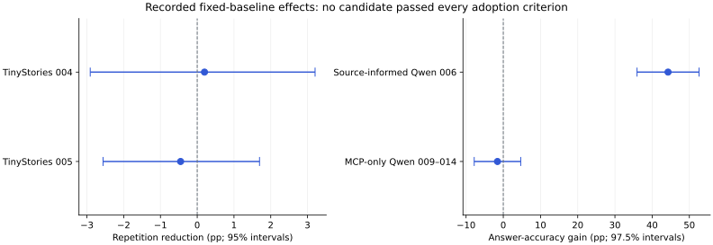

# ForwardEdit: 그래디언트 기반 학습 없이 수행하는 LLM 주도 가중치 개입의 감사

[English — 기본 원고](manuscript.md) · 한국어 · [주장별 근거](evidence-map.md) · [BibTeX](references.bib)

**연구 논문 초안 v0.1 — 2026년 11월 19일.** 저자와 소속은 투고 전에 확정한다. 기존 기록을 분석한 시스템·실증 방법론 논문이며, 새로운 모델 평가 결과를 보고하는 논문이 아니다. 근거 기준 저장소 커밋은 `32f62aef193fb6cac4dc84db6128657ecfe2be4f`이다.

## 초록

LLM이 선택한 가중치 수정의 로그는 신경망 메커니즘에 관한 주장을 어디까지 뒷받침할 수 있는가? 본 논문은 실제 파라미터를 관측하고, 명시적 개입을 기록하며, 그래디언트 기반 학습 없이 그 결과를 평가하는 도구 인터페이스와 근거 관리 절차인 ForwardEdit를 제시한다. 외부 LLM은 가설·좌표·방향·수치를 선택하고, 도구는 지정된 CPU 산식을 실행해 추론 관측을 반환한다. 우리는 정확한 파라미터 적용, 예측한 행동 변화, 기존 정답 보존을 포함한 독립 성능 개선을 구분한다. TinyStories와 Qwen3.5-0.8B의 선택된 다섯 사례군을 후향적으로 분석했다. 원 연구의 정보를 참고한 Qwen 사례에서는 192문항 수학 부분집합의 정답 수가 18개에서 103개로 증가했지만, 기존 정답 18개 중 하나를 잃어 고정된 5% 보존 한도를 초과했다. 오답에서 정답으로 바뀐 86개는 모두 이전에 답을 파싱하지 못했던 문항이므로, 새로운 수학 지식 획득으로 해석하는 데 한계가 있다. TinyStories의 두 사례에서는 독립적인 반복 감소가 입증되지 않았다. 하나의 연속된 MCP 전용 연구에서는 실제 피드백에 근거한 재수정 한 번을 확인했으나 독립 정답 수는 192문항 중 25개에서 22개로 감소했다. 포함된 모든 연구는 하나 이상의 채택 기준을 통과하지 못했다. 이 기록은 감사 가능한 개입 절차를 뒷받침하고 수치적 정확성·행동 제어·메커니즘 설명 사이의 간극을 드러내지만, 일반적인 블랙박스 문제의 해결을 입증하지는 않는다.

**핵심어:** 가중치 공간 프로그래밍, 모델 편집, 기계적 해석 가능성, 추론 전용 개입, 감사 기록, 음성 결과.

## 1. 서론

모델의 내부 가중치는 접근 가능한 수치 객체지만, 숫자를 읽는 것만으로 모델의 계산을 설명할 수는 없다. 편집 LLM이 큰 활성을 발견하고 그럴듯한 의미를 붙인 뒤 가중치를 바꿔 다른 답을 얻어도, 제시한 메커니즘이 옳았다고 결론 내릴 수는 없다. 반대로 정확히 적용한 개입이 과제 점수를 개선하지 못하더라도 원래 설명의 약점을 드러낼 수 있다. 연구 절차는 이러한 차이를 보존해야 한다.

Weight-Space Programming(WSP)은 LLM이 신경망 파라미터를 읽고 직접 쓰는 관점을 제시한다. 원 연구는 표적 수정을 다루며, 추론 루프의 수리와 수학 능력 추가를 구분한다. ForwardEdit는 이 관점을 바탕으로 구현한 도구와 절차다. WSP 자체의 창안이나 원 연구의 전체 실험 프로토콜 재현을 주장하지 않는다. [Takehi 외, 2026](https://rikiyat.github.io/blog/weight-space-programming/).

본 논문의 질문은 LLM이 신경망 전체를 이해하는지보다 좁다. **남겨진 관측, 명시적 가중치 변경, 반대 방향 대조군, 고정된 평가로 특정 설명에 관해 무엇을 검증할 수 있는가?** 이를 재사용 가능한 구현과 실패를 포함한 기존 기록으로 검토한다. 외부 편집자와 수정 대상 모델은 역할이 다르다. 편집자의 설명은 가설이며, 도구 호출의 성공은 실행 사건이다.

기여는 다음과 같다.

1. 파라미터 관측, 부호 있는 forward 관측, 호출자가 작성한 CPU 수정, 후보 이력, 고정 평가를 연결한 구현.
2. 정확한 쓰기, 행동 효과, 메커니즘 근거, 보존 조건을 만족한 과제 개선을 구분하는 주장 구조.
3. 큰 고정 기준선 대비 상승, 국소 재수정, 정확한 쓰기가 있어도 채택이나 넓은 해석 가능성 주장에 부족할 수 있음을 보여 주는 다섯 사례군의 후향적 분석.
4. 보고 수치를 공개 JSON과 연결하고 provenance 및 재실행 한계를 밝히는 근거 부록.

이는 도구와 보고 방법의 기여다. 사례는 선택된 구현 이정표이며 독립 무작위 시행이 아니다. WSP나 특정 편집자 제공자의 일반적인 성공률은 추정하지 않는다.

## 2. 관련 연구

**직접 모델 편집.** ROME은 인과 추적과 국소 파라미터 변경을 결합해 사실 연관을 수정한다. MEMIT는 다수의 연관을 편집하는 방향으로 확장한다. 개입과 보존 평가의 중요한 선행 연구지만, 이 사례 모음에서 두 방법을 기준선으로 구현·비교하지 않았다. ForwardEdit의 실행 계약은 수정값을 정하는 방식을 제한한다. 행렬 변경을 사용한다는 공통점만으로 같은 알고리즘이 되는 것은 아니다. [Meng 외, 2022](https://arxiv.org/abs/2202.05262); [Meng 외, 2023](https://arxiv.org/abs/2210.07229).

**메커니즘 근거.** 활성 패칭 연구는 위치 특정 결과가 평가 지표와 개입 방법에 따라 달라질 수 있음을 보여 준다. ForwardEdit는 이를 검토하는 데 필요한 일부 관측을 남기지만, 각 수정의 완전한 인과 경로나 회로를 제공하지 않는다. 구성 요소의 의미 역할은 반증 가능한 가설로 취급한다. [Zhang·Nanda, 2024](https://arxiv.org/abs/2309.16042).

**과제와 모델.** 사례는 TinyStories 언어 모델링과 Qwen3.5-0.8B 수학 생성을 다룬다. 수학 데이터의 기반은 GSM8K와 MATH이며, Qwen 확인은 MATH-500의 64문항 등을 포함한 선택 부분집합에 한정된다. 전체 벤치마크 점수가 아니다. [Eldan·Li, 2023](https://arxiv.org/abs/2305.07759); [Cobbe 외, 2021](https://arxiv.org/abs/2110.14168); [Hendrycks 외, 2021](https://arxiv.org/abs/2103.03874); [MATH-500 카드](https://huggingface.co/datasets/HuggingFaceH4/MATH-500); [Qwen 모델 카드](https://huggingface.co/Qwen/Qwen3.5-0.8B).

WSP, ROME, MEMIT, 사람이 설계한 수정, 가장 강한 적용 가능한 무수정 설정과의 통제 비교는 수행하지 않았다. 관련 연구는 배경이며 성능 순위의 근거가 아니다.

## 3. 개입과 근거 관리 절차

### 3.1 실행 계약

고정 모델의 파라미터를 θ, 추론 설정을 c라 하자. 단계 t에서 외부 편집자는 실제 파라미터나 forward 실행에서 얻은 관측 oₜ를 읽고 가설 Hₜ와 개입 Δθₜ를 명시한다. 실행기는 원본 체크포인트를 유지하면서 별도 후보에 지정된 연산을 적용한다.

$$
\theta_{t+1}=\operatorname{cast}_{d}(\theta_t+\Delta\theta_t).
$$

이는 그래디언트 갱신이 아니라 명시적인 변경을 요약하는 표기다. d는 저장 dtype이다. 직접 값 교체, 국소 배율 조정, 방향 투영, 명시적인 외적을 지원한다. 방향·외적의 피연산자와 계수는 LLM이 선택해야 하며, 실행기는 최적화 목적식으로부터 이를 추정하지 않는다. 예상 원래 값, 원본 해시, shape, 유한한 수치, 변경 예산을 검사한다. 재수정에는 부모 후보의 식별자와 현재 값 검사도 남긴다. [구현과 계약](../DESIGN.md).

backward, autograd 수집, 수치 그래디언트, 유한 차분, optimizer·LoRA 학습, 자동 loss fitting, 무작위 탐색, 좌표·세기 sweep, 최소제곱·유사역행렬에 의한 fitted update는 금지한다. forward 관측, 행렬 분석, 명시적인 CPU 산식, 제한된 반증 개입은 허용한다. GPU는 추론에만 사용한다. loss를 관측한다고 자동 fitting이 허용되지는 않는다. 실행 감시와 테스트는 해당 소프트웨어 경로를 확인하며 임의 외부 코드의 준수를 증명하지 않는다.

### 3.2 관측에서 검증 가능한 가설로

실제 모듈 소유 관계, 텐서 축, forward 코드를 먼저 읽는다. Linear 가중치는 `[out,in]`, GPT-2 Conv1D는 `[in,out]`이므로 이름만 보고 축을 추측하면 개입 의미가 뒤집힐 수 있다. 실패·참조 문맥의 지정된 토큰 위치에서 입력 부호와 기여를 비교한다.

확인한 국소 선형 계산 y = Wx + b에서 Wᵢⱼ만 명시적으로 바꾸고 입력 x를 고정하면 다음 관계가 성립한다.

$$
\Delta y_i = \Delta W_{ij}\,x_j.
$$

dtype 반올림 후 실제 값도 확인해야 한다. 이 관계는 국소 산술 예측이다. 이후 비선형 연산, attention, 생성 토큰을 통한 후속 계산과 입력 변화까지 포함한 최종 답을 예측하는 것은 아니다.

제안에는 좌표·새 값의 도출, 대안 설명, 예측 행동, 반증 조건, 보존 기준을 기록한다. `defer`는 관측·검토가 더 필요하다는 뜻이고 `ready_for_causal_probe`는 제한된 개입을 준비했다는 뜻이다. 두 상태 모두 인과나 성능의 합격 판정이 아니다. 이 절차는 의미 개입을 위한 지침이며 모든 저수준 쓰기를 막는 보편적 관문은 아니다. 관측된 tensor identity 연결도 완전한 계산 그래프가 아니다. [파라미터 분석 지침](../docs/PARAMETER_ANALYSIS.md).

### 3.3 서로 다른 근거가 필요한 네 가지 주장

| 주장 | 최소한 필요한 근거 | 아직 입증되지 않은 것 |
|---|---|---|
| 정확한 적용 | 원본·부모 해시, 예상·실제 old/new 값, 로딩 dtype, 변경 좌표 검사 | 의미 역할과 유용한 행동 |
| 행동 개입 | 입력과 decoding을 고정한 원본·후보 추론, 필요한 변동성 대조 | 편집자가 제시한 구체적 메커니즘 |
| 국소 메커니즘 | 개입 전에 남긴 예측, 대응 참조 사례, 대안을 구별하는 반대·제거 대조군, 반복 확인 | 모델 전체 설명과 일반 과제 개선 |
| 독립 성능 개선 | 선택 고정, 독립 평가, 불확실성, 모든 보존·채택 기준 | 보편적인 보존과 새로운 지식 획득 |

조작이 출력에 인과적으로 영향을 주어도 언어로 설명한 원인은 틀리거나 불완전할 수 있다. 메커니즘 이해를 주장하려면 일반적인 교란, 출력 형식, 종료 효과, 생성 변동성 등의 대안을 구분하는 대조군이 필요하다. 국소적인 제어도 모델 전체 계산의 해명을 뜻하지 않는다.

### 3.4 선택·보존·provenance

개발·검증 데이터로 분석과 후보 선택을 수행한다. 독립 확인 전에 원본, 후보, 데이터, decoding의 식별자를 고정한다. 같은 test의 결과로 재수정·재선택하지 않는다. 일부 과거 후보는 개발 부적격 상태에서도 진단용 독립 확인을 수행했다. 결과를 보존하되 이를 기본 자원 정책으로 권장하지 않는다.

같은 문항의 원본·수정 정답 여부를 bᵢ, eᵢ라 하면 정답률 변화와 기존 정답의 조건부 손실은 다음과 같다.

$$
\Delta A = \frac{1}{n}\sum_i(e_i-b_i),\qquad
L_{\mathrm{old}} = \frac{\sum_i b_i(1-e_i)}{\sum_i b_i}.
$$

원본 정답이 0개이면 두 번째 값은 정의되지 않으므로 별도의 명시적 보고 규칙이 필요하다. 정의되는 경우에는 전체 문항 중 회귀 비율이 아니라 원래 맞힌 문항 안에서의 손상을 측정한다. 평균 reference NLL과 토큰 정확도는 다른 질문에 답하므로 이를 대신할 수 없다.

해시는 두 층위로 보존한다. 과거 문서에 내장된 해시는 원본을 식별하고, 공개 바이트 해시는 경로 등을 가린 공개 사본을 식별한다. 공개 묶음에는 선택한 텍스트 근거만 있으며 체크포인트, 수정 텐서 바이너리, 활성 배열, 전체 데이터셋은 없다. 체크섬 일치는 보존된 바이트의 정합성을 확인할 뿐 외부 진위, 완전 재실행, 메커니즘 타당성을 보장하지 않는다. [공개 범위](../experiments/README.md).

## 4. 후향적 연구 설계

### 4.1 사례 선택과 연구 질문

다섯 사례군은 직접 수치 편집 001, TinyStories 누적 수정 004, 실패 수리 005, 원 연구 정보를 참고한 Qwen 006, 그리고 009–014 세션으로 이어진 하나의 MCP 전용 Qwen 연구다. 구현 이정표를 기준으로 선택했으며, 이전 실험·호환성 시험·gradient-assisted 아카이브는 분석에 포함하지 않았다. 호스트의 선행 지식, 이전 실패, 세션 간 연속성 때문에 모두를 블라인드 발견으로 취급할 수 없다.

연구 질문은 (RQ1) 지정한 수정과 실제 적용을 구분해 확인할 수 있는가, (RQ2) 부모 피드백과 재수정·메커니즘 가설을 연결하는 근거는 무엇인가, (RQ3) 선택한 행동 변화가 독립 과제·보존 기준을 통과하는가이다. 기존 결과를 보고하며 새로운 벤치마크를 실행하지 않는다. 이 원고를 위해 모델 추론, 가중치 수정, 후보 선택, held-out 평가를 새로 수행하지 않았다.

### 4.2 모델·평가·불확실성

TinyStories 사례는 사전학습된 TinyStories-1M 체크포인트를 FP32로 사용했다. 004·005의 생성은 greedy, 최대 128토큰, EOS 종료, KV cache 설정이다. 지표는 EOS와 이후 토큰을 제외한 생성 내용의 문항별 반복 8-gram 비율을 평균한 값이며 낮을수록 좋다. 보존된 프로토콜은 paired bootstrap 2,000회, seed 17, 95% 구간을 명시한다. reference NLL, 토큰 정확도, 짧은 출력 비율, 길이도 별도로 검사한다. [E2–E3](evidence-map.md).

Qwen 사례는 Qwen3.5-0.8B text weights의 revision `2fc06364715b967f1860aea9cf38778875588b17`과 BF16 추론을 사용한다. 생성 설정은 temperature 0.6, top-p 0.95, top-k 20, presence penalty 1.5, seed 4217, 최대 32,768토큰, 고정된 답 형식 suffix를 포함한다. 독립 집단은 GSM8K 128문항과 MATH-500 64문항이다. 두 프로토콜은 정답률 최소 10%p 상승, 기존 정답 조건부 손실 최대 5%, bootstrap 10,000회·seed 17, 97.5% paired 구간을 명시한다. 실행 환경 이력은 서로 다르며 원 기록에 보존돼 있다. [E4–E5](evidence-map.md).

본 논문은 과거 불확실성 구간을 옮겨 적으며 재추정하거나 새 유의성 주장을 추가하지 않는다. 사례별 신뢰수준이 다르고 선택된 사례 전체에 대한 동시 보장이 아니다. 데이터, 환경, 이력, 편집자 접근이 달라 합산하거나 통제 비교할 수 없다. 기준선은 기록된 고정 설정이며 가장 강한 무수정 설정이라고 입증되지 않았다.

## 5. 결과

### 5.1 정확한 적용과 개선은 구분된다

001의 두 후보는 각각 여섯 값을 바꿨다. 감사 기록은 수동 patch의 정확한 적용, 실제 로딩 값, 선택하지 않은 값의 불변성, CPU·CUDA 검사를 보고한다. 12개 검증 사례의 NLL은 2.925428에서 각각 2.926468, 2.938720으로 증가했다. 두 후보 모두 거절했고 held-out 평가는 수행하지 않았다. RQ1의 정확한 쓰기 확인을 뒷받침하지만, 약한 의미 해석이나 개선 주장을 검증하지 않는다. [E1](evidence-map.md#e1-exact-writes-001).

### 5.2 반복 편집의 독립 효과는 확립되지 않았다

| 연구 | 독립 이야기 수 | 원본 반복률 | 수정 반복률 | 감소량, %p | 보존된 95% 구간, %p | 채택 |
|---|---:|---:|---:|---:|---|---|
| TinyStories 004 | 64 | 7.2791% | 7.0812% | +0.1979 | [−2.9104, +3.2062] | 실패 |
| TinyStories 005 | 128 | 6.0597% | 6.5118% | −0.4521 | [−2.5611, +1.6950] | 실패 |

004는 주요 수정 세 개, 대조군 하나, 누적 재수정 연결 두 개를 기록했다. 최종 후보는 256개 값을 바꿨다. 반복 지표의 구간은 0을 포함하며 reference NLL은 0.006389 증가했다. cutoff 비율이 71.8750%에서 64.0625%로 줄었다고 반복 감소나 이야기 품질 향상이 입증되지는 않는다. [E2](evidence-map.md#e2-repetition-004).

005는 실제 반복 생성 문맥과 norm을 맞춘 반대 방향 대조군을 사용했다. 두 방향 모두 일부 개발 반복을 개선해 단순한 방향 특이적 설명을 약화했다. 독립 평균 반복은 악화했고 reference NLL은 0.002622 증가했다. 128개 참조 이야기 중 91개의 NLL이 악화했다. 평균 NLL 증가는 허용 범위 안이었지만 개선 기준을 통과하지 못했다. 허용 가능한 손상과 성공적인 수리는 다른 판단이다. [E3](evidence-map.md#e3-repetition-005).

### 5.3 큰 수학 정답률 상승도 보존 기준에서 탈락했다

| Qwen 006 독립 부분집합 | 문항 수 | 원본 정답 | 수정 정답 |
|---|---:|---:|---:|
| GSM8K 선택 부분집합 | 128 | 13 | 76 |
| MATH-500 선택 부분집합 | 64 | 5 | 27 |
| 합계 | 192 | 18 | 103 |

전체 정답률 상승은 +44.2708%p이며 보존된 97.5% paired 구간은 [+35.9375, +52.6042]%p다. 오답→정답 86개, 정답→오답 하나였다. 기존 정답 조건부 손실은 1/18 = 5.5556%로 고정 한도 5%를 초과했다. 최종 호스트 승인은 거절됐고 `study_complete`는 false로 남았다. 긍정적인 점수 비교와 채택 실패를 함께 보고한다. [E4](evidence-map.md#e4-source-informed-qwen-006).

수정 대상은 15·19번 레이어의 MLP down projection이었다. 저장된 124,928개 값이 변경됐지만 실제 GPU BF16 표현에서 변경이 남은 값은 123,452개였다. 전체 text parameter 752,393,024개 중 저장 기준 약 0.0166%다. 저장·로딩 변경 수의 차이는 dtype 확인이 실질적인 검증임을 보여 준다.

복구된 86문항은 모두 이전에 답을 파싱하지 못했던 문항이었다. 파싱된 오답에서 복구된 문항은 보존된 채점에 없었다. 파싱 실패는 174개에서 73개로 감소했다. 이와 별도로 행별 `max_new_tokens` 종료는 175개에서 72개로 줄었다. cutoff 출력에도 파싱 가능한 답이 있을 수 있으므로 두 수치는 다르다. 결과는 생성·종료 실패에서 사용 가능한 답을 회복한 해석과 부합하지만 새로운 수학 지식 획득을 입증하지 않는다. 기존 정답 하나를 잃은 고유한 파라미터 수준 원인도 미확정이다.

이 분기는 원 연구 정보를 참고한 호스트 개입이므로 블라인드 재발견이 아니다. 여섯 문항의 작은 대조군에서도 반대 방향 수정이 두 문항을 해결했고 일부 원본 생성은 실행 사이에서 달라져 고유한 방향 메커니즘이 분리되지 않았다. 개발의 성공 logical job 50개는 가중치 수정 50번, 학습 epoch, 또는 측정한 내부 autoregressive forward 수가 아니다. 가장 강한 적용 가능한 무수정 설정이나 원 WSP보다 낫다는 근거는 없다. [E4–E6](evidence-map.md).

### 5.4 확인된 피드백 재수정 한 번은 독립 개선으로 이어지지 않았다

009–014는 하나의 연속된 Qwen 연구다. Codex는 Claude의 후보와 관측을 이어받았고, 시작·예산·권한 실패도 기록에 포함했다. 독립 시행 여섯 번이나 제공자 품질 비교가 아니다.

| 비교 | 원본 | 부모 후보 | 재수정 후보 |
|---|---:|---:|---:|
| 개발 정답 수, n = 64 | 5 | 7 | 10 |
| 잃은 기존 개발 정답 | — | 3/5 | 3/5 |

이벤트 감사는 재수정 요청 전에 부모 결과·생성 읽기가 완료됐음을 확인한다. 편집자는 23번 레이어 down projection의 세 값을 복원하고 나머지 변경을 유지했다. RQ2의 피드백 의존 재수정 한 번을 뒷받침하지만 지속적인 자기개선이나 고유한 메커니즘 설명을 증명하지는 않는다. 최종 저장 변경은 3,069개, GPU BF16 변경은 3,067개였다. reference-text 평균 보존 기준은 통과했지만 기존 정답 손실은 60%였다. 개발 상승 7.8125%p도 필수 10%p에 미달해 `diagnostic_only`로 고정했다. [E5](evidence-map.md#e5-mcp-only-qwen-009014).

독립 정답 수는 25/192에서 22/192로 변했다. 변화는 −1.5625%p, 보존된 97.5% 구간은 [−7.8125, +4.6875]%p다. 오답→정답 13개보다 정답→오답 16개가 많았으며 기존 정답 손실은 16/25 = 64%다. 개발 상승과 피드백 사용만으로 독립 개선을 주장할 수 없다. 성공한 개발 job은 여덟 개, 독립 paired job은 두 개로, 006과 예산을 맞춘 재현도 아니다. [E5](evidence-map.md#e5-mcp-only-qwen-009014).

**그림 1.** 기록된 점추정과 paired 구간. 왼쪽은 반복 감소, 오른쪽은 정답률 상승이며 양수가 개선 방향이다. 두 패널의 신뢰수준과 축 범위는 다르다. 표시된 모든 후보는 하나 이상의 채택 기준에서 탈락했다. 006도 정답률 구간은 양수지만 보존 기준을 통과하지 못했다. 공개 요약 JSON에서 다시 그린 그림이며 새 추론 결과가 아니다.

## 6. 블랙박스 문제에 관해 로그가 뒷받침하는 범위

이 모음은 명시적 개입과 관측 결과를 남겨 어떤 값이 바뀌었는지, 일부 사례에서는 실제 피드백이 재수정보다 앞섰는지를 감사할 수 있다는 운영상 주장을 뒷받침한다. 006은 고정 설정에서 큰 정답 점수 효과도 기록했다. 이는 검증 가능한 모델 디버깅을 위한 유용한 단계다.

그러나 모델 내부의 불투명성 전체가 해결됐다는 근거는 아니다. 적은 수의 가중치 변경도 무관한 여러 행동에 영향을 줄 수 있으므로 수치적 희소성은 의미적 특이성과 다르다. 최종 답의 개선만으로 원인이 된 내부 과정을 고유하게 특정할 수 없다. 005·006의 반대 방향 대조군은 단순한 방향 설명을 약화했다. 원 연구 정보는 독립 발견 주장을 제한하고, MCP 전용 확인의 실패는 자율적 일반화 주장을 제한한다.

더 강한 국소 메커니즘 주장을 위해서는 개입 전 예측, 일반 교란과 종료·형식 효과를 구분하는 대조군, 문맥·생성 변동성에 걸친 반복 확인, 무관한 행동의 보존이 필요하다. 그래도 특정 조건의 제한된 메커니즘을 입증할 뿐 신경망 전체를 해명하지는 않는다. 현재 기록에는 이 분석의 재료가 있지만 중요한 빈틈도 남아 있다.

## 7. 한계와 미대응 비판 / Unaddressed criticisms

**선택된 비독립 근거.** 구현 이정표를 기준으로 선택했다. 호스트는 이전 실패를 알았고, 일부 개입은 원 연구 정보를 사용했으며, 여러 세션이 같은 연구를 이어갔다. 성공 확률·제공자 순위·블라인드 발견률을 추정할 수 없다.

**빠진 기준선.** 가장 강한 무수정 decoding·프롬프트 설정, runtime steering, 사람이 작성한 수정, 경쟁 편집 방법을 동일 프로토콜로 평가하지 않았다. 006의 긍정 결과는 고정 원본과의 비교에 한정되며 비용·과학적 우위도 미확정이다.

**불완전한 메커니즘 특정.** 부호 있는 관측과 국소 산식은 가설을 좁히지만 완전한 회로를 식별하지 않는다. 관측된 대조군에는 대안 설명이 남아 있다. 저수준 쓰기와 편집자의 설명이 의미 이해를 증명하지 않는다.

**보존과 통계 범위.** 원래 맞힌 문항 수가 작으면 한 번의 실패가 조건부 보존에 크게 영향을 준다. 이는 고정 기준의 특성이며 결과를 본 뒤 기준을 완화할 이유가 아니다. 반복률과 reference NLL은 넓은 품질의 대리 지표다. 보고 구간은 사례 선택, 반복적인 편집자 의사결정, 사전학습 오염에 따른 불확실성을 포함하지 않는다.

**재실행과 과거 버전.** 공개 텍스트에는 필수 바이너리와 전체 실행 환경·데이터가 빠져 있다. 일부 연구 이후 구현과 스킬도 바뀌었으므로 과거 기록이 현재의 모든 안전장치를 검증하지 않는다. MCP 경로 제한과 클라이언트 도구 비활성화도 OS sandbox를 입증하지 않는다. 완전한 독립 재실행과 폭넓은 과제 보존은 미완료다.

**진단 평가 비용.** 005와 009–014는 개발 부적격 후보에 독립 진단 확인을 수행했다. 음성 근거로 보존하지만 권장 정책은 아니다. 토큰·시간·지출 기록만으로 학습이나 더 단순한 대조군 대비 비용 우위를 주장할 수 없다.

## 8. 후속 검증 제안: 수행하지 않음

후속 연구는 새 test에 접근하기 전에 가설, 허용 관측, 후보·forward·토큰 예산, 채택 기준을 등록해야 한다. 가장 강하게 측정된 무수정 설정과 적절한 비LLM 수정 절차를 비교하고, 원 연구 정보를 아는 편집자와 모르는 편집자를 구분해야 한다. 미리 정한 소수의 반대 방향·제거 개입으로 예측을 검증하되 파라미터·세기 탐색이나 fitted update를 사용하지 않는다.

새 독립 집단을 열기 전에 개발 선택을 끝낸다. 종료·파싱 지표와 정답률을 분리하고, 기존 정답 조건부 손실과 무관한 과제 보존을 측정한다. 부적격 후보를 반복적으로 큰 확인에 보내기보다 제한된 개발 예산에서 진단한다. 명시한 생성 변동성 아래 핵심 관측을 반복하고 모든 시도 세션을 보고한다. 이는 더 강한 근거를 얻기 위한 요구이며 본 논문의 수행 결과가 아니다.

## 9. 결론

ForwardEdit는 명시적 산식, 후보 이력, 고정 평가로 LLM이 선택한 파라미터 개입을 검토할 수 있게 한다. 후향적 사례는 정확한 쓰기, 피드백에 따른 재수정, 큰 고정 기준선 효과가 보존 실패·부정적인 독립 결과와 공존할 수 있음을 보여 준다. 뒷받침되는 기여는 감사 가능한 절차와 현재 한계에 관한 근거다. 일반적인 블랙박스 해결, 새로운 수학 지식, 기존 WSP·편집 방법 대비 우위는 입증되지 않았다.

## 자료 공개와 원고 작성

코드와 선택한 과거 기록은 [AnamKwon/ForwardEdit](https://github.com/AnamKwon/ForwardEdit)에 공개돼 있다. [근거표](evidence-map.md), [추출 수치](evidence.json), [추출·그림 스크립트](build_evidence.py), [참고문헌](references.bib)이 원고에 포함된다. 공개 추출 파일 435개는 원본·공개 바이트 해시를 별도로 보존한다. 모델, 수정 가중치, 배열, 전체 데이터셋은 이 논문으로 재배포하지 않는다. 공개 test 예시는 새 held-out 데이터로 재사용할 수 없다. 설명 영상은 개념 일러스트와 모의 호출이며 실험 근거가 아니다.

문헌 확인, 초안 작성, 공개 기록의 기술통계 추출에 코딩 어시스턴트의 도움을 받았다. 투고 전 실제 저자가 과학적 주장, 출처, 데이터 조건, 저자 자격을 확인해야 한다. 초안 작성 중 새로운 학습·모델 실행·test 선택은 수행하지 않았다.

## 참고문헌

- Takehi, R., Teoh, J., Zhang, A., Khattab, O. (2026). [Sparks of Weight-Space Programming: LLMs can natively read & write neural network weights](https://rikiyat.github.io/blog/weight-space-programming/). 연구 블로그, 11월 2일. 2026년 11월 19일 확인.
- Meng, K., Bau, D., Andonian, A., Belinkov, Y. (2022). [Locating and Editing Factual Associations in GPT](https://arxiv.org/abs/2202.05262). NeurIPS.
- Meng, K., Sharma, A. S., Andonian, A., Belinkov, Y., Bau, D. (2023). [Mass-Editing Memory in a Transformer](https://arxiv.org/abs/2210.07229). ICLR.
- Zhang, F., Nanda, N. (2024). [Towards Best Practices of Activation Patching in Language Models: Metrics and Methods](https://arxiv.org/abs/2309.16042). ICLR.
- Eldan, R., Li, Y. (2023). [TinyStories: How Small Can Language Models Be and Still Speak Coherent English?](https://arxiv.org/abs/2305.07759). arXiv:2305.07759.
- Cobbe, K., 외 (2021). [Training Verifiers to Solve Math Word Problems](https://arxiv.org/abs/2110.14168). arXiv:2110.14168.
- Hendrycks, D., 외 (2021). [Measuring Mathematical Problem Solving With the MATH Dataset](https://arxiv.org/abs/2103.03874). arXiv:2103.03874.
- Hugging Face H4. [MATH-500 데이터 카드](https://huggingface.co/datasets/HuggingFaceH4/MATH-500). 2026년 11월 19일 확인.
- Qwen Team. [Qwen3.5-0.8B 모델 카드](https://huggingface.co/Qwen/Qwen3.5-0.8B). 2026년 11월 19일 확인. 모델 카드는 배경 자료이며 실제 과거 실행 조건은 보존된 프로토콜이 명시한다.
