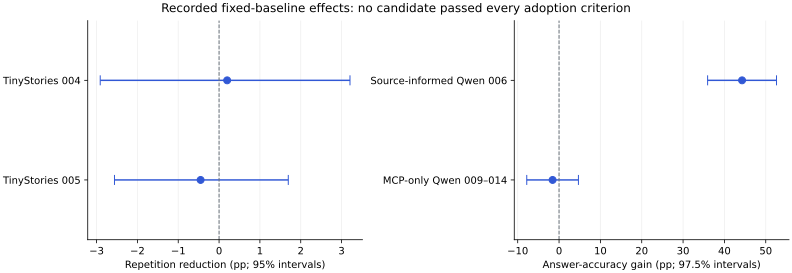

# ForwardEdit: Auditing LLM-Directed Weight Interventions Without Gradient-Based Training

English · [한국어](manuscript.ko.md) · [Evidence map](evidence-map.md) · [BibTeX](references.bib)

**Research draft v0.1 — 19 November 2026.** Author list and affiliations are to be supplied before submission. This is a retrospective systems and empirical-methodology paper, not a new model evaluation. The evidence snapshot is repository commit `32f62aef193fb6cac4dc84db6128657ecfe2be4f`.

## Abstract

Can logs of LLM-directed weight edits support claims about neural-network mechanisms? We present ForwardEdit, a tool interface and evidence workflow for inspecting actual parameters, recording explicit interventions, and evaluating their consequences without gradient-based training. An external LLM chooses hypotheses, coordinates, directions and numeric values; tools execute the specified CPU arithmetic and return inference observations. We distinguish exact parameter application, predicted behavioral effects, and independent task improvement with preservation. A retrospective analysis covers five selected case groups on TinyStories and Qwen3.5-0.8B. In one source-informed Qwen study, recorded accuracy on a 192-item mathematics subset rose from 18 to 103 correct, but losing one of the 18 originally correct answers exceeded the frozen 5% preservation limit. All 86 wrong-to-right transitions began with unparsed answers, restricting an interpretation as acquisition of mathematical knowledge. Two TinyStories studies did not establish an independent reduction in repetition. A continued MCP-only study documented one feedback-dependent revision, but independent accuracy changed from 25 to 22 of 192. No bundled study passed every declared adoption criterion. These records support an auditable intervention workflow and expose gaps between numerical correctness, behavioral control and mechanistic explanation; they do not resolve the general black-box problem.

**Keywords:** weight-space programming; model editing; mechanistic interpretability; inference-only interventions; audit trails; negative results.

## 1. Introduction

A model's internal weights are accessible numerical objects, yet access alone does not explain what the model computes. An editing LLM can identify a large activation, attach a plausible interpretation, alter a weight, and obtain a different answer without establishing that its proposed mechanism was correct. Conversely, a precisely applied intervention can fail to improve a task while still revealing a weakness in the original explanation. A useful research workflow must preserve these distinctions.

Weight-Space Programming (WSP) frames an LLM as a reader and direct writer of neural-network parameters. The original report includes targeted repair and explicitly distinguishes repairing reasoning loops from adding mathematical capability. ForwardEdit builds on this framing; it does not claim to originate WSP or reproduce its complete experimental protocol. [Takehi et al., 2026](https://rikiyat.github.io/blog/weight-space-programming/).

Our question is narrower than whether an LLM understands an entire network: **what can retained observations, explicit weight changes, opposing controls and frozen evaluations establish about a proposed explanation?** We investigate this question through a reusable implementation and selected historical records, including failures. The external editor and the edited model have separate roles. An editor's fluent explanation is a hypothesis, and a successful tool call is an execution event.

This paper contributes:

1. A documented implementation connecting parameter inspection, signed forward observations, caller-authored CPU edits, candidate lineage and frozen evaluation.
2. A claim structure separating exact writes, behavioral consequences, mechanism evidence and task improvement under preservation constraints.
3. A retrospective analysis of five case groups showing why large fixed-baseline gains, local revisions and correct writes can remain insufficient for adoption or broad interpretability claims.
4. An evidence supplement linking reported quantities to public JSON records, with explicit provenance and replay limitations.

These are tooling and reporting contributions. The cases are selected engineering milestones, not independent random trials, and the analysis does not estimate an overall success rate for WSP or for any editor provider.

## 2. Related work

**Direct model editing.** ROME combines causal tracing with localized parameter updates for factual associations. MEMIT extends direct memory editing to many associations. These works establish relevant precedents for intervention and preservation evaluation, but their editing procedures are not implemented or evaluated as baselines here. Our execution contract restricts how edit values may be chosen; a shared use of matrix updates does not make ForwardEdit equivalent to either method. [Meng et al., 2022](https://arxiv.org/abs/2202.05262); [Meng et al., 2023](https://arxiv.org/abs/2210.07229).

**Mechanistic evidence.** Activation patching studies show that localization conclusions can depend materially on metrics and intervention methodology. ForwardEdit records some of the ingredients needed to examine such dependencies, but these case studies do not supply exhaustive causal traces or an identified circuit for every edit. We therefore treat a component's semantic role as a falsifiable hypothesis. [Zhang and Nanda, 2024](https://arxiv.org/abs/2309.16042).

**Tasks and models.** The case collection uses TinyStories language modeling and Qwen3.5-0.8B mathematics generation. GSM8K and MATH are the underlying mathematics dataset families; the Qwen confirmations use selected subsets, including 64 items from MATH-500, rather than full-benchmark evaluations. [Eldan and Li, 2023](https://arxiv.org/abs/2305.07759); [Cobbe et al., 2021](https://arxiv.org/abs/2110.14168); [Hendrycks et al., 2021](https://arxiv.org/abs/2103.03874); [MATH-500 dataset card](https://huggingface.co/datasets/HuggingFaceH4/MATH-500); [Qwen model card](https://huggingface.co/Qwen/Qwen3.5-0.8B).

No controlled comparison with WSP, ROME, MEMIT, a human-designed edit, or the strongest applicable unedited configuration was conducted in this collection. Their discussion provides context, not a performance ranking.

## 3. Intervention and evidence workflow

### 3.1 Execution contract

Let a frozen model have parameters θ and inference configuration c. At step t, the external editor receives observations oₜ from actual parameters or forward execution, proposes a hypothesis Hₜ, and specifies an intervention Δθₜ. The executor applies the stated operation to a separate candidate, leaving the source checkpoint unchanged:

$$
\theta_{t+1}=\operatorname{cast}_{d}(\theta_t+\Delta\theta_t).
$$

The notation summarizes an explicit edit, not a gradient update; d is the storage dtype. Replacement, local scaling, directional projection and an explicitly specified outer product are supported. Directional and outer-product operands and coefficients must be chosen by the LLM. The executor does not infer them from an optimization objective. Expected old values, source hashes, shapes, finite values and change budgets are checked. Revisions retain parent identity and current-value checks. [Implementation and contract](../DESIGN.md).

Backward execution, autograd collection, numerical gradients, finite differences, optimizer/LoRA training, automatic loss fitting, random search, coordinate/strength sweeps and least-squares/pseudoinverse fitted updates are prohibited. Forward observations, matrix analysis, explicit CPU arithmetic and bounded falsification interventions are allowed. GPU use is inference only. Loss can be measured as an observation; it is not permission to fit an update automatically. Runtime tripwires and tests cover specific execution paths, rather than proving compliance of arbitrary external code.

### 3.2 From an observation to a testable hypothesis

The workflow first inspects actual module ownership, tensor axes and forward code. A Linear layer uses `[out,in]`, whereas GPT-2 Conv1D uses `[in,out]`; guessing from tensor names can reverse the meaning of an edit. The editor then compares failed and reference contexts at stated token positions, retaining signed inputs and contributions.

For a verified local linear computation y = Wx + b, an explicitly chosen change to coordinate Wᵢⱼ gives

$$
\Delta y_i = \Delta W_{ij}\,x_j
$$

when the local input x is held fixed, with realized values checked after dtype rounding. This is a local arithmetic prediction. It does not by itself predict a final answer after downstream nonlinearities, attention, recurrence through generated tokens, or changes in later inputs.

A proposal records the coordinate and value derivation, alternative explanations, predicted behavior, falsification conditions and preservation criteria. `defer` requests further observation or review; `ready_for_causal_probe` means that a bounded intervention is prepared. Neither certifies causality or performance. The proposal procedure is guidance for semantic interventions, not a universal gate on every low-level write. Observed tensor-identity links likewise do not constitute a complete computation graph. [Parameter-analysis guidance](../docs/PARAMETER_ANALYSIS.md).

### 3.3 Four claims that require different evidence

| Claim | Minimum supporting evidence | What remains unestablished |
|---|---|---|
| Exact application | Source/parent hashes, expected and actual old/new values, loaded dtype and changed-coordinate checks | A semantic role or useful behavior |
| Behavioral intervention | Matched source/candidate inference with fixed inputs and recorded decoding, including variability controls where needed | The editor's specific mechanism explanation |
| Local mechanism | A prediction stated before intervention, matched reference cases, discriminating opposing/ablation controls and replication | A complete model explanation or general task gain |
| Independent improvement | Frozen selection, independent evaluation, uncertainty and all declared preservation/adoption gates | Universal preservation or newly acquired knowledge |

A manipulation can causally affect outputs while its verbal explanation remains wrong or incomplete. Mechanistic understanding requires controls that distinguish that explanation from alternatives, such as generic disruption, output formatting, termination effects or generation variability. Local control also does not imply full access to the network's computations.

### 3.4 Selection, preservation and provenance

Development/validation data support analysis and candidate selection. Source, candidate, data and decoding identities are frozen before independent confirmation. Test results must not trigger revision or reselection on that same test. Some historical candidates were confirmed diagnostically despite development ineligibility; we report those evaluations but do not recommend this as the default resource policy.

For paired correctness indicators bᵢ and eᵢ, answer-accuracy gain and conditional loss of originally correct answers are

$$
\Delta A = \frac{1}{n}\sum_i(e_i-b_i),\qquad
L_{\mathrm{old}} = \frac{\sum_i b_i(1-e_i)}{\sum_i b_i}.
$$

If no source answer is correct, the second quantity is undefined and requires an explicit reporting rule. Where defined, it measures damage among formerly correct answers, not the fraction of all items that regress. Aggregate reference NLL and token accuracy answer different questions and cannot replace this conditional criterion.

Provenance has two layers. Historical embedded hashes identify original artifacts; published-byte hashes identify possibly redacted excerpts. They are retained separately. The public bundle contains selected text evidence, not checkpoints, replacement tensor binaries, activation arrays or full datasets. Checksum agreement establishes consistency of retained bytes, not external authenticity, complete replay or mechanistic validity. [Publication scope](../experiments/README.md).

## 4. Retrospective study design

### 4.1 Case selection and research questions

We examine five selected case groups: direct numeric edits 001, cumulative TinyStories editing 004, TinyStories failure repair 005, source-informed Qwen editing 006, and one continued MCP-only Qwen study spanning sessions 009–014. They were selected as implementation milestones. Earlier experiments, compatibility trials and gradient-assisted archives are outside this analysis. Prior host knowledge, related development failures and continuation across sessions prevent an interpretation as uniformly blind discovery.

The questions are: (RQ1) can the records distinguish specified and actually applied edits; (RQ2) what evidence connects a revision to observed parent feedback and a proposed mechanism; and (RQ3) do selected behavioral changes survive independent task and preservation criteria? We report historical outcomes rather than run a new benchmark. No new model inference, weight edits, candidate selection or held-out evaluation was performed for this manuscript.

### 4.2 Models, evaluation and uncertainty

The TinyStories studies use a pretrained TinyStories-1M checkpoint in FP32. In studies 004 and 005, generation is greedy with a 128-token limit, EOS stopping and KV cache. The target metric is mean per-prompt repeated generated 8-gram fraction, excluding EOS and subsequent tokens; a smaller value is better. Their retained protocols specify 2,000 paired bootstrap draws, seed 17, and 95% intervals. Reference NLL, token accuracy, short-output rate and length are additional checks. [E2–E3](evidence-map.md).

The Qwen studies use Qwen3.5-0.8B text weights, model revision `2fc06364715b967f1860aea9cf38778875588b17`, and BF16 inference. Their recorded generation policy includes temperature 0.6, top-p 0.95, top-k 20, presence penalty 1.5, seed 4217, a 32,768-token limit and a fixed answer-format suffix. Independent populations contain 128 GSM8K and 64 MATH-500 items. Both protocols specify a 10-percentage-point minimum accuracy gain, a 5% maximum conditional old-correct loss, 10,000 bootstrap draws with seed 17, and 97.5% paired intervals. Runtime histories differ and are retained in their records. [E4–E5](evidence-map.md).

We copy historical uncertainty intervals; we do not recompute them or introduce new significance claims. Intervals use different confidence levels and are not simultaneous guarantees across the selected collection. Differences in data, runtimes, histories and editor access prevent pooling or a controlled comparison between case groups. The source baselines are the recorded fixed configurations, not verified strongest unedited baselines.

## 5. Results

### 5.1 Exact application can be verified without improvement

Study 001 retained two candidates that each changed six values. Its audit reports exact manual patch application, exact loaded values, unchanged unselected parameters and CPU/CUDA checks. Validation NLL over 12 examples changed from 2.925428 to 2.926468 and 2.938720. Both candidates were rejected, and no held-out test was evaluated. The write verification supports RQ1; it does not validate the editor's weakly supported semantic interpretation or an improvement claim. [E1](evidence-map.md#e1-exact-writes-001).

### 5.2 Repetition edits did not establish independent benefit

| Study | Independent stories | Original repetition | Edited repetition | Reduction, pp | Retained 95% interval, pp | Adoption |
|---|---:|---:|---:|---:|---|---|
| TinyStories 004 | 64 | 7.2791% | 7.0812% | +0.1979 | [−2.9104, +3.2062] | Failed |
| TinyStories 005 | 128 | 6.0597% | 6.5118% | −0.4521 | [−2.5611, +1.6950] | Failed |

Study 004 recorded three primary edits, one control and two cumulative revision edges. The final candidate changed 256 values. Its repetition interval includes zero, while reference NLL increased by 0.006389. A lower cutoff rate, 71.8750% to 64.0625%, therefore does not establish less repetition or better narrative quality. [E2](evidence-map.md#e2-repetition-004).

Study 005 used actual generated repetition contexts and an opposing, norm-matched control. Both intervention directions sometimes improved development repetition, weakening a simple direction-specific mechanism. Independent mean repetition worsened; reference NLL increased by 0.002622, and 91 of 128 reference stories had worse NLL. The aggregate NLL increase remained within a tolerance, but the improvement gate failed. This case illustrates why tolerable damage and successful repair must remain distinct. [E3](evidence-map.md#e3-repetition-005).

### 5.3 A large source-informed accuracy gain failed preservation

| Independent Qwen subset, study 006 | Items | Original correct | Edited correct |
|---|---:|---:|---:|
| GSM8K selected subset | 128 | 13 | 76 |
| MATH-500 selected subset | 64 | 5 | 27 |
| Combined selected subset | 192 | 18 | 103 |

The combined gain is +44.2708 percentage points, with a retained 97.5% paired interval of [+35.9375, +52.6042]. There were 86 wrong-to-right changes and one right-to-wrong change. Conditional old-correct loss was 1/18 = 5.5556%, above the frozen 5% limit. Final host approval was rejected and the recorded `study_complete` flag remained false. We retain the positive accuracy comparison together with the failed adoption decision. [E4](evidence-map.md#e4-source-informed-qwen-006).

The edit targeted MLP down projections in layers 15 and 19. It changed 124,928 stored values, of which 123,452 remained changed in the actual GPU BF16 representation. The reported changed fraction is approximately 0.0166% of 752,393,024 text parameters. This difference between stored and loaded changes makes dtype verification substantive rather than administrative.

All 86 rescued answers were previously unparsed; none was a parsed incorrect answer in the retained grading. Unparsed answers decreased from 174 to 73. Separately, row-level `max_new_tokens` terminations decreased from 175 to 72. A cutoff can still contain a parseable answer, so these counts are not interchangeable. The results are consistent with recovering usable outputs from generation/termination failures, but do not establish new mathematical knowledge. A unique parameter-level explanation of the one lost answer remains unresolved.

This was a source-informed host branch, not blind rediscovery. Small six-item controls also did not isolate a unique directional mechanism: an opposing edit solved two items, and some original generations differed across control runs. Its 50 successful development logical jobs are not 50 weight updates, training epochs or measured internal autoregressive forward calls. There is no demonstrated advantage over the strongest applicable unedited configuration or over the original WSP procedure. [E4–E6](evidence-map.md).

### 5.4 One verified feedback revision did not generalize

Sessions 009–014 form one continued Qwen study. Codex inherited a Claude-authored candidate and observations; failed startup, budget and permission attempts are retained. They are not six independent trials or a provider comparison.

| Comparison | Original | Parent candidate | Revised candidate |
|---|---:|---:|---:|
| Correct development answers, n = 64 | 5 | 7 | 10 |
| Originally correct development answers lost | — | 3/5 | 3/5 |

The retained event audit establishes that parent result/generation reads completed before the revision request. The editor restored three values in the layer-23 down projection while retaining other parent changes. This supports one feedback-dependent revision for RQ2, not a sustained self-improvement process or a unique mechanistic explanation. The final candidate had 3,069 stored changes and 3,067 GPU BF16 changes. Reference-text aggregate gates passed, but conditional old-correct loss remained 60%; the 7.8125-point development gain also fell below the required 10 points. The candidate was frozen as `diagnostic_only`. [E5](evidence-map.md#e5-mcp-only-qwen-009014).

Independent accuracy changed from 25/192 to 22/192: −1.5625 points, with a retained 97.5% interval [−7.8125, +4.6875]. Thirteen wrong-to-right transitions were outweighed by 16 right-to-wrong transitions. Conditional old-correct loss was 16/25 = 64%. Development improvement and feedback use therefore did not establish independent improvement. Eight successful development jobs and two independent paired jobs were recorded; this was not a budget-matched replication of study 006. [E5](evidence-map.md#e5-mcp-only-qwen-009014).

**Figure 1.** Retained point estimates and paired intervals. Positive values mean repetition reduction on the left and answer-accuracy gain on the right. Confidence levels and axis scales differ. Every displayed candidate failed at least one adoption criterion; study 006 failed preservation despite its positive accuracy interval. This figure is regenerated from public summary JSON, not from new inference.

## 6. What the logs establish about the black-box question

The collection supports an operational claim: explicit interventions and resulting observations can be recorded closely enough to audit which values changed and, in some cases, whether actual feedback preceded a revision. Study 006 additionally records a large fixed-configuration answer-score effect. Those are useful steps toward testable model debugging.

They do not support a general solution to opacity. In particular, numerical sparsity is not semantic specificity; a change affecting few weights can still alter many unrelated behaviors. A final-answer improvement does not uniquely identify the internal process responsible. Opposing controls in studies 005 and 006 weaken simple directional accounts. Source-informed guidance limits claims of discovery, and the failed MCP-only confirmation limits claims of autonomous generalization.

A stronger local mechanism claim would require a prediction recorded before intervention, controls that discriminate the proposed pathway from generic perturbation and termination/format effects, replication across contexts and generation variability, and preservation on unrelated behavior. Even such evidence would establish a bounded mechanism for specified conditions rather than complete understanding of a network. The current records provide ingredients for that analysis, with material gaps remaining.

## 7. Limitations and unaddressed criticisms / 미대응 비판

**Selected, dependent evidence.** Cases were chosen for implementation milestones. Hosts knew earlier failures, some interventions used source guidance, and several sessions continued the same study. No success probability, provider ranking or blind-discovery rate can be estimated from this collection.

**Missing baselines.** The strongest applicable unedited decoding/prompt settings, runtime steering, human-authored recipes and competing editing methods were not evaluated under a matched protocol. The positive study-006 comparison is restricted to its frozen baseline. Cost or scientific superiority is unestablished.

**Incomplete mechanism identification.** Signed observations and local arithmetic narrow hypotheses but do not identify complete circuits. The observed control behavior leaves alternative explanations. Low-level writes and an editor's explanation do not prove semantic understanding.

**Preservation and statistical scope.** Small old-correct denominators make conditional preservation sensitive to a single failure. This is a property of the frozen criterion; it is not grounds to relax it after exposure. Repetition and reference NLL are proxies rather than broad quality measures. Reported intervals do not include uncertainty from case selection, repeated editor decisions or model pretraining contamination.

**Replay and historical versions.** Public text excerpts omit essential binary assets and complete runtime/data material. The current implementation and skills also evolved after some studies; the retrospective records do not validate every current safeguard. Tool restrictions and disabled client tools do not establish an OS sandbox. Full independent replay and broad task preservation remain incomplete.

**Diagnostic evaluation costs.** Studies 005 and 009–014 ran independent diagnostic confirmations despite ineligible development candidates. These observations are retained as negative evidence, not as a recommended evaluation policy. Present token, timing and spend records do not establish a cost advantage over training or simpler controls.

## 8. Future validation: proposed, not performed

A follow-up should register its hypotheses, allowable observations, candidate/forward/token budgets and acceptance gates before any new test access. It should include a matched comparison against the strongest measured unedited settings and an appropriate non-LLM recipe, with source-informed and source-blind editors distinguished explicitly. A small fixed set of opposing or ablation interventions should test stated predictions, without parameter/strength search or fitted updates.

Development selection must finish before a fresh independent population is opened. Separate termination and parsing measures from answer correctness; quantify conditional old-correct loss and unrelated-task preservation. Diagnose already ineligible candidates on a bounded development budget rather than routinely sending them to a large confirmation. Replicate key observations under declared generation variability and report every attempted session. These are requirements for stronger evidence, not results of this paper.

## 9. Conclusion

ForwardEdit makes LLM-directed parameter interventions inspectable through explicit arithmetic, lineage and frozen evaluation. The retrospective cases show that exact writes, feedback-dependent revision and large fixed-baseline effects can coexist with failed preservation and negative independent outcomes. The supported contribution is an auditable workflow and evidence of its current limits. A general black-box solution, new mathematical knowledge and superiority over existing WSP or model-editing approaches remain unestablished.

## Artifact availability and manuscript preparation

Code and selected historical records are in [AnamKwon/ForwardEdit](https://github.com/AnamKwon/ForwardEdit). This draft's [evidence map](evidence-map.md), [extracted numbers](evidence.json), [extraction/figure script](build_evidence.py) and [references](references.bib) accompany the text. The 435 extracted public artifacts have separate original-source and published-byte hashes. Models, replacement weights, arrays and full datasets are not redistributed by this paper. Exposed test examples must not be reused as fresh held-out data. The explanatory video is conceptual artwork and mock calls; it is not experimental evidence.

The draft was prepared with coding-assistant support for literature lookup, text drafting and descriptive extraction of public records. Named authors must verify the scientific statements, attribution, data terms and authorship before submission. No new training, model execution or test selection was performed during drafting.

## References

- Takehi, R., Teoh, J., Zhang, A., and Khattab, O. (2026). [Sparks of Weight-Space Programming: LLMs can natively read & write neural network weights](https://rikiyat.github.io/blog/weight-space-programming/). Research blog, 2 November; accessed 19 November 2026.
- Meng, K., Bau, D., Andonian, A., and Belinkov, Y. (2022). [Locating and Editing Factual Associations in GPT](https://arxiv.org/abs/2202.05262). NeurIPS.
- Meng, K., Sharma, A. S., Andonian, A., Belinkov, Y., and Bau, D. (2023). [Mass-Editing Memory in a Transformer](https://arxiv.org/abs/2210.07229). ICLR.
- Zhang, F., and Nanda, N. (2024). [Towards Best Practices of Activation Patching in Language Models: Metrics and Methods](https://arxiv.org/abs/2309.16042). ICLR.
- Eldan, R., and Li, Y. (2023). [TinyStories: How Small Can Language Models Be and Still Speak Coherent English?](https://arxiv.org/abs/2305.07759). arXiv:2305.07759.
- Cobbe, K., et al. (2021). [Training Verifiers to Solve Math Word Problems](https://arxiv.org/abs/2110.14168). arXiv:2110.14168.
- Hendrycks, D., et al. (2021). [Measuring Mathematical Problem Solving With the MATH Dataset](https://arxiv.org/abs/2103.03874). arXiv:2103.03874.
- Hugging Face H4. [MATH-500 dataset card](https://huggingface.co/datasets/HuggingFaceH4/MATH-500). Accessed 19 November 2026.
- Qwen Team. [Qwen3.5-0.8B model card](https://huggingface.co/Qwen/Qwen3.5-0.8B). Accessed 19 November 2026. The model card is contextual documentation; historical execution is specified by the retained protocol.
